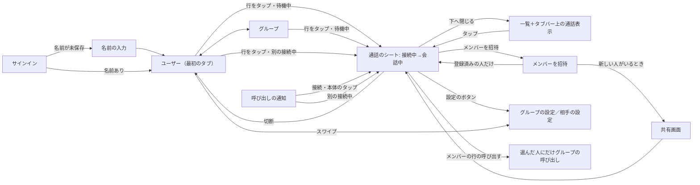

# RideCom 操作の流れ

## 指示と背景

2026-11-02の利用者指摘により、画面単位ではなく利用者のストーリー単位で操作を設計し直す。指摘の要点は次のとおり。

| 指摘 | 現行（2026-11-02時点）の動き |
|---|---|
| 人やグループを選んでも接続しない | Standard・Advancedとも、一覧の選択は`selectUser`／`selectGroup`を`connectIfIdle: false`で呼び、Callへ移るだけ。接続にはCallの「Connect」をもう一度押す |
| 以前の詳細画面は、グループを選ぶとすぐに接続した | Advancedの旧導線は選択と同時に接続し、そこから招待できた |
| グループ通話の画面で人を追加できない | 設計案でCallから追加を外し、Groupsの`ⓘ`からグループの詳細を開く形にしていた |
| グループの設定・人の登録が分かりにくい | `ⓘ`は小さく、行のタップ（通話）と意味が違うのに隣り合っている |
| 通話がメインのタブで、選んでいない・切断した後は「再接続のためだけ」の画面が残る | 通話タブが最初の画面で、未選択の空状態と切断後の未接続の画面を経由する |
| 全員の名前が同じ | 表示名を設定するまで既定の「You」が全員に表示される。サインイン後に名前を求める画面がない |
| 通知から開いても、もう一度接続を押す必要がある | 通知のactionは「iPhoneで応答」だけで、開いた後の接続までの流れが一体になっていない |
| 1対1は通知を着信の代わりにし、グループの開始は通知しない。直接つながった人からのグループ招待は通知し、一部の人だけの会話に他のメンバーを巻き込まない（同日の追加指示） | 通知は固定文で誰からか分からず、通話中も同じように鳴る。グループへの通知はない |
| 1対1もグループも、IDで決まる場所に集まるだけ。通知は親切で添えるもので、接続も通知のボタンでできる。拒否は要らず、放っておいても困らない。相手は相手のいない場所に接続しているだけで、近距離だけのときは通知も届かない（2026-11-10・11の利用者指示） | 1対1の選択で「呼び出し中」「応答がありませんでした」「もう一度呼び出す」などの電話型の表示を出していた（2026-11-10の実装） |
| 2026-11-04のバックログ（[優先順位と引継ぎ](../backlog/README.md)）: 下部の通話表示が小さいと分かりづらい・ミュートと切断を置きたい／Standardのグループタブは既定で非表示／招待の返信と再送の区別・仮名／招待・削除の同期／個人登録した相手だけを呼び出せる | 縮小した通話表示は名前と状態だけ。グループタブは常に表示。招待中の行は未受諾・送信待ちを並べるだけで、返信と再送の区別・仮名がない。削除は端末内だけ |

本書は、一般向け（Standard）のユーザーストーリー（[UXの定義](一般向け/画面構成とレイアウト.md#uxの定義)の場面ごとの流れ）の正本である。動作は共通操作（`openDestination`・`switchCall(to:)`・`startCall`・`endCall`など）で実装し、詳細表示（Advanced）は同じ共通操作を[実装との対応表](詳細画面/診断と詳細画面の構成.md#実装との対応表)の名前と値で表す（Advancedの画面にこの語・部品を流用しない）。見た目と部品は[デザインシステム](デザインシステム.md)、画面ごとの構成は[一般向け](一般向け/画面構成とレイアウト.md)と[詳細表示](詳細画面/診断と詳細画面の構成.md)、流れの見本は[操作の流れ見本](操作の流れ見本.html)を参照する。要求は[製品要求](../requirements/製品要求.md#利用者に提供すること)の「選んですぐ接続し、通知から応答できる」「呼び出しは親切な知らせとして1回送り、会話の始め方は利用者に任せる」「閲覧と通話先変更を区別する」を正本とする。

## つながり方の前提

RideComはインカム・無線・Web会議と同じく、決まった場所に集まって話す道具である（2026-11-10・11の利用者指示、[製品要求](../requirements/製品要求.md#利用者に提供すること)の「呼び出しは親切な知らせとして1回送り、会話の始め方は利用者に任せる」）。電話のように相手を鳴らして呼び出し、応答を待つものではない。すべてのユーザーストーリーはこの前提に従う。

| 前提 | 内容 |
|---|---|
| 接続先は場所 | グループはそのグループの場所、1対1は2人だけの場所（互いのIDで決まる内部の1対1のグループ）。どちらも「選ぶ＝その場所に入る」で、相手を呼び出す操作ではない |
| 先に入った人は待つだけ | 先に入った人は、相手のいない場所に接続しているだけ。通話のシートは「接続中」と補足「相手の参加を待っています」のままで、エラー・警告の文・待ち時間・期限を出さない。待てる長さの上限は自動切断の設定（通常3時間、Apple Watchから始めた接続は5分）だけ |
| 相手が入れば会話 | 相手が同じ場所を選べば（一覧の行・通知の「接続」・Widget・Apple Watch・Siriのどこからでも）会話が始まる。どちらが先に入ってもよく、同時でもよい |
| 通知は添えるだけ | 1対1の場所に入るとき、相手へ1回だけ通知を送る。グループに入るときは誰にも送らない。届いたか・見たか・入るかを追わず、送れなかったとき（圏外・相手の許可なし・相手の通知がオフ）も表示を変えない |
| 放っておいてよい | 通知を受け取った人は「接続」するか、「無視」するか、何もしない。「無視」は通知を閉じるだけで、断ったことを相手へ送る拒否ではない。鳴り続けないので放っておいても困らず、送った人へも何も返らない |
| 近距離だけのとき | インターネットがない場所では通知は届かない。近くの仲間はその場で声を掛け合い、互いを選んで入る。相手がまだ選んでいない間は、声も届かない場所に1人で入っているだけで、エラーにしない |
| 1つの場所にだけいる | 接続中（接続待ちも含む）は1つの場所にいる。別の場所へは切断してから入る。一覧の別の行や通知をタップしても今の通話のシートを開くだけで、切り替えない。切替の確認のダイアログは置かない |
| OSの仕組みだけ | SwiftUIとOS標準でできることだけで作る。通知は標準の通知（音・読み上げ・集中モードはOSに任せる）で、CallKitは使わない |
| 会い方は利用者が決める | 同じ時間に入る約束、目の前での声掛け、メッセージなど他の連絡手段と合わせて使う。アプリは通知の成否で会話の始まりを管理しない |

## 操作の原則

| 原則 | 内容 | 根拠 |
|---|---|---|
| 一覧が主、通話はシート | 主な画面は人の一覧（ユーザー）、次にグループ。通話はタブにせず、選んだときに開く（compact幅のiPhoneは`sheet`、regular幅のiPad・Macは`inspector`の右の列。サイズクラスで切り替える）。接続中（接続待ちも含む）だけ、どのタブでもタブバーの上のアクセサリ（`tabViewBottomAccessory`）に名前・状態・ミュート・切断を表示し、どのタブからでも戻れる。タブバーとアクセサリはスクロールで縮めない（[通話のアクセサリ](デザインシステム.md#通話のアクセサリ)） | 通話は「誰と話すか」を選んだ結果であり、場所ではない。ミュージックの再生中表示と同じOS標準の型。利用者の指示（2026-11-02、個人がメイン・グループは次） |
| 再接続のための画面を作らない | 切断したらシートを閉じて一覧へ戻る。「未接続」「接続先を選んでください」だけの画面を置かない。もう一度話すときは一覧の行（前回の接続先は先頭）をタップする | 1回のタップで済む操作のために画面を増やさない |
| 名前を最初に決める | サインイン直後、名前を一度も保存していなければ名前の入力を求める | 未設定の既定名「You」が全員に並ぶと誰が誰か分からない |
| 選んだら接続 | 接続していない間に人・グループを選ぶと、その場で接続を始めて通話のシートを開く。選択と接続を別の操作に分けない | 通信アプリの基本の操作（電話・FaceTimeは相手を選んで発信、トランシーバー型のアプリはチャンネルを選んで参加）に合わせる。止まっている間の短い時間に、グローブのまま1回で始められる（[利用環境の前提](デザインシステム.md#利用環境の前提)） |
| 切らないと他に入れない | 接続中は1つの場所にいる。別の行のタップは今の通話のシートを開くだけで、切り替えない（確認のダイアログも置かない）。別の場所へは、切断してから選ぶ。通知のタップも同じ。接続中（接続待ちも含む）だけ、どのタブでもタブバーの上に通話表示を出す | 利用者の指示（2026-11-11）「切り替えのダイアログは撤廃」。[製品要求](../requirements/製品要求.md)の「閲覧と通話先変更を区別する」を、確認の代わりに「切断してから選ぶ」で満たす。グローブで隣の行に触れても会話を失わない |
| その場で招待 | グループ通話のシートから、そのまま人を招待できる。招待のために別のタブ・詳細画面へ移らせない | 通話中に「あの人も呼びたい」と思った場所で完結させる。現行Advancedの旧導線でも通話画面から招待できた |
| 設定は名前の付いた入口から | グループの設定（名前・メンバー・削除）と相手の設定（名前・削除）は、通話のシートのツールバーの「グループの設定」／「相手の設定」のボタンと、一覧の行のスワイプから開く。「メンバーを招待」は設定とは別のボタンにし、メニューにまとめない。削除などの行の操作はスワイプと、開いた画面の中のボタンの2つで出し、長押しのメニューは置かない。小さな`ⓘ`だけに頼らない | HIGのメニューとリストのスワイプの使い方。行のタップは「接続」の1つの意味だけにする |
| 1対1も場所に入る | 人を選ぶと2人の場所に入り、相手へ通知を1回添える（相手ごとの許可がある場合）。相手が来るまでは通常の接続中のまま待つ（[つながり方の前提](#つながり方の前提)） | 1対1は相手も同じ場所を選ばないとつながらない。選ぶ操作と知らせる操作を分けず、1回で済ませる |
| 通知から1回で接続 | 呼び出しの通知に「接続」を出す。「接続」と通知の本体のタップはアプリを開いてそのまま接続する。開いた後にもう一度接続を押させない。別の場所に接続中は切り替えない（入るときは切断してから選ぶ）。通知は親切な知らせで、拒否・応答待ち・不在の追跡は置かない（[通知は親切な知らせ](通知の設計.md#通知は親切な知らせ2026-11-10の利用者判断)） | HIGの通知（actionで主な応答を通知の中から行える）。CallKitの電話型着信は製品要求で採用しないため、標準の通知actionで同等の手早さを作る |
| 人が人を呼ぶときだけ通知する | 音の出る通知は、1対1の呼び出しと、会話中のグループから選んだ人へのグループの呼び出しだけ（グループへの招待が届いたことは静かに知らせる）。グループの開始は誰にも通知しない。通話中に届いた呼び出しは鳴らさない。知らせ方・読み上げはOSの通知の仕組みに任せる | [製品要求](../requirements/製品要求.md#利用者に提供すること)の「呼び出しは親切な知らせとして1回送り、会話の始め方は利用者に任せる」。設計の詳細は[通知の設計](通知の設計.md) |
| 走行中は操作しない | 接続は出発前に済ませ、走行中は発話検出で会話が続く。走行中に必要な操作を作らない | [製品要求](../requirements/製品要求.md#共通の品質方針)の「走行中の操作」 |

## 画面の行き来

## ユーザーストーリー

各ストーリーは「前提 → 操作 → 結果」で定め、操作の回数は止まっている間に済む最小にする。

### サインイン直後に名前を決める

| 項目 | 内容 |
|---|---|
| 前提 | Appleでサインインした直後で、この端末にもアカウントにも名前を一度も保存していない（既定の「You」のまま） |
| 操作 | 1. 名前の入力（例: ナオ） 2. 「はじめる」 |
| 結果 | 名前を保存し、ユーザーの一覧へ進む。名前はグループの仲間に表示される。あとから設定の「自分の表示名」で変えられる |
| 画面 | 全画面のシート（下へ閉じられない`interactiveDismissDisabled`）。見出し「あなたの名前」、説明1文「仲間に表示される名前です。本名でなくてかまいません。」、`TextField`（自動で選択、`textContentType(.nickname)`）、「はじめる」（名前が空の間は無効）。前後の空白を除き、空白だけ・制御文字・UTF-8で320byte超は現行と同じく受け付けない |
| 既存の利用者 | 名前を保存していない既存の利用者にも、次に開いたときに同じシートを出す |

### 出発前にグループで接続する

| 項目 | 内容 |
|---|---|
| 前提 | グループ「週末ツーリング」が保存済み。接続していない。Standardではグループタブを表示している（既定は非表示。非表示のときはユーザーの一覧の先頭の「前回」から同じく1回で接続できる。[グループタブの表示](一般向け/画面構成とレイアウト.md#グループタブの表示)） |
| 操作 | 1. グループタブで「週末ツーリング」をタップ |
| 結果 | すぐに接続を始め、通話のシート（接続中: 相手の参加を待っています）が開く。仲間が参加すると会話中になる。シートを閉じても接続は続き、タブバーの上の通話表示から戻れる |
| 通知 | 他のメンバーには何も届けない。仲間はそれぞれグループを選んで参加する。来てほしい人がいれば、会話中に[その人だけを呼ぶ](#会話中のグループへ仲間を呼ぶ) |
| 失敗したとき | 利用権・24時間条件・権限などで接続できない場合は、通話のシートの状態ヒーローに理由1文と次の操作1つを出す（[失敗の伝え方](デザインシステム.md#操作と状態の共通規則)） |

### 走行中に会話する

| 項目 | 内容 |
|---|---|
| 前提 | 接続済み |
| 操作 | なし |
| 結果 | 話すと発話検出で送信され、相手の声が聞こえる。経路が切れても自動で復旧する。音声機器が外れた場合は触覚と通知音で知らせ、止まったときに「音声を再開」1回で戻る |

### 会話中に仲間を招待する

| 項目 | 内容 |
|---|---|
| 前提 | グループ通話で会話中 |
| 操作 | 1. 通話のシートの「メンバーを招待」 2. 自分のユーザーから選ぶ。まだ登録していない人は「新しい人を招待」で名前を入れる 3. 「招待を送る」 4. 新しい人がいるときだけ共有画面で送り先を選ぶ 5. 今すぐ来てほしい人は、メンバーの行の「呼び出す」 |
| 結果 | 登録済みの人にはグループが自動で届き、新しい人にはリンクが届く（[グループへの招待](招待と登録の設計.md#グループへの招待)）。どちらもメンバーの行に「招待中」で入り、参加すると「接続していません」と「呼び出す」になる。招待だけでは呼び出さない。呼び出すと[グループの呼び出し](通知の設計.md#グループの呼び出し)が届く。会話は途切れない |
| 意図と操作 | 相手が登録済みでも新しい人でも、同じシート・同じ「招待を送る」で済む。届け方の違いはアプリが引き受け、利用者が追加でするのは新しい人の送り先を選ぶことだけ（[操作の語の意味](デザインシステム.md#操作の語の意味)） |
| 補足 | 1対1の通話には招待しない（内部の1対1グループのため）。3人以上で話す場合はグループを作る |

### 1対1で接続する

| 項目 | 内容 |
|---|---|
| 前提 | ユーザー「ハルカ」を個人で登録している |
| 操作 | 1. ユーザータブで「ハルカ」をタップ |
| 結果 | すぐにハルカとの場所に入り、ハルカへ呼び出しの通知を1回送る。通話のシートは「接続中」と補足「相手の参加を待っています」（呼び出しの表示や音は足さない）。ハルカが通知の「接続」か一覧のナオの行で入ると会話中になる |
| 通知が届かないとき | ハルカがOSで通知を許可していない・圏外などで届かなくても、表示は変えず、同じく場所で待つ（他の連絡手段で知らせる） |
| 詳細 | [通知の設計の1対1の呼び出し](通知の設計.md#1対1の呼び出し) |

### 相手のいない場所で待つ

| 項目 | 内容 |
|---|---|
| 前提 | ナオがハルカを選んで入った。ハルカはまだ入っていない（通知を見ていない、走行中、放っておいている、通知が届いていない） |
| 表示 | 通話のシートは「接続中」と補足「相手の参加を待っています」のまま変わらない。メンバー一覧のハルカは「接続していません」。タブバーの上の通話表示も「接続中」。応答待ち・応答なし・届けられない・送れなかったの表示、「呼び出しを取り消す」「もう一度呼び出す」、呼び出し中の音はない |
| 操作 | なし。待つ間にシートを閉じて一覧やほかのアプリを使ってよい。やめるときは「切断」 |
| 結果 | ハルカが入れば会話中になる。入らなければ、ナオが切断するか自動切断の時間（通常3時間）が来るまで、相手のいない場所に接続したまま。どちらで終わっても、ハルカへは何も届かない |

### 同じ時間に入る

| 項目 | 内容 |
|---|---|
| 前提 | ナオとハルカは「9時に入ろう」とメッセージで決めた、または目の前で「せーの」と声を掛けた |
| 操作 | 1. それぞれがユーザーの一覧で相手をタップ |
| 結果 | 先に入った方は少しの間「接続中」で待ち、後から入った方と会話中になる。同時でもよい。それぞれの通知は相手へ1回届くが、届いた側がもうその1対1に入っていれば静かに置く |

### 呼び出しを受ける

| 項目 | 内容 |
|---|---|
| 前提 | ナオを個人で登録していて、初回の起動でOSの通知を許可した。今は通話していない |
| 届く通知 | タイトル「ナオ」、本文「呼び出しています」。送り主の名前と人の画像にRideComのアイコンを重ねた通信の通知で、OSの通知音が1回鳴る（鳴り続けない） |
| 操作 | 止まってから、通知の本体をタップ、または長押しして「接続」。入らないときは「無視」か、何もしない。Apple Watchにも同じ「接続」「無視」 |
| 結果 | 「接続」・本体のタップ: ロック解除の後にアプリが開き、ナオの待つ場所に入って会話中になる（もう一度押させない）。「無視」: 通知が閉じるだけ（ロック中でもできる）。「無視」でも何もしなくても、ナオへは何も返さない |

### 通知を放っておく

| 項目 | 内容 |
|---|---|
| 前提 | ハルカにナオからの呼び出しの通知が届いたが、今は話すつもりがない |
| 操作 | 長押しして「無視」、または何もしない（通知を消しても、残したままでもよい） |
| 結果 | 音は1回で止まり、通知は通知センターに残るだけ。ナオへは何も返らず、断ったことも見たことも伝わらない。ナオは相手のいない場所で待っているだけで、困る状態にならない（[相手のいない場所で待つ](#相手のいない場所で待つ)）。期限が来ても通知を置き換えず、「応答できなかった呼び出し」を出さない |

### 後から自分で入る

| 項目 | 内容 |
|---|---|
| 前提 | ハルカは通知を放っておいた。しばらくして、ナオと話したくなった |
| 操作 | 1. ユーザーの一覧でナオをタップ（残っている通知の本体のタップ・「接続」でもよい） |
| 結果 | ナオがまだ場所にいれば、そのまま会話中になる。ナオが切断していれば、今度はハルカが場所に入って待ち、ナオへ通知が1回届く。どちらの場合も同じ1回の操作で、折り返し専用の操作や画面はない |

### 圏外で近くの仲間と始める

| 項目 | 内容 |
|---|---|
| 前提 | スキー場の山頂でセルラーもWi-Fiもない。ナオとハルカは隣にいて、近距離の接続の条件（[製品要求](../requirements/製品要求.md#利用者に提供すること)の「圏外でも近距離で会話できる」）を満たしている |
| 操作 | 1. 「入るよ」と声を掛け合い、それぞれがユーザーの一覧で相手をタップ |
| 結果 | 近距離でつながり会話中になる。通知は送れないが、送れなかったことは表示しない。片方だけが入った間は、声も届かない場所に1人で入っているだけで「接続中」と「相手の参加を待っています」のまま。エラーにも警告にもしない。もう片方が入れば会話が始まる |
| グループのとき | 同じく、近くの仲間がそれぞれグループを選んで入る。グループはもともと誰にも通知しない |

### 会話中に呼び出しが届く

| 項目 | 内容 |
|---|---|
| 前提 | 「週末ツーリング」で会話しながら走っている。ナオから1対1の呼び出しが届く |
| 届き方 | 端末は鳴らさず、画面も点けない（OSの静かな通知）。通知は通知センターに残る。アプリは会話の音声に合図や読み上げを混ぜない。AirPodsなどでの読み上げはOSの「通知の読み上げ」の設定に従う |
| 操作 | 走行中はなし。止まってから通知をタップしても、今の通話のシートが開くだけで切り替わらない（「接続」でも同じ。一覧の別の行のタップと同じく、今の通話のシートを開くだけ） |
| 結果 | グループの会話はそのまま続き、ナオは相手のいない場所で待つだけ（[相手のいない場所で待つ](#相手のいない場所で待つ)）。ナオと話すときは、今の接続を切断してから一覧でナオを選ぶ（[後から自分で入る](#後から自分で入る)） |

### 会話中のグループへ仲間を呼ぶ

| 項目 | 内容 |
|---|---|
| 前提 | グループ「週末ツーリング」（5人）のうち、ナオとハルカの2人だけが会話中。ナオはケンタを個人で登録している |
| 操作 | 1. 通話のシートのメンバー一覧で、未接続のケンタの行の「呼び出す」 |
| 結果 | ケンタにだけグループの呼び出しが1回届く。他の未接続の2人には何も届かない。ケンタの行の表示は変えず、ケンタが参加すれば会話中の行になる |
| 出ない場合 | ナオがユウを個人で登録していない場合は「呼び出す」を出さないだけ。全員を一度に呼ぶ操作は作らない |
| 詳細 | [呼び出せる相手](招待と登録の設計.md#呼び出せる相手)、[巻き込みを防ぐ規則](通知の設計.md#巻き込みを防ぐ規則) |

### グループの呼び出しを受ける

| 項目 | 内容 |
|---|---|
| 前提 | ナオを個人で登録している |
| 届く通知 | タイトル「ナオ」、サブタイトル「週末ツーリング」、本文「呼んでいます（ハルカが会話中）」。OSの通知音が1回。会話中なら鳴らさず静かに届く（OSの静かな通知） |
| 操作 | 本体のタップ・「接続」。入らないときは「無視」か何もしない（ナオへは何も返らない） |
| 結果 | 「接続」: 週末ツーリングに接続し、通話のシートが開く（グループがまだ届いていなければ、呼び出しと一緒に届いたグループを保存してから）。別の場所に接続中なら切り替えず、今の通話のシートを開くだけ。到着だけでは参加しない |

### 会話中に別の相手を選ぶ

| 項目 | 内容 |
|---|---|
| 前提 | 「週末ツーリング」と会話中 |
| 操作 | 1. タブバーの上の通話表示か通話のシートで「切断」 2. ユーザータブで「ケンタ」をタップ |
| 結果 | 切断した後は待機中に戻り、ケンタの行のタップでケンタとの場所に入る。切断せずにケンタの行をタップしても、今の「週末ツーリング」の通話のシートが開くだけで切り替わらない。確認のダイアログは出さない |

### グループを作る

| 項目 | 内容 |
|---|---|
| 前提 | Standardではグループタブを表示している |
| 操作 | 1. グループタブの「＋」 2. 自分のユーザーから選ぶ（新しい人は「新しい人を招待」で名前を入れる。[メンバーを招待のシート](招待と登録の設計.md#メンバーを招待のシート)と同じ一覧）。グループ名の欄には選んだ人から作る名前（例: ハルカ、ケンタ）が薄く見え、選ぶたびに変わる。好きな名前を入れてもよい 3. 「作成して接続」 |
| 結果 | グループを保存し、すぐに接続を始める。登録済みの人にはグループを自動で届け、新しい人がいれば共有画面でリンクを送る（呼び出しはしない）。全員「招待中」から参加 |

### 新しい相手を招待する

| 項目 | 内容 |
|---|---|
| 操作 | 1. ユーザータブの「＋」 2. 相手の名前を入れる（例: ハルカ。欄には仮名の候補「青いキツネ」が薄く見えていて、すぐに決められなければ空のまま送るとその名前になる） 3. 「招待を送る」で共有先を選ぶ |
| 結果 | 相手は「招待中」に「受け取り待ち」で入る。ハルカが受け入れると「返信を待っています」になり、返信が届いた時点でユーザーとして登録される（共有しただけでは登録しない）。登録した時点から互いに通知できる（許可を聞き直さない） |
| 届かないとき | 招待中の行をタップして招待の詳細を開き、「もう一度送る」。送った側も受け取った側も同じ語で、誰に何を送るかはボタンの下の1文で示す（[個人の招待](招待と登録の設計.md#個人の招待)） |

### 相手に削除された

| 項目 | 内容 |
|---|---|
| 前提 | ハルカが自分をユーザーから削除した。自分はそのときオフラインだった |
| 結果 | 次にインターネットまたは近距離でつながったときに削除が届き、ユーザーの一覧からハルカの行が消える。通知は出さない。ハルカの設定を開いていた場合は「この相手は削除されました」に置き換わる。1対1で会話中だった場合は接続が終わり、通話のシートは状態「接続が終了しました」、補足「ハルカとの登録が解除されました」と「閉じる」になる |
| 削除する側 | 1対1で接続中の相手を削除するときは、確認に「今の接続は切断されます。」を加え、確定のボタンを「切断して削除」にする（[接続中の相手・グループを削除するとき](招待と登録の設計.md#接続中の相手グループを削除するとき)） |
| 詳細 | [削除と相手側への反映](招待と登録の設計.md#削除と相手側への反映) |

### 一覧から削除する

| 項目 | 内容 |
|---|---|
| 規則 | 行の削除・外す・取り消すは、行を左へスワイプして出るボタンと、その行から開く画面の最後の赤いボタンの2つ。長押しのメニューは置かない。どれも確認を出してから実行する（[削除の種類](招待と登録の設計.md#削除の種類)） |
| ユーザー | 行のスワイプに「相手の設定」「削除」。相手の設定の最後に「ユーザーを削除」。削除すると互いに通知も届かなくなる |
| グループ | 行のスワイプは「グループの設定」だけ。グループの設定の最後に赤のボタン1つ: オーナー（作った人）は「グループを削除」、オーナー以外は「グループから抜ける」。一覧のスワイプに削除・抜けるは出さない |
| メンバー | グループの設定のメンバーの行のスワイプに「外す」、行のタップで開くメンバーの画面の最後に「グループから外す」。利用権を持つ人にだけ出す。通話のシートのメンバーの行には置かない |
| 招待中 | 行のスワイプに「取り消す」、招待の詳細の最後に「招待を取り消す」（受け取った招待は「この相手を削除」） |
| 見本 | [操作の流れ見本の一覧から削除する](操作の流れ見本.html#delete) |

### グループ・相手の設定を変える

| 項目 | 内容 |
|---|---|
| 入口 | 通話のシートのツールバーの「グループの設定」／「相手の設定」のボタン、または一覧の行のスワイプの「グループの設定」／「相手の設定」 |
| グループの設定 | 名前、メンバー（招待。メンバーの行のタップでメンバーの画面を開き名前の変更・外す、スワイプでも外す）、招待中、最後に赤のボタン1つ（オーナーは「グループを削除」、オーナー以外は「グループから抜ける」。確認付き）。メンバーの招待・外すは利用権を持つ人だけに出す（[削除できる人](招待と登録の設計.md#削除できる人)）。削除・抜けるは一覧の行のスワイプに出さない |
| 相手の設定 | 呼び名、本人の名前、ユーザーを削除（赤・確認付き） |

### 止まって切断する

| 項目 | 内容 |
|---|---|
| 操作 | 通話のシート・タブバーの上の通話表示（[通話のアクセサリ](デザインシステム.md#通話のアクセサリ)）・ウィジェット・Apple Watch・Siriの「切断」（ウィジェット以外は確認付き。確認を出せないウィジェットはミュートとの距離で守る。ロック画面の表示とControlには置かない） |
| 結果 | 通話のシートが閉じ、一覧へ戻る。通話表示は消える。もう一度話すときは一覧の行をタップする（前回の接続先は一覧の先頭に「前回」と表示） |

## 通知

通知の種類・鳴り方・文言・許可を求める時点・巻き込みを防ぐ規則・実装の構成は[通知の設計](通知の設計.md)を正本とする。操作の流れに関わる要点は次のとおり。

| 場面 | 通知 |
|---|---|
| 1対1で接続を始める | 相手に呼び出しを1回送る（親切な知らせ）。OSの通知音1回。届いたか・入るかを追わない |
| グループを選ぶ | 送らない |
| 会話中のグループで人を選ぶ | 選んだ人にだけグループの呼び出しを送る |
| 受け取る人が通話中 | 鳴らさず静かに届く（読み上げなどはOSに任せる）。通知からは切り替えない |

## 根拠

| 判断 | 根拠 |
|---|---|
| 選んだら接続 | 利用者の指摘（2026-11-02）。電話・FaceTime・トランシーバー型の通信アプリで共通する「相手やチャンネルを選ぶ＝つながる」という操作の期待。[製品要求](../requirements/製品要求.md#共通の品質方針)の「走行中の操作」（止まっている間の短い操作） |
| 切らないと他に入れない | 利用者の指示（2026-11-11）。インカムやWeb会議と同じく、1つの場所を出てから別の場所に入る。確認のダイアログを挟まず、[製品要求](../requirements/製品要求.md)の「閲覧と通話先変更を区別する」も守れる |
| その場で追加・設定は名前の付いた入口 | HIGの[Menus](https://developer.apple.com/design/human-interface-guidelines/menus)・[Context menus](https://developer.apple.com/design/human-interface-guidelines/context-menus)。行のタップに1つの意味だけを持たせる |
| 通知の接続・送る場面 | 利用者の指示（2026-11-02）と[通知の設計の根拠](通知の設計.md#根拠)。HIGの[Notifications](https://developer.apple.com/design/human-interface-guidelines/notifications)（通知のactionで主な応答を行えるようにする）。actionの種類は[UNNotificationAction](https://developer.apple.com/documentation/usernotifications/unnotificationaction)の`.foreground`。CallKitは[製品要求](../requirements/製品要求.md)の「インカムを電話型の通話にしない」で採用しない |
| 場所に集まる・通知は添えるだけ | 利用者の指示（2026-11-10・11）と[製品要求](../requirements/製品要求.md#利用者に提供すること)。インカム・無線のチャンネル、Web会議の会議室と同じく、先に入った人は待ち、後から来た人と話す。1対1も同じ場所を選ばないと成立しない（[Call画面](../spec/App/UI/Call.md)のdirect callの案内）ため、選ぶ操作に通知を1回だけ添える |

## 現行との差と依存

| 項目 | 現行 | 本書の設計 | 依存 |
|---|---|---|---|
| 画面の構成 | 実装済み（[Call画面](../spec/App/UI/Call.md#standardの通話ユーザーグループ)）: タブはユーザー・グループ・設定、通話はシート・右の列と`tabViewBottomAccessory` | Standardのグループタブを既定で非表示にし、設定で表示できるようにする | [グループタブ表示設定](../backlog/未実装課題.md#個人招待の修復と画面アーキテクチャの整理)（未実装） |
| 一覧の選択 | 実装済み: 待機中は接続を始めて通話のシートを開き、会話中は確認して切替 | 会話中は別の行のタップで今の通話のシートを開くだけ。切替の確認のダイアログを外す | [画面実装とデザイン見本の差分](../backlog/画面実装とデザイン見本の差分.md#会話中の切替の確認) |
| 名前の入力 | 実装済み: サインイン直後に名前の入力を求める | — | — |
| 通話画面からの招待 | 実装済み: グループ通話の「…」メニューに「グループの設定」と「メンバーを招待」。追加後は招待URLの共有 | 「…」メニューをやめ、ツールバーの設定のボタンとメンバー一覧の下の「メンバーを招待」に分ける。個人登録済みの相手へはグループを自動で届ける（招待だけでは呼び出さない。呼び出しはメンバーの行の「呼び出す」） | [group鍵の配達](../backlog/未実装課題.md#通知とアプリ外からの通話操作)（未実装） |
| グループ・相手の設定 | 実装済み: 通話のシートの「…」メニューと一覧の長押し・スワイプ。グループの設定のメンバーは長押しだけで名前の変更・外す | 長押しのメニューを外し、スワイプと画面の中のボタンに揃える。メンバーは行のタップでメンバーの画面 | [画面実装とデザイン見本の差分](../backlog/画面実装とデザイン見本の差分.md) |
| 通話のアクセサリ | 実装済み（[Call](../spec/App/UI/Call.md)）: 縮めない表示、名前と状態の2行、ミュート、確認付きの切断、長押しのメニュー | 長押しのメニューは置かない（ミュート・切断はボタン、タップで通話を開く） | 実機の受入は[未確認事項](../validation/未確認事項.md#画面デザインの実環境受入) |
| 招待と削除 | 招待中の行は未受諾・送信待ち・Retry。削除は端末内だけ | [招待と登録の設計](招待と登録の設計.md) | [個人招待の修復](../backlog/未実装課題.md#個人招待の修復と画面アーキテクチャの整理)、[招待・削除同期](../backlog/未実装課題.md#インターネットとローカル接続での招待削除同期)（未実装） |
| 1対1の接続開始時の通知 | 1対1の接続を新しく始めると送る（2026-11-10）。ただし状態ヒーローに「呼び出し中」「応答がありませんでした」などと「呼び出しを取り消す」「もう一度呼び出す」「ほかの方法で知らせる」を出す | 1回送るだけで、通話のシートは接続中のまま（[相手のいない場所で待つ](#相手のいない場所で待つ)） | [画面実装とデザイン見本の差分](../backlog/画面実装とデザイン見本の差分.md)。送信の頻度制限は既存のserver側に従う |
| 通知のaction | 「iPhoneで応答」だけ | 「接続」 | [通知仕様](../spec/App/通知仕様.md)のcategoryとactionの工程で行う（[通知の設計の現行との差と依存](通知の設計.md#現行との差と依存)） |
| グループの通知 | なし（通常グループへの通知は未実装） | グループの開始は通知しない。会話中に選んだ人にだけグループの呼び出しを送る | グループの呼び出しの内容を端末間で暗号化して渡す方式と、serverの呼び出しの種類 |

## 未決事項

| 事項 | 選択肢 |
|---|---|
| Apple Watchの「接続」 | Apple Watchの音声で接続するか、iPhoneの音声で接続するか。iPhoneを背景で起動して接続できるかの実機確認を含む（[通知の設計の未決事項](通知の設計.md#未決事項)） |
| 1対1からグループへの切替 | 1対1の会話中に人を招待したいとき、新しいグループを作って切り替える導線を設けるか |
