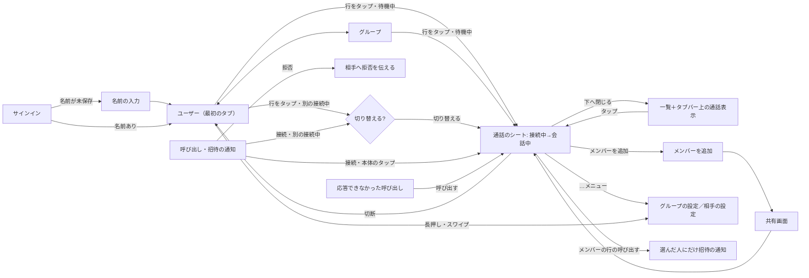

# RideCom 操作の流れ

## 指示と背景

2026-11-02の利用者指摘により、画面単位ではなく利用者のストーリー単位で操作を設計し直す。指摘の要点は次のとおり。

| 指摘 | 現行（2026-11-02時点）の動き |
|---|---|
| 人やグループを選んでも接続しない | Standard・Advancedとも、一覧の選択は`selectUser`／`selectGroup`を`connectIfIdle: false`で呼び、Callへ移るだけ。接続にはCallの「Connect」をもう一度押す |
| 以前の詳細画面は、グループを選ぶとすぐに接続した | Advancedの旧導線は選択と同時に接続し、そこから招待できた |
| グループ通話の画面で人を追加できない | 設計案でCallから追加を外し、Groupsの`ⓘ`からグループの詳細を開く形にしていた |
| グループの設定・人の登録が分かりにくい | `ⓘ`は小さく、行のタップ（通話）と意味が違うのに隣り合っている |
| 通話がメインのタブで、選んでいない・切断した後は「再接続のためだけ」の画面が残る | 通話タブが最初の画面で、未選択の空状態と切断後の未接続の画面を経由する |
| 全員の名前が同じ | 表示名を設定するまで既定の「You」が全員に表示される。サインイン後に名前を求める画面がない |
| 通知から開いても、もう一度接続を押す必要がある | 通知のactionは「iPhoneで応答」だけで、拒否がない。開いた後の接続までの流れが一体になっていない |
| 1対1は通知を着信の代わりにし、グループの開始は通知しない。直接つながった人からのグループ招待は通知し、一部の人だけの会話に他のメンバーを巻き込まない（同日の追加指示） | 通知は固定文で誰からか分からず、通話中も同じように鳴る。グループへの通知はない |
| 2026-11-04のバックログ（[優先順位と引継ぎ](../backlog/README.md)）: 下部の通話表示が小さいと分かりづらい・ミュートと切断を置きたい／Standardのグループタブは既定で非表示／招待の返信と再送の区別・仮名／招待・削除の同期／個人登録した相手だけを呼び出せる | 縮小した通話表示は名前と状態だけ。グループタブは常に表示。招待中の行は未受諾・送信待ちを並べるだけで、返信と再送の区別・仮名がない。削除は端末内だけ |

本書は、一般向け（Standard）と詳細表示（Advanced）に共通する操作の流れの正本である。見た目と部品は[デザインシステム](デザインシステム.md)、画面ごとの構成は[一般向け](一般向け/画面構成とレイアウト.md)と[詳細表示](詳細画面/診断と詳細画面の構成.md)、流れの見本は[操作の流れ見本](操作の流れ見本.html)を参照する。要求は[製品要求](../requirements/製品要求.md)の「選んですぐ接続し、通知から応答できる」「呼び出しは電話のように受け、会話に巻き込まない」「閲覧と通話先変更を区別する」を正本とする。

## 操作の原則

| 原則 | 内容 | 根拠 |
|---|---|---|
| 一覧が主、通話はシート | 主な画面は人の一覧（ユーザー）、次にグループ。通話はタブにせず、選んだときに開く（iPhoneはシート、iPad・Macは右の列。どちらも`inspector`で、幅に応じてOSが切り替える）。接続中はタブバーの上のアクセサリ（`tabViewBottomAccessory`）に名前・状態・ミュート・切断を表示し、どのタブからでも戻れる。タブバーとアクセサリはスクロールで縮めない（[通話のアクセサリ](デザインシステム.md#通話のアクセサリ)） | 通話は「誰と話すか」を選んだ結果であり、場所ではない。ミュージックの再生中表示と同じOS標準の型。利用者の指示（2026-11-02、個人がメイン・グループは次） |
| 再接続のための画面を作らない | 切断したらシートを閉じて一覧へ戻る。「未接続」「接続先を選んでください」だけの画面を置かない。もう一度話すときは一覧の行（前回の接続先は先頭）をタップする | 1回のタップで済む操作のために画面を増やさない |
| 名前を最初に決める | サインイン直後、名前を一度も保存していなければ名前の入力を求める | 未設定の既定名「You」が全員に並ぶと誰が誰か分からない |
| 選んだら接続 | 接続していない間に人・グループを選ぶと、その場で接続を始めて通話のシートを開く。選択と接続を別の操作に分けない | 通信アプリの基本の操作（電話・FaceTimeは相手を選んで発信、トランシーバー型のアプリはチャンネルを選んで参加）に合わせる。止まっている間の短い時間に、グローブのまま1回で始められる（[利用環境の前提](デザインシステム.md#利用環境の前提)） |
| 会話中の選択は確認して切替 | すでに接続しているときに別の人・グループを選んだら、切り替えるかを確認する。確認の選択肢は「切り替える」と「キャンセル」。今の接続先を選んだときは確認せずに通話のシートを開く | [製品要求](../requirements/製品要求.md)の「閲覧と通話先変更を区別する」。グローブで隣の行に触れても会話を失わない |
| その場で追加 | グループ通話のシートから、そのまま人を追加・招待できる。追加のために別のタブ・詳細画面へ移らせない | 通話中に「あの人も呼びたい」と思った場所で完結させる。現行Advancedの旧導線でも通話画面から招待できた |
| 設定は名前の付いた入口から | グループの設定（名前・メンバー・削除）と相手の設定（名前・呼び出しの許可・削除）は、通話のシートの「…」メニューの「グループの設定」／「相手の設定」と、一覧の行の長押し・スワイプから開く。小さな`ⓘ`だけに頼らない | HIGのメニュー・コンテキストメニューの使い方。行のタップは「接続」の1つの意味だけにする |
| 1対1は呼び出しと一体 | 人を選ぶと接続を始め、相手がまだ接続していなければ呼び出しの通知を送る（相手ごとの許可がある場合） | 1対1は相手も同じ通話を開かないとつながらない。電話と同じく「選ぶ＝呼ぶ」にする |
| 通知から1回で応答 | 呼び出しの通知に「接続」と「拒否」を出す。「接続」と通知の本体のタップはアプリを開いてそのまま接続する。開いた後にもう一度接続を押させない | HIGの通知（actionで主な応答を通知の中から行える）。CallKitの電話型着信は製品要求で採用しないため、標準の通知actionで同等の手早さを作る |
| 人が人を呼ぶときだけ通知する | 通知を送るのは、1対1の呼び出しと、会話中のグループから選んだ人への招待だけ。グループの開始は誰にも通知しない。通話中に届いた呼び出し・招待は鳴らさず、会話の中で自分にだけ知らせる | [製品要求](../requirements/製品要求.md)の「呼び出しは電話のように受け、会話に巻き込まない」。設計の詳細は[通知の設計](通知の設計.md) |
| 走行中は操作しない | 接続は出発前に済ませ、走行中は発話検出で会話が続く。走行中に必要な操作を作らない | [製品要求](../requirements/製品要求.md#共通の品質方針)の「走行中の操作」 |

## 画面の行き来

## ユーザーストーリー

各ストーリーは「前提 → 操作 → 結果」で定め、操作の回数は止まっている間に済む最小にする。

### サインイン直後に名前を決める

| 項目 | 内容 |
|---|---|
| 前提 | Appleでサインインした直後で、この端末にもアカウントにも名前を一度も保存していない（既定の「You」のまま） |
| 操作 | 1. 名前の入力（例: ナオ） 2. 「はじめる」 |
| 結果 | 名前を保存し、ユーザーの一覧へ進む。名前はグループの仲間に表示される。あとから設定の「自分の表示名」で変えられる |
| 画面 | 全画面のシート（下へ閉じられない`interactiveDismissDisabled`）。見出し「あなたの名前」、説明1文「仲間に表示される名前です。本名でなくてかまいません。」、`TextField`（自動で選択、`textContentType(.nickname)`）、「はじめる」（名前が空の間は無効）。前後の空白を除き、空白だけ・制御文字・UTF-8で320byte超は現行と同じく受け付けない |
| 既存の利用者 | 名前を保存していない既存の利用者にも、次に開いたときに同じシートを出す |

### 出発前にグループで接続する

| 項目 | 内容 |
|---|---|
| 前提 | グループ「週末ツーリング」が保存済み。接続していない。Standardではグループタブを表示している（既定は非表示。非表示のときはユーザーの一覧の先頭の「前回」から同じく1回で接続できる。[グループタブの表示](一般向け/画面構成とレイアウト.md#グループタブの表示)） |
| 操作 | 1. グループタブで「週末ツーリング」をタップ |
| 結果 | すぐに接続を始め、通話のシート（接続中: 相手の参加を待っています）が開く。仲間が参加すると会話中になる。シートを閉じても接続は続き、タブバーの上の通話表示から戻れる |
| 通知 | 他のメンバーには何も届けない。仲間はそれぞれグループを選んで参加する。来てほしい人がいれば、会話中に[その人だけを呼ぶ](#会話中のグループへ仲間を呼ぶ) |
| 失敗したとき | 利用権・24時間条件・権限などで接続できない場合は、通話のシートの状態ヒーローに理由1文と次の操作1つを出す（[失敗の伝え方](デザインシステム.md#操作と状態の共通規則)） |

### 走行中に会話する

| 項目 | 内容 |
|---|---|
| 前提 | 接続済み |
| 操作 | なし |
| 結果 | 話すと発話検出で送信され、相手の声が聞こえる。経路が切れても自動で復旧する。音声機器が外れた場合は触覚と通知音で知らせ、止まったときに「音声を再開」1回で戻る |

### 会話中に仲間を追加する

| 項目 | 内容 |
|---|---|
| 前提 | グループ通話で会話中 |
| 操作 | 1. 通話のシートの「メンバーを追加」 2. 保存済みのユーザーを選ぶ（個人登録済みで届けられる人には「自動で届く」、それ以外は「リンクで招待」と表示）、または「新しい人を招待」 3. 「追加」 4. リンクが必要な人がいる場合だけ共有先を選ぶ |
| 結果 | 自動で届く人には、グループが相手の一覧に届き（[グループへの追加](招待と登録の設計.md#グループへの追加)）、同時に[会話への招待](通知の設計.md#グループへの招待)が届く。リンクで招待した人は「招待中」に入る。相手が参加すると、そのまま同じ通話のメンバーになる。会話は途切れない |
| 補足 | 1対1の通話には追加しない（内部の1対1グループのため）。3人以上で話す場合はグループを作る |

### 1対1で呼び出す

| 項目 | 内容 |
|---|---|
| 前提 | ユーザー「ハルカ」が保存済みで、ハルカがこちらからの呼び出しを許可している |
| 操作 | 1. ユーザータブで「ハルカ」をタップ |
| 結果 | すぐに接続を始め、ハルカがまだ接続していなければ呼び出しの通知を送る。通話のシートは「呼び出し中」で、自分の耳には小さな呼び出し中の音が流れる。ハルカが「接続」すると会話中になる |
| 応答がないとき | 拒否: 「ハルカは今は応答できません」（5分間は再び呼び出せない）。ハルカが別の会話中: 「呼び出し中 — ハルカは別の相手と会話中です」のまま待つ。期限切れ（120秒）: 「応答がありませんでした」と「もう一度呼び出す」。どの場合も1対1の接続は待機したまま続き、ハルカが後から一覧で選べば会話が始まる |
| 許可がないとき | 呼び出しは送らず「接続中 — 相手の参加を待っています」。相手に開いてもらうための「招待を共有」を補助操作に出す |
| 詳細 | [通知の設計の1対1の呼び出し](通知の設計.md#1対1の呼び出し) |

### 呼び出しを受ける

| 項目 | 内容 |
|---|---|
| 前提 | ナオからの呼び出しを許可している（人を登録した直後の「ナオからの呼び出しを受け取りますか？」で「受け取る」を選んだ）。今は通話していない |
| 届く通知 | 「ナオ — 呼び出しています」。送り主の名前と人の画像にRideComのアイコンを重ねた通信の通知で、約15秒の呼び出し音が鳴る |
| 操作 | 止まってから、通知の本体をタップ、または長押しして「接続」。断るときは長押しして「拒否」（ロックしたまま行える）。Apple Watchにも同じ「接続」「拒否」 |
| 結果 | 「接続」・本体のタップ: ロック解除の後にアプリが開き、そのままナオとの接続を始める（もう一度押させない）。「拒否」: アプリを開かずにナオへ「今は応答できません」を伝える。他の自分の端末の通知は「別の端末で応答しました」に置き換わる |

### 会話中に呼び出しが届く

| 項目 | 内容 |
|---|---|
| 前提 | 「週末ツーリング」で会話しながら走っている。ナオから1対1の呼び出しが届く |
| 届き方 | 端末は鳴らさず、画面も点けない。会話の音声の中に、自分にだけ聞こえる短い合図と「ナオから呼び出しです」の読み上げが1回だけ入る。グループの仲間には聞こえない。通知は通知センターに静かに残る |
| 操作 | 走行中はなし。止まってから通知をタップすると、「週末ツーリングとの接続を切断して、ナオに接続しますか？」の確認が出る |
| 結果 | 「切り替える」でナオとの会話へ移る。何もしなければグループの会話はそのまま続き、ナオ側は「呼び出し中 — 別の相手と会話中です」から期限で「応答がありませんでした」になる |

### 応答できなかった呼び出しに折り返す

| 項目 | 内容 |
|---|---|
| 前提 | 走行中で応答できず、120秒が過ぎた |
| 表示 | 通知は「ナオ — 応答できなかった呼び出し」に置き換わる（音なし）。ユーザーの一覧のナオの行に「応答できなかった呼び出し・14:05」 |
| 操作 | 通知の「呼び出す」、またはユーザーの一覧でナオの行をタップ |
| 結果 | ナオへの接続を始め、ナオへ呼び出しを送る。行の補足は接続した時点で消える |

### 会話中のグループへ仲間を呼ぶ

| 項目 | 内容 |
|---|---|
| 前提 | グループ「週末ツーリング」（5人）のうち、ナオとハルカの2人だけが会話中。ケンタはナオと直接つながっていて、ナオからの呼び出しを許可している |
| 操作 | 1. 通話のシートのメンバー一覧で、未接続のケンタの行の「呼び出す」 |
| 結果 | ケンタにだけ招待の通知が届く。他の未接続の2人には何も届かない。ケンタの行は「呼び出し中」→ 参加すれば会話中の行、拒否なら「今は参加できません」、期限なら「応答がありませんでした」 |
| 出ない場合 | ナオがユウを個人で登録していない、またはユウが呼び出しを許可していない場合は「呼び出す」を出さない。ユウの行を長押しすると、無効の「呼び出す」に理由（「個人で登録していないため呼び出せません」など）と「個人で登録」が出る。全員を一度に呼ぶ操作は作らない |
| 詳細 | [呼び出せる相手](招待と登録の設計.md#呼び出せる相手)、[巻き込みを防ぐ規則](通知の設計.md#巻き込みを防ぐ規則) |

### グループへの招待を受ける

| 項目 | 内容 |
|---|---|
| 前提 | ナオからの呼び出しを許可している |
| 届く通知 | 「ナオ — 週末ツーリング — 会話に招待しています（ハルカが会話中）」。短い招待音。会話中なら鳴らさず、会話の中の合図と読み上げだけ |
| 操作 | 本体のタップ・「接続」、または「拒否」 |
| 結果 | 「接続」: 週末ツーリングに接続し、通話のシートが開く（まだメンバーでなければ招待を受け入れてから）。別の会話中なら切替の確認を出す。「拒否」: ナオへ「今は参加できません」を返す。到着だけでは参加しない |

### 会話中に別の相手を選ぶ

| 項目 | 内容 |
|---|---|
| 前提 | 「週末ツーリング」と会話中 |
| 操作 | 1. ユーザータブで「ケンタ」をタップ 2. 確認で「切り替える」 |
| 結果 | 今の接続を切断し、ケンタへ接続を始める。「キャンセル」なら何も変えずに一覧に戻る |
| 確認の文 | 「週末ツーリングとの接続を切断して、ケンタに接続しますか？」 |

### グループを作る

| 項目 | 内容 |
|---|---|
| 前提 | Standardではグループタブを表示している |
| 操作 | 1. グループタブの「＋」 2. 名前を入力し、保存済みのユーザーを選ぶ（新しい人は「新しい人を招待」） 3. 「作成して接続」 |
| 結果 | グループを保存し、すぐに接続を始める。個人登録済みの人にはグループを自動で届け（呼び出しはしない）、リンクが必要な人がいる場合だけ招待の共有画面を開く。参加前の人は「招待中」 |

### 人を登録する

| 項目 | 内容 |
|---|---|
| 操作 | 1. ユーザータブの「＋」 2. 相手の名前を入れる（例: ハルカ。すぐに決められなければ「「青いキツネ」にする」を押す） 3. 「招待を送る」で共有先を選ぶ |
| 結果 | 相手は「招待中」に「受け取り待ち」で入る。ハルカが受け入れると「返信を待っています」になり、返信が届いた時点でユーザーとして登録される（共有しただけでは登録しない）。登録した直後に「ハルカからの呼び出しを受け取りますか？」を1回だけ聞く |
| 届かないとき | 招待中の行をタップして招待の詳細を開き、「招待を再送」。受け取った側で返信が届かないときは、受け取った側の詳細に「返信を送り直す」が出る。2つは別の操作として説明する（[個人の招待](招待と登録の設計.md#個人の招待)） |

### 相手に削除された

| 項目 | 内容 |
|---|---|
| 前提 | ハルカが自分をユーザーから削除した。自分はそのときオフラインだった |
| 結果 | 次にインターネットまたは近距離でつながったときに削除が届き、ユーザーの一覧からハルカの行が消える。通知は出さない。ハルカの設定を開いていた場合は「この相手は削除されました」に置き換わる。1対1で会話中だった場合は接続が終わり、通話のシートは「接続が終了しました — ハルカとの登録が解除されました」と「閉じる」になる |
| 削除する側 | 1対1で接続中の相手を削除するときは、確認に「今の接続は切断されます。」を加え、確定のボタンを「切断して削除」にする（[接続中の相手・グループを削除するとき](招待と登録の設計.md#接続中の相手グループを削除するとき)） |
| 詳細 | [削除と相手側への反映](招待と登録の設計.md#削除と相手側への反映) |

### グループ・相手の設定を変える

| 項目 | 内容 |
|---|---|
| 入口 | 通話のシートの「…」メニューの「グループの設定」／「相手の設定」、または一覧の行の長押し（コンテキストメニュー）・スワイプの「設定」 |
| グループの設定 | 名前、メンバー（追加・名前の変更・外す）、招待中、グループを削除（赤・確認付き）。メンバーを外す・グループの削除は利用権を持つ人だけ。持たない人には「グループから抜ける」を出す（[削除できる人](招待と登録の設計.md#削除できる人)） |
| 相手の設定 | 呼び名、本人の名前、この相手からの呼び出しを受け取る、招待を共有、ユーザーを削除（赤・確認付き） |

### 止まって切断する

| 項目 | 内容 |
|---|---|
| 操作 | 通話のシート・タブバーの上の通話表示（[通話のアクセサリ](デザインシステム.md#通話のアクセサリ)）・ウィジェット・Apple Watch・Siriの「切断」（通話のアクセサリとApple Watchは確認付き。ロック画面の表示には置かない） |
| 結果 | 通話のシートが閉じ、一覧へ戻る。通話表示は消える。もう一度話すときは一覧の行をタップする（前回の接続先は一覧の先頭に「前回」と表示） |

## 通知

通知の種類・鳴り方・文言・許可を求める時点・巻き込みを防ぐ規則・実装の構成は[通知の設計](通知の設計.md)を正本とする。操作の流れに関わる要点は次のとおり。

| 場面 | 通知 |
|---|---|
| 1対1で選ぶ | 相手に呼び出しを送る（着信の代わり）。時間確定・約15秒の呼び出し音 |
| グループを選ぶ | 送らない |
| 会話中のグループで人を選ぶ | 選んだ人にだけ招待を送る |
| 受け取る人が通話中 | 鳴らさず、会話の中で自分にだけ合図と読み上げ。接続は切替の確認付き |
| 応答・拒否・期限・取消 | 届いている通知を静かな表示に置き換える。応答できなかった呼び出しは「呼び出す」で折り返せる |

## 根拠

| 判断 | 根拠 |
|---|---|
| 選んだら接続 | 利用者の指摘（2026-11-02）。電話・FaceTime・トランシーバー型の通信アプリで共通する「相手やチャンネルを選ぶ＝つながる」という操作の期待。[製品要求](../requirements/製品要求.md#共通の品質方針)の「走行中の操作」（止まっている間の短い操作） |
| 会話中の切替は確認 | [製品要求](../requirements/製品要求.md)の「閲覧と通話先変更を区別する」。HIGは取り消しにくい操作の前に確認を求める（[Alerts](https://developer.apple.com/design/human-interface-guidelines/alerts)） |
| その場で追加・設定は名前の付いた入口 | HIGの[Menus](https://developer.apple.com/design/human-interface-guidelines/menus)・[Context menus](https://developer.apple.com/design/human-interface-guidelines/context-menus)。行のタップに1つの意味だけを持たせる |
| 通知の接続・拒否・送る場面 | 利用者の指示（2026-11-02）と[通知の設計の根拠](通知の設計.md#根拠)。HIGの[Notifications](https://developer.apple.com/design/human-interface-guidelines/notifications)（通知のactionで主な応答を行えるようにする）。actionの種類は[UNNotificationAction](https://developer.apple.com/documentation/usernotifications/unnotificationaction)の`.foreground`・`.destructive`。CallKitは[製品要求](../requirements/製品要求.md)の「インカムを電話型の通話にしない」で採用しない |
| 1対1は呼び出しと一体 | 1対1は相手も同じ通話を開かないと成立しない（[Call画面](../spec/App/UI/Call.md)のdirect callの案内）。選ぶ操作と呼ぶ操作を分けると、走行前の短い時間で2回の操作が要る |

## 現行との差と依存

| 項目 | 現行 | 本書の設計 | 依存 |
|---|---|---|---|
| 画面の構成 | 実装済み（[Call画面](../spec/App/UI/Call.md#standardの通話ユーザーグループ)）: タブはユーザー・グループ・設定、通話はシート・右の列と`tabViewBottomAccessory` | Standardのグループタブを既定で非表示にし、設定で表示できるようにする | [グループタブ表示設定](../backlog/未実装課題.md#個人招待の修復と画面アーキテクチャの整理)（未実装） |
| 一覧の選択 | 実装済み: 待機中は接続を始めて通話のシートを開き、会話中は確認して切替 | — | — |
| 名前の入力 | 実装済み: サインイン直後に名前の入力を求める | — | — |
| 通話画面の追加 | 実装済み: グループ通話の「…」メニューに「メンバーを追加」。追加後は招待URLの共有 | 個人登録済みの相手へはグループを自動で届け、会話中なら呼び出す | [group鍵の配達](../backlog/未実装課題.md#通知とアプリ外からの通話操作)（未実装） |
| グループ・相手の設定 | 実装済み: 通話のシートの「…」メニューと一覧の長押し・スワイプ | — | — |
| 通話のアクセサリ | 名前と状態・ミュート、長押しで切断。タブバーのスクロールでの縮小は試験の都合で外した（[証跡](../validation/history/画面デザインと録音操作の整理.md#2026-11-04の区切りと引継ぎ)） | 縮めない設計として確定し、切断のボタンと確認を加える | [小さい通話表示からの操作](../backlog/未実装課題.md#下部の小さい通話表示からの操作)（未実装） |
| 招待と削除 | 招待中の行は未受諾・送信待ち・Retry。削除は端末内だけ | [招待と登録の設計](招待と登録の設計.md) | [個人招待の修復](../backlog/未実装課題.md#個人招待の修復と画面アーキテクチャの整理)、[招待・削除同期](../backlog/未実装課題.md#インターネットとローカル接続での招待削除同期)（未実装） |
| 1対1の選択時の呼び出し | 呼び出しは相手の設定の「Send Call Request」だけ | 選択時に相手が未接続なら自動で呼び出す | 既存の通知API。送信の頻度制限は既存のserver側に従う |
| 通知のaction | 「iPhoneで応答」だけ | 「接続」「拒否」、応答できなかった呼び出しの「呼び出す」 | 拒否を相手へ伝える経路（server通知APIの応答状態）が未実装。追加は[通知仕様](../spec/App/通知仕様.md)とserverの工程で行う（[通知の設計の現行との差と依存](通知の設計.md#現行との差と依存)） |
| グループの通知 | なし（通常グループへの通知は未実装） | グループの開始は通知しない。会話中に選んだ人にだけ招待の通知を送る | 招待の内容を端末間で暗号化して渡す方式と、serverの招待の種類 |

## 未決事項

| 事項 | 選択肢 |
|---|---|
| Apple Watchの「接続」 | Apple Watchの音声で接続するか、iPhoneの音声で接続するか。iPhoneを背景で起動して接続できるかの実機確認を含む（[通知の設計の未決事項](通知の設計.md#未決事項)） |
| 1対1からグループへの切替 | 1対1の会話中に人を追加したいとき、新しいグループを作って切り替える導線を設けるか |
