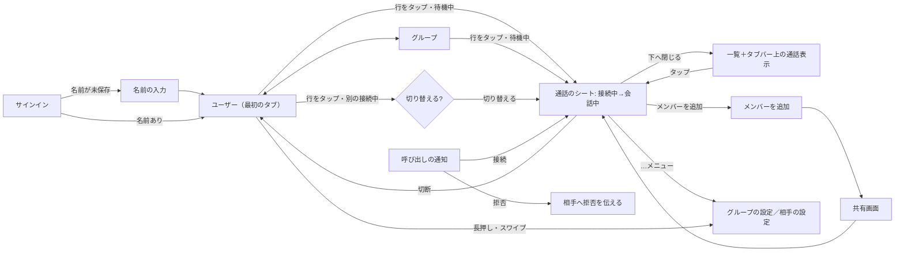

# RideCom 操作の流れ

## 指示と背景

2026-11-02の利用者指摘により、画面単位ではなく利用者のストーリー単位で操作を設計し直す。指摘の要点は次のとおり。

| 指摘 | 現行（2026-11-02時点）の動き |
|---|---|
| 人やグループを選んでも接続しない | Standard・Advancedとも、一覧の選択は`selectUser`／`selectGroup`を`connectIfIdle: false`で呼び、Callへ移るだけ。接続にはCallの「Connect」をもう一度押す |
| 以前の詳細画面は、グループを選ぶとすぐに接続した | Advancedの旧導線は選択と同時に接続し、そこから招待できた |
| グループ通話の画面で人を追加できない | 設計案でCallから追加を外し、Groupsの`ⓘ`からグループの詳細を開く形にしていた |
| グループの設定・人の登録が分かりにくい | `ⓘ`は小さく、行のタップ（通話）と意味が違うのに隣り合っている |
| 通話がメインのタブで、選んでいない・切断した後は「再接続のためだけ」の画面が残る | 通話タブが最初の画面で、未選択の空状態と切断後の未接続の画面を経由する |
| 全員の名前が同じ | 表示名を設定するまで既定の「You」が全員に表示される。サインイン後に名前を求める画面がない |
| 通知から開いても、もう一度接続を押す必要がある | 通知のactionは「iPhoneで応答」だけで、拒否がない。開いた後の接続までの流れが一体になっていない |

本書は、一般向け（Standard）と詳細表示（Advanced）に共通する操作の流れの正本である。見た目と部品は[デザインシステム](デザインシステム.md)、画面ごとの構成は[一般向け](一般向け/画面構成とレイアウト.md)と[詳細表示](詳細画面/診断と詳細画面の構成.md)、流れの見本は[操作の流れ見本](操作の流れ見本.html)を参照する。要求は[製品要求](../requirements/製品要求.md)の「選んですぐ接続し、通知から応答できる」と「閲覧と通話先変更を区別する」を正本とする。

## 操作の原則

| 原則 | 内容 | 根拠 |
|---|---|---|
| 一覧が主、通話はシート | 主な画面は人の一覧（ユーザー）、次にグループ。通話はタブにせず、選んだときにシートで開く。接続中はタブバーの上のアクセサリ（`tabViewBottomAccessory`）に表示し、どのタブからでも戻れる。スクロールするとアクセサリはタブバーの中央に小さく収まる | 通話は「誰と話すか」を選んだ結果であり、場所ではない。ミュージックの再生中表示と同じOS標準の型。利用者の指示（2026-11-02、個人がメイン・グループは次） |
| 再接続のための画面を作らない | 切断したらシートを閉じて一覧へ戻る。「未接続」「接続先を選んでください」だけの画面を置かない。もう一度話すときは一覧の行（前回の接続先は先頭）をタップする | 1回のタップで済む操作のために画面を増やさない |
| 名前を最初に決める | サインイン直後、名前を一度も保存していなければ名前の入力を求める | 未設定の既定名「You」が全員に並ぶと誰が誰か分からない |
| 選んだら接続 | 接続していない間に人・グループを選ぶと、その場で接続を始めて通話のシートを開く。選択と接続を別の操作に分けない | 通信アプリの基本の操作（電話・FaceTimeは相手を選んで発信、トランシーバー型のアプリはチャンネルを選んで参加）に合わせる。止まっている間の短い時間に、グローブのまま1回で始められる（[利用環境の前提](デザインシステム.md#利用環境の前提)） |
| 会話中の選択は確認して切替 | すでに接続しているときに別の人・グループを選んだら、切り替えるかを確認する。確認の選択肢は「切り替える」と「キャンセル」。今の接続先を選んだときは確認せずに通話のシートを開く | [製品要求](../requirements/製品要求.md)の「閲覧と通話先変更を区別する」。グローブで隣の行に触れても会話を失わない |
| その場で追加 | グループ通話のシートから、そのまま人を追加・招待できる。追加のために別のタブ・詳細画面へ移らせない | 通話中に「あの人も呼びたい」と思った場所で完結させる。現行Advancedの旧導線でも通話画面から招待できた |
| 設定は名前の付いた入口から | グループの設定（名前・メンバー・削除）と相手の設定（名前・呼び出しの許可・削除）は、通話のシートの「…」メニューの「グループの設定」／「相手の設定」と、一覧の行の長押し・スワイプから開く。小さな`ⓘ`だけに頼らない | HIGのメニュー・コンテキストメニューの使い方。行のタップは「接続」の1つの意味だけにする |
| 1対1は呼び出しと一体 | 人を選ぶと接続を始め、相手がまだ接続していなければ呼び出しの通知を送る（相手ごとの許可がある場合） | 1対1は相手も同じ通話を開かないとつながらない。電話と同じく「選ぶ＝呼ぶ」にする |
| 通知から1回で応答 | 呼び出しの通知に「接続」と「拒否」を出す。「接続」でアプリが開き、そのまま接続する。開いた後にもう一度接続を押させない | HIGの通知（actionで主な応答を通知の中から行える）。CallKitの電話型着信は製品要求で採用しないため、標準の通知actionで同等の手早さを作る |
| 走行中は操作しない | 接続は出発前に済ませ、走行中は発話検出で会話が続く。走行中に必要な操作を作らない | [製品要求](../requirements/製品要求.md#共通の品質方針)の「走行中の操作」 |

## 画面の行き来

## ユーザーストーリー

各ストーリーは「前提 → 操作 → 結果」で定め、操作の回数は止まっている間に済む最小にする。

### サインイン直後に名前を決める

| 項目 | 内容 |
|---|---|
| 前提 | Appleでサインインした直後で、この端末にもアカウントにも名前を一度も保存していない（既定の「You」のまま） |
| 操作 | 1. 名前の入力（例: ナオ） 2. 「はじめる」 |
| 結果 | 名前を保存し、ユーザーの一覧へ進む。名前はグループの仲間に表示される。あとから設定の「自分の表示名」で変えられる |
| 画面 | 全画面のシート（下へ閉じられない`interactiveDismissDisabled`）。見出し「あなたの名前」、説明1文「仲間に表示される名前です。本名でなくてかまいません。」、`TextField`（自動で選択、`textContentType(.nickname)`）、「はじめる」（名前が空の間は無効）。前後の空白を除き、空白だけ・制御文字・UTF-8で320byte超は現行と同じく受け付けない |
| 既存の利用者 | 名前を保存していない既存の利用者にも、次に開いたときに同じシートを出す |

### 出発前にグループで接続する

| 項目 | 内容 |
|---|---|
| 前提 | グループ「週末ツーリング」が保存済み。接続していない |
| 操作 | 1. グループタブで「週末ツーリング」をタップ |
| 結果 | すぐに接続を始め、通話のシート（接続中: 相手の参加を待っています）が開く。仲間が参加すると会話中になる。シートを閉じても接続は続き、タブバーの上の通話表示から戻れる |
| 失敗したとき | 利用権・24時間条件・権限などで接続できない場合は、通話のシートの状態ヒーローに理由1文と次の操作1つを出す（[失敗の伝え方](デザインシステム.md#操作と状態の共通規則)） |

### 走行中に会話する

| 項目 | 内容 |
|---|---|
| 前提 | 接続済み |
| 操作 | なし |
| 結果 | 話すと発話検出で送信され、相手の声が聞こえる。経路が切れても自動で復旧する。音声機器が外れた場合は触覚と通知音で知らせ、止まったときに「音声を再開」1回で戻る |

### 会話中に仲間を追加する

| 項目 | 内容 |
|---|---|
| 前提 | グループ通話で会話中 |
| 操作 | 1. 通話のシートの「メンバーを追加」 2. 保存済みのユーザーを選ぶ、または「新しい人を招待」 3. 「追加して招待を送る」 4. 共有先を選ぶ |
| 結果 | 追加した人は「招待中」に入る。相手が参加すると、そのまま同じ通話のメンバーになる。会話は途切れない |
| 補足 | 1対1の通話には追加しない（内部の1対1グループのため）。3人以上で話す場合はグループを作る |

### 1対1で呼び出す

| 項目 | 内容 |
|---|---|
| 前提 | ユーザー「ハルカ」が保存済みで、ハルカがこちらからの呼び出しを許可している |
| 操作 | 1. ユーザータブで「ハルカ」をタップ |
| 結果 | すぐに接続を始め、ハルカがまだ接続していなければ呼び出しの通知を送る。通話のシートは「呼び出し中」。ハルカが「接続」すると会話中になる。「拒否」なら「ハルカは今は応答できません」、期限切れなら「応答がありませんでした」と出し、「もう一度呼び出す」を残す |
| 許可がないとき | 呼び出しは送らず「接続中 — 相手の参加を待っています」。相手に開いてもらうための「招待を共有」を補助操作に出す |

### 呼び出しを受ける

| 項目 | 内容 |
|---|---|
| 前提 | こちらで「呼び出しを受け取る」をONにし、ハルカからの呼び出しを許可している |
| 操作 | 通知の「接続」または「拒否」を押す（ロック画面・通知センター・Apple Watch） |
| 結果 | 「接続」: アプリが開き、そのままハルカとの接続を始める（もう一度押させない）。「拒否」: アプリを開かずにハルカへ拒否を伝える。通知の本体をタップした場合は、呼び出しのシート（ハルカから呼び出し・「接続」「拒否」）を出す |
| 別の接続中 | 「接続」は切替の確認を出す（[会話中の選択は確認して切替](#操作の原則)） |

### 会話中に別の相手を選ぶ

| 項目 | 内容 |
|---|---|
| 前提 | 「週末ツーリング」と会話中 |
| 操作 | 1. ユーザータブで「ケンタ」をタップ 2. 確認で「切り替える」 |
| 結果 | 今の接続を切断し、ケンタへ接続を始める。「キャンセル」なら何も変えずに一覧に戻る |
| 確認の文 | 「週末ツーリングとの接続を切断して、ケンタに接続しますか？」 |

### グループを作る

| 項目 | 内容 |
|---|---|
| 操作 | 1. グループタブの「＋」 2. 名前を入力し、保存済みのユーザーを選ぶ（新しい人は「新しい人を招待」） 3. 「作成して接続」 |
| 結果 | グループを保存し、すぐに接続を始める。選んだ人へ招待の共有画面を開く。参加前の人は「招待中」 |

### 人を登録する

| 項目 | 内容 |
|---|---|
| 操作 | 1. ユーザータブの「＋」 2. 「招待を送る」で共有先を選ぶ |
| 結果 | 相手は「招待中（未参加）」に入る。相手が招待を受け入れて参加した時点でユーザーとして登録される（共有しただけでは登録しない） |

### グループ・相手の設定を変える

| 項目 | 内容 |
|---|---|
| 入口 | 通話のシートの「…」メニューの「グループの設定」／「相手の設定」、または一覧の行の長押し（コンテキストメニュー）・スワイプの「設定」 |
| グループの設定 | 名前、メンバー（追加・名前の変更・削除）、招待中、グループを削除（赤・確認付き） |
| 相手の設定 | 呼び名、本人の名前、この相手からの呼び出しを受け取る、招待を共有、ユーザーを削除（赤・確認付き） |

### 止まって切断する

| 項目 | 内容 |
|---|---|
| 操作 | 通話のシート・タブバーの上の通話表示の長押しメニュー・ウィジェット・Apple Watch・Siriの「切断」（Apple Watchは確認付き。ロック画面の表示には置かない） |
| 結果 | 通話のシートが閉じ、一覧へ戻る。通話表示は消える。もう一度話すときは一覧の行をタップする（前回の接続先は一覧の先頭に「前回」と表示） |

## 通知

呼び出しは標準の通知（time-sensitive）で届け、通知の中から応答できるようにする。

| 対象 | 内容 |
|---|---|
| 届く通知 | タイトル「ハルカ」、本文「呼び出しています」。アプリの表示は通知の設定（プレビュー）に従う |
| action | 「接続」（アプリを前面に開いて接続する。`UNNotificationAction`の`.foreground`）、「拒否」（アプリを開かずに拒否を送る。`.destructive`） |
| 本体のタップ | 呼び出しのシート（「ハルカから呼び出し」・「接続」・「拒否」）を出す。自動では接続しない |
| 期限 | 現行の120秒。期限が過ぎた通知は「応答がありませんでした」に置き換え、actionを外す |
| Apple Watch | 同じ「接続」「拒否」を出す。「接続」はApple Watchの音声で接続するか、iPhoneで接続するかを[Watch操作](../spec/App/Watch操作.md)の範囲で決める（実機の成立は未確認） |
| 呼び出した側 | 通話のシートの状態ヒーローに「呼び出し中」→「会話中」／「今は応答できません」／「応答がありませんでした」。いずれも取消・再呼び出しの操作を1つ出す |

## 根拠

| 判断 | 根拠 |
|---|---|
| 選んだら接続 | 利用者の指摘（2026-11-02）。電話・FaceTime・トランシーバー型の通信アプリで共通する「相手やチャンネルを選ぶ＝つながる」という操作の期待。[製品要求](../requirements/製品要求.md#共通の品質方針)の「走行中の操作」（止まっている間の短い操作） |
| 会話中の切替は確認 | [製品要求](../requirements/製品要求.md)の「閲覧と通話先変更を区別する」。HIGは取り消しにくい操作の前に確認を求める（[Alerts](https://developer.apple.com/design/human-interface-guidelines/alerts)） |
| その場で追加・設定は名前の付いた入口 | HIGの[Menus](https://developer.apple.com/design/human-interface-guidelines/menus)・[Context menus](https://developer.apple.com/design/human-interface-guidelines/context-menus)。行のタップに1つの意味だけを持たせる |
| 通知の接続・拒否 | HIGの[Notifications](https://developer.apple.com/design/human-interface-guidelines/notifications)（通知のactionで主な応答を行えるようにする）。actionの種類は[UNNotificationAction](https://developer.apple.com/documentation/usernotifications/unnotificationaction)の`.foreground`・`.destructive`。CallKitは[製品要求](../requirements/製品要求.md)の「インカムを電話型の通話にしない」で採用しない |
| 1対1は呼び出しと一体 | 1対1は相手も同じ通話を開かないと成立しない（[Call画面](../spec/App/UI/Call.md)のdirect callの案内）。選ぶ操作と呼ぶ操作を分けると、走行前の短い時間で2回の操作が要る |

## 現行との差と依存

| 項目 | 現行 | 本書の設計 | 依存 |
|---|---|---|---|
| 画面の構成 | 通話タブが最初の画面。未選択の空状態と切断後の未接続の画面がある | タブはユーザー・グループ・設定（Advancedは診断を加える）。通話はシートと`tabViewBottomAccessory`。未選択・未接続だけの画面をなくす | iOS 26の`tabViewBottomAccessory`（現行の最低OSは27） |
| 一覧の選択 | `connectIfIdle: false`でCallへ移るだけ | 待機中は接続を始めて通話のシートを開く。会話中は確認して切替 | なし（既存の`startCall`と切替の確認を使う） |
| 名前の入力 | 未保存なら既定の「You」。設定でだけ変更できる | サインイン直後に名前の入力を求める | 既存の`LocalDisplayNameSection`の保存処理を使う |
| 通話画面の追加 | 設計案でCallから外していた | グループ通話のシートに「メンバーを追加」 | 既存の`Add Saved Users`と招待の共有 |
| グループ・相手の設定 | Advancedの`ⓘ`、名前の鉛筆ボタン | 通話のシートの「…」メニューと一覧の長押し・スワイプ | なし |
| 1対1の選択時の呼び出し | 呼び出しは相手の設定の「Send Call Request」だけ | 選択時に相手が未接続なら自動で呼び出す | 既存の通知API。送信の頻度制限は既存のserver側に従う |
| 通知のaction | 「iPhoneで応答」だけ | 「接続」「拒否」 | 拒否を相手へ伝える経路（server通知APIの応答状態）が未実装。追加は[通知仕様](../spec/App/通知仕様.md)とserverの工程で行う |
| グループの呼び出し | なし（通常グループへの通知は未実装） | 対象外。グループは選んで接続し、参加は各自が行う | 採用する場合はserverの通知仕様から設計する |

## 未決事項

| 事項 | 選択肢 |
|---|---|
| Apple Watchの「接続」 | Apple Watchの音声で接続するか、iPhoneの音声で接続するか |
| 自動の呼び出し | 選択時に毎回呼び出すか、相手が一定時間内に接続していない場合だけ呼び出すか |
| 1対1からグループへの切替 | 1対1の会話中に人を追加したいとき、新しいグループを作って切り替える導線を設けるか |
