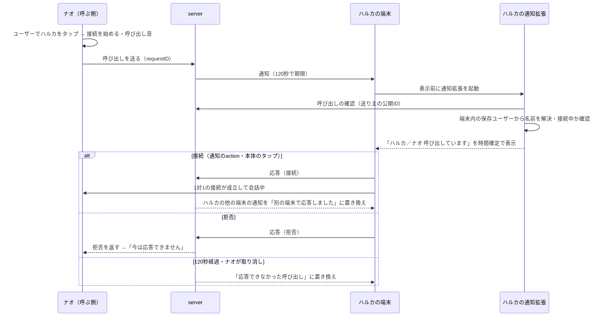

# RideCom 通知の設計

## 指示と背景

2026-11-02の利用者指示により、通知を「どの場面で送るか」から設計し直す。指示の要点は次のとおり。

| 指示 | 本書での扱い |
|---|---|
| 1対1の通話開始は、通知を着信の代わりに使う | 1対1で相手を選ぶと、相手に「呼び出し」の通知が届く。電話の着信と同じく、誰からかが分かり、通知から接続・拒否できる |
| グループの通話開始は通知しない | グループを選んで接続しても、他のメンバーには何も届けない |
| すでにつながっている人からのグループ招待は通知する | 直接つながり、呼び出しを許可した相手からの「グループへの招待」は通知で届ける |
| グループの一部だけが会話しているときの巻き込みを防ぐ | 招待は選んだ人にだけ届け、一斉通知・自動参加・会話中の割り込みを作らない（[巻き込みを防ぐ規則](#巻き込みを防ぐ規則)） |
| CallKitは使わないので普通の通知しか使えない | [製品要求](../requirements/製品要求.md)の「インカムを電話型の通話にしない」を維持し、標準の通知（`UserNotifications`）とその拡張だけで組む |
| それでも電話のように気軽に受け取れて、巻き込みもないこと | 標準の通知で使える手段（Notification Service Extension、通信の通知、時間確定の通知、通知の置き換え、会話の中の合図）を組み合わせる |

現行（2026-11-02時点）の通知は次の状態で、利用者から「中途半端」と指摘されている。

| 項目 | 現行 | 問題 |
|---|---|---|
| 通知の表示 | serverの固定文`CALL_REQUEST_TITLE`／`CALL_REQUEST_BODY`だけ。payloadは版・requestID・recipientIDのみ | 誰からの呼び出しかが分からない。電話の着信の代わりにならない |
| action | 背景action「iPhoneで応答」1つ。拒否がない | 断る手段がなく、相手は120秒待たされる |
| 鳴り方 | `sound: default`、通常の割り込みレベル | 接続中でも同じように鳴り、会話を遮る。着信らしい長さの音がない |
| 応答後・期限後 | 届いた通知はそのまま残る | 別の端末で応答しても、期限が過ぎても、通知が「呼び出し中」のまま残る |
| 送信側の表示 | serverの受付結果（accepted等）だけ | 相手が拒否した・別の会話中・応答なしを区別できない |
| 許可 | 設定の「Enable／Check／Disable Notifications」3つのボタン | いつ・なぜ許可するのかが分からない。確認ボタンは利用者の操作として意味がない |
| グループ | 通知なし | 会話中に仲間を呼ぶ手段が共有リンクだけ |

本書は通知の設計の正本である。操作の流れ（ストーリー）は[操作の流れ](操作の流れ.md)、画面の部品は[デザインシステム](デザインシステム.md)、設定画面の構成は[一般向けの画面構成](一般向け/画面構成とレイアウト.md#呼び出しの通知)、見本は[通知見本](通知見本.html)を参照する。現行の実装契約は[App通知仕様](../spec/App/通知仕様.md)と[server通知](../spec/server/通知.md)にあり、本書の設計と違う点は[現行との差と依存](#現行との差と依存)にまとめる。

## 通知を送る場面

| 場面 | 通知 | 理由 |
|---|---|---|
| 1対1で相手を選んだ（相手がまだ接続していない） | 相手に「呼び出し」を送る | 1対1は相手も同じ通話を開かないと成立しない。電話の着信と同じ役割 |
| グループを選んで接続した | 送らない | グループは各自が自分で選んで参加する。誰かが開くたびに全員の端末が鳴ると、話すつもりのない人まで巻き込む |
| グループの会話中に、来てほしい人を選んだ | 選んだ人にだけ「グループへの招待」を送る | 会話している本人が個人登録しており、通知が許可されている相手から明示的に選んだ人だけに届ける |
| 呼び出し・招待に応答した／拒否した／期限が過ぎた／取り消された | 届いている通知を静かな表示に置き換える（音なし） | 終わった呼び出しが「呼び出し中」のまま残らないようにする |
| 相手がグループに参加した・退出した | 送らない（会話の中の音と画面で知らせる） | 会話している人はすでにアプリの音声を聞いている |
| 招待のリンクを受け取った人が参加した | 送らない | 共有リンクは通知とは別の招待の手段 |

通知は「人が人を呼ぶ」ときだけ送る。アプリの状態変化（接続の成立、経路の切替、音声機器の変化）は通知にせず、会話の中の音・触覚・画面で知らせる（[デザインシステム](デザインシステム.md#利用環境の前提)）。

## 通知の種類

| 種類 | 届く条件 | 割り込みレベル | 音 | action | 本体のタップ |
|---|---|---|---|---|---|
| 呼び出し（待機中に届く） | 呼び出しを許可した相手が1対1で選んだ。受け取る端末は接続していない | 時間確定（`timeSensitive`） | 呼び出し音（約15秒、[音と振動](#音と振動)） | 「接続」「拒否」 | 接続する |
| 呼び出し（接続中に届く） | 同上。受け取る端末が別の相手・グループと接続中 | 静か（`passive`） | 鳴らさない。会話の中に自分だけに聞こえる合図と読み上げ | 「接続」「拒否」 | 切替の確認を出す |
| グループへの招待（待機中に届く） | 呼び出しを許可した相手が、会話中のグループから自分を選んだ | 通常（`active`） | 短い招待音（約2秒） | 「接続」「拒否」 | 接続する |
| グループへの招待（接続中に届く） | 同上。受け取る端末が接続中 | 静か（`passive`） | 鳴らさない。会話の中の合図と読み上げ | 「接続」「拒否」 | 切替の確認を出す |
| 応答できなかった呼び出し | 応答せずに期限が過ぎた、または相手が取り消した | 静か（`passive`）。届いている通知を置き換える | なし | 「呼び出す」 | ユーザーの一覧でその人の行を示す |
| 応答できなかった招待 | 応答せずに期限が過ぎた、または招待した人が取り消した | 静か（`passive`）。置き換え | なし | なし | グループの一覧でそのグループの行を示す |
| 別の端末で応答・拒否した | 自分の別の端末（iPhone・iPad・Mac）で応答または拒否した | 静か（`passive`）。置き換え | なし | なし | アプリを開く |

割り込みレベルの使い分け:

| レベル | 使う場面 | 理由 |
|---|---|---|
| 時間確定 | 1対1の呼び出しだけ | 120秒以内に応答しないと意味がなくなる、人からの呼び出し。HIGは時間確定を「今すぐ知る必要がある情報」に限っており、招待や状態変化には使わない |
| 通常 | グループへの招待 | 会話への誘いで、電話ほど急がない。集中モードを越えて知らせる必要はない |
| 静か | 接続中に届いたもの、終わった呼び出しの置き換え | 画面を点けず、音を鳴らさない。通知センターには残る |
| 緊急（`critical`） | 使わない | 健康・安全・治安の用途に限られ、インカムの呼び出しは該当しない |

## 1対1の呼び出し

### 呼び出しの時間の流れ

### 受け取る側の表示

通知の見た目は「通信の通知」（`INStartCallIntent`で内容を更新した通知）にする。送り主の名前を大きく、人の画像（保存ユーザーの画像がない場合はOSの既定表示）にRideComのアイコンを小さく重ねて出す。Dynamic Islandやロック画面で、どのアプリの・誰からの呼び出しかが一目で分かる。

| 状態 | 受け取る端末の条件 | 表示 | 鳴り方 |
|---|---|---|---|
| 待機中 | 接続していない | タイトル「ナオ」、本文「呼び出しています」、action「接続」「拒否」 | 時間確定。呼び出し音を約15秒。マナーモードでは振動だけ（OSの規則） |
| 接続中 | 別の相手・グループと接続中 | 同じ表示を静かに通知センターへ置く | 画面を点けず鳴らさない。会話の音声の中に、自分にだけ聞こえる短い合図（約1秒）と「ナオから呼び出しです」の読み上げを1回だけ混ぜる |
| 名前を解決できない | 確認の通信が失敗した、または保存ユーザーにまだ反映されていない | タイトル「呼び出し」、本文「RideComの仲間が呼び出しています」、action「接続」「拒否」 | 待機中・接続中の規則に従う |
| 保存していない相手 | 送り主が現在の保存ユーザーにいない（削除済み・別アカウント） | タイトル「呼び出し」、本文「登録していない相手からの呼び出しです」、actionなし | 静か。接続の手段を出さない（現行の「削除済みの相手を復活させない」を維持） |
| すでに終わっている | 確認の結果が期限切れ・取消（server応答410） | 「応答できなかった呼び出し」 | 静か |

接続中の合図と読み上げは、自分の出力だけに混ぜて相手・グループへは送信しない。読み上げは端末の言語で行い、本文と同じ名前（自分の呼び名）を使う。

### 応答の操作

| 操作 | 場所 | 動き |
|---|---|---|
| 本体のタップ | ロック画面・通知センター・バナー | ロック解除の後、アプリが開いて接続を始め、通話のシートを開く。別の相手と接続中なら切替の確認を出す。もう一度「接続」を押させない |
| 「接続」 | 通知の長押し（展開）、Apple Watch | 本体のタップと同じ。actionは`.foreground`（アプリを前面にする。ロック中は解除を求める） |
| 「拒否」 | 通知の長押し、Apple Watch | アプリを開かずに拒否を送る。actionは`.destructive`、背景で処理し、ロック解除を求めない |
| 何もしない | — | 120秒で「応答できなかった呼び出し」に変わる |
| 通知を消す（スワイプ） | 通知センター | 拒否として扱わない。期限まで相手は「呼び出し中」のまま |

action「接続」には`phone.fill`、「拒否」には`phone.down.fill`の記号を付ける（`UNNotificationActionIcon`）。どちらも通知の中で文字と記号の両方で区別でき、色だけに頼らない（「拒否」の赤はOSの`.destructive`の表示）。

ロック中の「接続」と本体のタップはロック解除が必要になる。CallKitを使わない標準の通知では避けられない制約であり、止まってから端末を取り出し、Face IDまたはパスコードで解除して応答する前提にする（[利用環境の前提](デザインシステム.md#利用環境の前提)）。「拒否」はロックしたまま行える。

### 呼び出した側の表示

呼び出した側は通話のシートの状態ヒーロー（[通話のシートの状態別構成](一般向け/画面構成とレイアウト.md#通話のシートの状態別構成)）に結果を出す。呼び出し中は自分の出力に小さな呼び出し音（4秒ごと）を流し、画面を見なくても呼んでいる最中だと分かるようにする。

| 状態 | 状態文 | 補足 | 主操作 |
|---|---|---|---|
| 呼び出し中 | 呼び出し中 | 応答すると会話を始めます | 「呼び出しを取り消す」 |
| 呼び出し中・相手は別の会話中 | 呼び出し中 | ハルカは別の相手と会話中です | 「呼び出しを取り消す」 |
| 応答した | 会話中 | — | 通常の会話中の操作 |
| 拒否された | ハルカは今は応答できません | 5分後にもう一度呼び出せます | 「切断」（5分後に「もう一度呼び出す」へ変わる） |
| 応答がなかった | 応答がありませんでした | — | 「もう一度呼び出す」 |
| 届けられない | ハルカに呼び出しを届けられません | ハルカがこの端末からの呼び出しを受け取る設定になっていません | 「招待を共有」 |
| 送れなかった | 呼び出しを送れませんでした | 通信できる場所でもう一度お試しください | 「もう一度呼び出す」 |

呼び出し中・応答なし・拒否のいずれでも、1対1の接続は待機したまま続く。相手が後から自分で一覧を選んで接続すれば会話が始まる。

### 自動の呼び出し

1対1で相手を選ぶと、接続を始めると同時に呼び出しを送る。ただし、相手がすでに同じ1対1の接続にいると接続の開始時点で分かった場合は送らない。送った後に会話が成立した場合は、呼び出しを自動で取り消す。受け取る端末の通知は「応答できなかった呼び出し」ではなく「接続しました」の静かな表示に置き換える。通知拡張は、受け取る端末が接続している相手が送り主本人との1対1なら、合図と読み上げを行わない。

## グループへの招待

### 送れる条件

| 条件 | 内容 |
|---|---|
| 送る人 | そのグループの会話に接続している人。接続していない間（グループを選んでいない間）は送れない |
| 受け取る人 | 送る人と直接つながっていて（直接招待で保存ユーザーになっている）、送る人からの呼び出しを許可している人。グループの中で会っただけの人には送れない（現行のgrantの規則と同じ） |
| 対象 | そのグループの未接続のメンバー、または「メンバーを追加」で新しく加える保存ユーザー |
| 1回の操作 | 1人ずつ、明示的に選ぶ。「全員を呼ぶ」操作は作らない |
| 繰り返し | 同じ人への招待は1件ずつ。拒否された後は5分間、その人を同じグループへ招待できない。応答がなかった場合はすぐにもう一度招待できる |

### 送り方

| 入口 | 表示 | 動き |
|---|---|---|
| 通話のシートのメンバー一覧 | 未接続のメンバーの行の末尾に「呼び出す」（glass、44pt以上）。条件を満たさない人には出さない | 押すとその人に招待を送り、行の補足が「呼び出し中」になる。もう一度押すと取り消す（行の末尾は「取り消す」） |
| 「メンバーを追加」 | 保存ユーザーを選ぶ一覧に、通知で届く人は「通知で招待」、それ以外は「リンクで招待」と補足を出す | 「追加して招待」で、通知で届く人には招待を送り、リンクが必要な人がいる場合だけ共有画面を開く |

送った結果はメンバーの行の補足に出す: 「呼び出し中」→ 参加すれば通常の会話中の行、「今は参加できません」（拒否）、「応答がありませんでした」（期限切れ）。会話は途切れない。

### 受け取る側の表示

| 状態 | 表示 | 鳴り方 |
|---|---|---|
| 待機中 | タイトル「ケンタ」、サブタイトル「週末ツーリング」、本文「会話に招待しています（ハルカ・ユウが会話中）」、action「接続」「拒否」 | 通常。短い招待音 |
| 接続中 | 同じ表示を静かに通知センターへ置く | 鳴らさない。会話の中に自分だけの合図と「ケンタから週末ツーリングへの招待です」の読み上げ |
| 内容を読めない | タイトル「グループへの招待」、本文「RideComの仲間が会話に招待しています」 | 状態に従う |

「接続」と本体のタップは、待機中ならそのグループに接続して通話のシートを開く。まだメンバーでない場合は、招待を受け入れてグループを保存してから接続する。接続中なら切替の確認（「1対1のハルカとの接続を切断して、週末ツーリングに接続しますか？」）を出す。「拒否」は招待した人へ「今は参加できません」を返す。

会話中の人の顔ぶれ（「ハルカ・ユウが会話中」）は、招待した人の端末が送る時点の会話中のメンバーを、受け取る人の呼び名で表示する。受け取る人が知らない人は本人の名前で表示する。

### 巻き込みを防ぐ規則

2026-11-04の追加要求。通話中にグループ内から選んで通知する場合も、送信者が個人登録しているユーザーだけを通知対象とする。グループ所属だけでは通知できない。個人登録に加え、相手の通知許可と既存の認可条件を満たすこと。未登録・削除済みの相手へ通知できないと分かる候補表示と操作可否を設計する。機能の実装・送信時の再確認・回帰条件は[通知の機能課題](../backlog/未実装課題.md#通知とアプリ外からの通話操作)で追跡する。これは追加の設計要件であり、実装済みとは扱わない。

グループの一部の人だけが会話しているときに、他のメンバーや会話中の人を意図せず巻き込まないための規則。

| 場面 | 起こりうる巻き込み | 設計 |
|---|---|---|
| 誰かがグループを選んで接続した | メンバー全員の端末が鳴る | グループの開始は誰にも通知しない |
| 2人で話していて1人を呼びたい | 全員に届く | 選んだ人にだけ届ける。「全員を呼ぶ」操作を作らない |
| 呼ばれた人 | 誰と話すことになるか分からないまま入る | 通知に会話中の人を出す。参加は本人の「接続」だけで、到着だけでは接続しない |
| 呼ばれた人が別の会話中 | 鳴って今の会話を遮る。誤って切り替わる | 静かに届け、合図と読み上げは自分にだけ。接続は切替の確認付き |
| 合図・読み上げ | 「○○から呼び出しです」が今の会話の相手に聞こえる | 合図と読み上げは自分の出力だけに混ぜ、送信しない |
| 会話中の人 | 突然知らない人が入ってくる | 招待できるのは会話中の人が選んだメンバー・保存ユーザーだけ。参加した人は短い参加音とメンバー一覧で全員に分かる |
| 断った人 | 何度も鳴らされる | 拒否後5分は同じ人から同じグループへ招待できない。1対1の呼び出しも同じ |
| グループの中で会っただけの人 | 直接の関係がないのに呼び出せる | 直接つながり、呼び出しを許可した相手からだけ届く |
| 自分の別の端末 | iPhoneとiPadが両方鳴り続ける | 1台で応答・拒否すると、他の端末の通知を静かな表示に置き換える |
| 一覧からグループを選んだ人 | 一部の人の会話に入ることになる | グループに参加するのは本人の選択として認める。会話中の人には参加音で知らせる |

## 応答できなかった呼び出し

電話の不在着信と同じ役割を、置き換えた通知とユーザーの一覧の行で果たす。

| 場所 | 表示 | 操作 |
|---|---|---|
| 通知センター | タイトル「ナオ」、本文「応答できなかった呼び出し」、時刻はOSの表示 | action「呼び出す」（`.foreground`）: アプリを開き、ナオを選んだときと同じく接続して呼び出す。本体のタップ: ユーザーの一覧を開き、ナオの行を示す |
| ユーザーの一覧 | ナオの行の補足に「応答できなかった呼び出し・14:05」（`phone.arrow.down.left`の記号だけwarning色） | 行のタップで通常どおり接続して呼び出す。接続した時点で補足を消す |
| アプリのアイコン | バッジは付けない | 件数のバッジは開くまで残り、走行中に意味を持たないため |

## 音と振動

| 音 | 鳴る場所 | 長さ | 設計 |
|---|---|---|---|
| 呼び出し音 | 受け取る端末（待機中） | 約15秒、1回 | 柔らかい2音の繰り返し。iPhoneの着信音と区別でき、ヘルメットのスピーカー越しでも聞き取れる中音域。通知の音の上限（30秒）以内。マナーモードではOSの振動だけ |
| 招待音 | 受け取る端末（待機中） | 約2秒 | 呼び出し音より短く軽い。急ぎでないことを音でも示す |
| 会話の中の合図 | 受け取る端末（接続中） | 約1秒＋読み上げ | 会話の音量を一時的に下げずに重ねる。1件につき1回。自分の出力だけで送信しない |
| 呼び出し中の音 | 呼んだ側 | 4秒ごとに短く | 応答・拒否・期限で止める。自分の出力だけ |
| 参加音・退出音 | 会話中の全員 | 約0.5秒 | 人が加わった・抜けたことを画面を見ずに知らせる |

音の素材はアプリに同梱する（`caf`形式）。通知の音は端末の通知の設定（サウンドのオフ）とマナーモードに従い、アプリから越えない。

## 通知の許可を求める時点

起動直後やサインイン直後には許可を求めない。呼び出しを受け取る意味が分かる時点で、相手ごとの許可とOSの許可を1回の判断にまとめる。

| 時点 | 表示 | 「受け取る」を選んだとき |
|---|---|---|
| 人を登録した直後（相手が招待を受け入れて保存ユーザーに加わったとき） | 標準のアラート。タイトル「ハルカからの呼び出しを受け取りますか？」、本文「ハルカが呼び出したときに、この端末に通知が届きます。」、ボタン「受け取る」「今はしない」 | OSの通知の許可がまだならOSの許可シートを出し、端末を登録して、ハルカへの許可を発行する |
| 相手の設定の「この相手からの呼び出しを受け取る」をONにした | — | 端末の「呼び出しを受け取る」がOFFならまとめてONにする（OSの許可を含む） |
| 設定の「呼び出しを受け取る」をONにした | — | OSの許可と端末の登録。相手ごとの許可は変えない |

「今はしない」を選んだ場合は、同じ相手について再び聞かない。あとから相手の設定で変えられる。OSで通知が許可されていない場合の表示は[一般向けの画面構成](一般向け/画面構成とレイアウト.md#呼び出しの通知)に従う。

グループへの招待は、1対1の呼び出しと同じ相手ごとの許可（「この相手からの呼び出しを受け取る」）で受け取る。招待のための別の許可は作らない。

## 端末ごとの違い

| 端末 | 表示 | 応答 |
|---|---|---|
| iPhone | ロック画面・バナー・通知センター。通信の通知の見た目 | 本体のタップ・長押しの「接続」でアプリが開き、通話のシートを開く |
| iPad | iPhoneと同じ | 通話は右の列（`inspector`）で開く（[幅と高さによる配置](デザインシステム.md#幅と高さによる配置)） |
| Mac | 画面右上の通知。actionは「オプション」の中 | 「接続」・本体のクリックでウインドウを前面にし、右の列で通話を開く |
| Apple Watch | iPhoneから転送された通知。iPhoneと同じ文言と「接続」「拒否」 | 「拒否」は確実に処理する。「接続」は[未決事項](#未決事項)のとおり実機で確かめる |
| 同じアカウントの複数の端末 | 登録した端末（最大8台）のすべてに届く | 1台で応答・拒否すると他の端末の通知を置き換える |

## 文言

| 場面 | 日本語 | English |
|---|---|---|
| 呼び出しのタイトル | {名前} | {name} |
| 呼び出しの本文 | 呼び出しています | Calling you |
| 名前を解決できない呼び出し | 呼び出し／RideComの仲間が呼び出しています | Call / Someone on RideCom is calling you |
| 保存していない相手 | 呼び出し／登録していない相手からの呼び出しです | Call / Call from someone not in your list |
| 応答できなかった呼び出し | 応答できなかった呼び出し | Missed call |
| 別の端末で応答・拒否 | 別の端末で応答しました／拒否しました | Answered on another device / Declined |
| 呼び出しの前に会話が成立 | 接続しました | Connected |
| 招待の本文 | 会話に招待しています（{名前}・{名前}が会話中） | Invites you to join ({name} and {name} are talking) |
| 内容を読めない招待 | グループへの招待／RideComの仲間が会話に招待しています | Group Invitation / Someone on RideCom invited you to talk |
| 応答できなかった招待 | 応答できなかった招待 | Missed invitation |
| action | 接続／拒否／呼び出す | Connect / Decline / Call |
| 会話の中の読み上げ | {名前}から呼び出しです／{名前}から{グループ}への招待です | {name} is calling / {name} invited you to {group} |

通知はOSの表示であり、アプリの表示モード（一般向け・詳細表示）に関係なく端末の言語で表示する。Advancedの画面でも通知の文言は上表を使う。

## 実装の構成

| 部品 | 役割 | 注意点 |
|---|---|---|
| 通知のcategory | 呼び出し・招待（action「接続」「拒否」）、応答できなかった呼び出し（action「呼び出す」）、actionなしの3つ | 現行の`RIDEINTERCOM_RESPOND_ON_IPHONE`（「iPhoneで応答」）は「接続」に置き換える |
| Notification Service Extension | 表示前に、呼び出しの確認（現行のGET）で送り主の公開IDを得て、端末内の保存ユーザーから名前を解決する。接続中かどうかで割り込みレベルと音を変える。`INStartCallIntent`で通信の通知に更新する。招待は暗号化された内容を復号する | 処理時間はOSの上限（約30秒）内。確認の通信は8秒で打ち切り、解決できない場合は汎用の文言で表示する。拡張からも端末資格を読めるよう、Keychainの共有と「最初のロック解除後」の読取を設定する |
| App Groupの共有状態 | アプリが「接続中か」を書き、拡張が読む | アプリが強制終了した場合に接続中のまま残らないよう、アプリは接続中15秒ごとに時刻を更新し、拡張は45秒より古い値を「接続していない」として扱う |
| 会話の中の合図 | 拡張が接続中の呼び出しを受けたらDarwin通知でアプリに知らせ、アプリが合図と読み上げを自分の出力に混ぜる | アプリは同じログイン・同じ受信者か確かめてから鳴らす。送信経路に混ぜない |
| 通知の置き換え | serverが同じ`apns-collapse-id`（requestID）で静かな通知を送り、表示中の通知を置き換える | アプリが動いていれば、同じ内容を`removeDeliveredNotifications`でも消す |
| 応答の送信 | 「接続」「拒否」と、別の会話中に受けたことを、受け取った端末からserverへ送る | 「拒否」は背景で送る。失敗したら1回だけ再送し、それでも失敗した場合は相手側は期限で「応答がありませんでした」になる |
| 送信側への結果 | serverが応答（拒否・別の会話中）を送信側の端末へ背景の通知で返す。前面の通話のシートが受けて状態を変える | 応答の接続は1対1の接続の成立で分かるため、通知を待たない |

### 実装の順序

| 順序 | 内容 | serverの変更 |
|---|---|---|
| 1 | category・action「接続」、本体のタップで接続、接続中の切替の確認 | なし。「拒否」は相手へ伝える手段（応答の送信）と同時に出し、それまでは「接続」だけを出す |
| 2 | 設定の切替1つへの整理と、人を登録した直後の許可の確認 | なし |
| 3 | Notification Service Extension、名前の解決、通信の通知、接続中の静かな表示と会話の中の合図 | payloadに`mutable-content`を付ける |
| 4 | 応答の送信、送信側の状態（拒否・別の会話中・応答なし）、通知の置き換え、応答できなかった呼び出し | 応答のAPI、置き換えの配送、期限での置き換え、送信側への結果 |
| 5 | グループへの招待（送り方・届く通知・巻き込みを防ぐ規則） | 招待の種類と、serverが読めない暗号化した内容の受け渡し |
| 6 | Apple Watchの「接続」の実機確認 | なし |

## 現行との差と依存

| 項目 | 現行 | 本書の設計 | 依存・変更先 |
|---|---|---|---|
| 送り主の名前 | 固定文だけ | 拡張がGETで送り主の公開IDを得て、端末内で名前を解決する | serverに名前を渡さない現行の方針を維持できる。payloadへ`mutable-content`の追加が必要（[server通知](../spec/server/通知.md)） |
| 通信の通知 | なし | `INStartCallIntent`で送り主の名前と画像を出す | Communication Notificationsの機能追加。CallKitは使わない（[製品要求](../requirements/製品要求.md)の「インカムを電話型の通話にしない」と両立する）。審査と実機の表示は未確認 |
| 時間確定の通知 | なし | 1対1の呼び出しだけ | Time Sensitive Notificationsの機能追加 |
| action | 「iPhoneで応答」 | 「接続」「拒否」「呼び出す」 | [App通知仕様](../spec/App/通知仕様.md)のcategoryとaction |
| 本体のタップ | 応答処理へ渡し、通話先を開始 | 同じく接続する。接続中なら切替の確認（現行は別の通話を通知だけで切り替えない） | 現行の`allowSwitchingCall: false`の代わりに、確認を経て切り替える |
| 拒否・別の会話中・応答の通知 | なし | 受け取った端末からserverへ送り、送信側へ返す | serverの応答のAPIと送信側への配送 |
| 置き換え | なし | 期限・取消・別の端末での応答で静かな表示に置き換える | serverの配送（1回の呼び出しで最大3回の配送） |
| グループへの招待 | なし | 直接つながった相手から、選んだ人だけ | serverは名前・グループの情報を持たないため、招待の内容は端末間で暗号化して渡す。既存メンバーへはグループの共有鍵、新しいメンバーへは直接招待で交換した鍵を使う方式を[通信仕様](../spec/App/通信仕様.md)の工程で決める |
| 許可の求め方 | 設定の3つのボタン | 人を登録した直後に相手ごとの許可とまとめて聞く。設定は切替1つ | [一般向けの画面構成](一般向け/画面構成とレイアウト.md#呼び出しの通知) |
| 再呼び出しの間隔 | serverの頻度制限だけ | 拒否後5分は同じ人へ呼び出し・招待しない（送信側の表示とserverの両方） | server側の拒否後の制限は応答のAPIと同時に入れる |

## 根拠

| 判断 | 根拠 |
|---|---|
| 1対1だけ時間確定 | HIGの[Notifications](https://developer.apple.com/design/human-interface-guidelines/notifications)は時間確定を「すぐに知る必要がある」通知に限るよう求める。[UNNotificationInterruptionLevel](https://developer.apple.com/documentation/usernotifications/unnotificationinterruptionlevel) |
| 通信の通知で名前を出す | [Implementing communication notifications](https://developer.apple.com/documentation/usernotifications/implementing-communication-notifications)。送り主を人として表示し、集中モードの「許可した人」の扱いもOSに任せられる |
| 表示前に端末内で内容を作る | [Modifying content in newly delivered notifications](https://developer.apple.com/documentation/usernotifications/modifying-content-in-newly-delivered-notifications)。serverに名前やグループを持たせない現行の方針（[server通知](../spec/server/通知.md)）を保ったまま、誰からかを表示できる |
| 終わった通知を置き換える | APNsの`apns-collapse-id`（[Sending notification requests to APNs](https://developer.apple.com/documentation/usernotifications/sending-notification-requests-to-apns)）。電話の不在着信と同じく、終わった呼び出しが呼び出し中のまま残らない |
| actionの種類 | [UNNotificationAction](https://developer.apple.com/documentation/usernotifications/unnotificationaction)の`.foreground`（接続はマイクと音声を開始するため前面が必要）と`.destructive`（拒否） |
| グループの開始を通知しない・招待は選んだ人だけ | 利用者の指示（2026-11-02）。グループは仲間が各自の都合で参加する場であり、一斉の通知は話すつもりのない人を巻き込む |
| 接続中は鳴らさず会話の中で知らせる | 走行中はアプリを操作しない前提（[製品要求](../requirements/製品要求.md#共通の品質方針)の「走行中の操作」）。鳴らしても応答できず、今の会話を遮るだけになる。電話のキャッチホンと同じく、耳で気付けて今の会話は続く |

## 未決事項

| 事項 | 選択肢 |
|---|---|
| Apple Watchの「接続」 | iPhoneのアプリを背景で起動して接続できるか（iOSが背景でのマイク開始を許すか）を実機で確かめる。できない場合はWatchの通知には「拒否」だけを出し、本文に「iPhoneで接続してください」を出す |
| 接続中の読み上げの切替 | 読み上げを常に行うか、設定で切れるようにするか |
| 呼び出し音の長さ | 約15秒で1回か、期限（120秒）の間に2回目の通知を送って鳴らし直すか（配送の費用と煩わしさの比較） |
| 拒否後の間隔 | 5分を固定にするか、相手の設定で変えられるようにするか |
