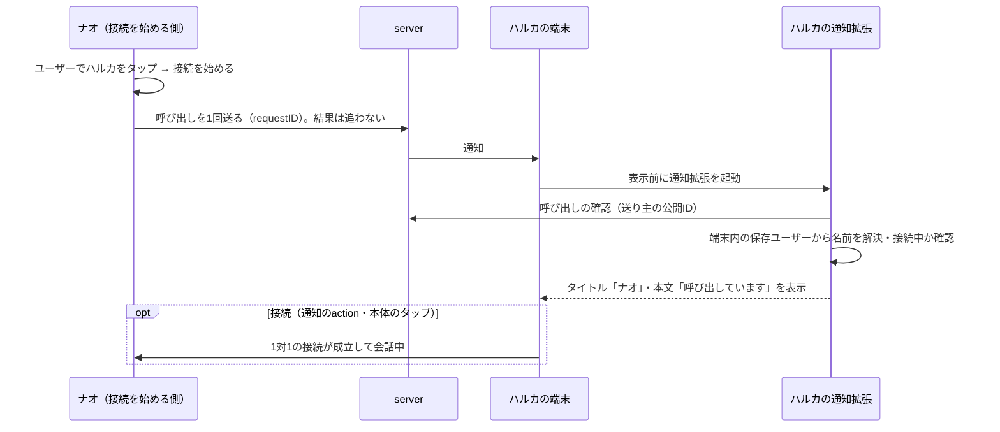

# RideCom 通知の設計

## 指示と背景

### 通知は親切な知らせ（2026-11-10の利用者判断）

2026-11-10・11の利用者判断により、通知を電話の着信として扱わない（[製品要求](../requirements/製品要求.md#利用者に提供すること)の「呼び出しは親切な知らせとして1回送り、会話の始め方は利用者に任せる」）。RideComはインカムやWeb会議と同じく、目の前でもインターネットでも「よーいドン」で同じ時間に入ったり、メッセージなど他の連絡手段も合わせて使ったりして会話を始める道具である。通知はそのうえで親切に添えるだけで、Zoomで最初の人が入ったと知らせるのに近い。CallKitは使わない。1対1もグループも決まった場所に集まるだけで、先に入った人は相手のいない場所で待ち、相手が同じ場所を選べば会話が始まる（[つながり方の前提](操作の流れ.md#つながり方の前提)）。

| 決めたこと | 内容 |
|---|---|
| 1対1 | 相手を選んで接続を始めるたびに、相手へ必ず1回だけ通知する |
| グループ | 通話の開始は誰にも通知しない。会話中に、自分と直接つながっている（個人で登録している）人だけを選んで、1回通知できる |
| 呼びっぱなし | 送った後は追わない。再送・応答待ちの表示・応答なしの表示・届けられない表示・取り消し・「もう一度呼び出す」・呼んだ側の呼び出し中の音を置かない |
| 拒否を置かない | 通知のaction「拒否」、拒否の送信と「今は応答できません」、拒否後の再呼び出しの制限を置かない。受け取った人は「接続」するか、何もしない |
| 鳴り続けない | 着信のように長く鳴らさない。期限で通知を置き換えたり「応答できなかった呼び出し」を出したりしない |
| 送れなくても同じ | 圏外・近距離だけ・相手の許可なし・相手の通知がオフで送れないときも、送った側の表示は変えない。相手のいない場所で待つのは正常な状態として扱う |
| 通知から切り替えない | 通知から入れても、今の会話を切り替える必要はない。別の場所に接続中は、「接続」も本体のタップも今の通話のシートを開くだけ（一覧の別の行のタップと同じ）。入るときは今の接続を切断してから選ぶ |
| OSの仕組みだけ | SwiftUIとOS標準の通知（`UserNotifications`、Notification Service Extension、通信の通知、割り込みレベル）だけで作る。CallKitは使わない。音・読み上げ・集中モードはOSに任せ、アプリで作らない |
| 後から来てよい | 通知が古くなっても、本体のタップ・「接続」は送り主の待つ1対1の場所を開く（一覧でその人を選ぶのと同じ）。送り主がもう切断していれば、今度は自分が場所に入って待つ |

2026-11-02の利用者指示により、通知を「どの場面で送るか」から設計し直す。指示の要点は次のとおり。

| 指示 | 本書での扱い |
|---|---|
| 1対1の通話開始は、通知を着信の代わりに使う（2026-11-10に改めた） | 1対1で接続を始めると、相手に「呼び出し」の通知が1回届く。誰からかが分かり、通知から接続できる。着信ではなく親切な知らせ（[通知は親切な知らせ](#通知は親切な知らせ2026-11-10の利用者判断)） |
| グループの通話開始は通知しない | グループを選んで接続しても、他のメンバーには何も届けない |
| すでにつながっている人からのグループ招待は通知する | 直接つながり、呼び出しを許可した相手からの「グループの呼び出し」（会話へ来てほしいという通知。[操作の語の意味](デザインシステム.md#操作の語の意味)により「招待」は仲間に入れる意味、「呼び出す」は会話へ来てほしい意味に分ける）は通知で届ける |
| グループの一部だけが会話しているときの巻き込みを防ぐ | グループの呼び出しは選んだ人にだけ届け、一斉通知・自動参加・会話中の割り込みを作らない（[巻き込みを防ぐ規則](#巻き込みを防ぐ規則)） |
| CallKitは使わないので普通の通知しか使えない | [製品要求](../requirements/製品要求.md)の「インカムを電話型の通話にしない」を維持し、標準の通知（`UserNotifications`）とその拡張だけで組む |
| 気軽に受け取れて、巻き込みもないこと | 標準の通知の仕組み（Notification Service Extension、通信の通知、割り込みレベル）だけで組む。音・合図・読み上げをアプリで作らない |

現行（2026-11-02時点）の通知は次の状態で、利用者から「中途半端」と指摘されている。

| 項目 | 現行 | 問題 |
|---|---|---|
| 通知の表示 | serverの固定文`CALL_REQUEST_TITLE`／`CALL_REQUEST_BODY`だけ。payloadは版・requestID・recipientIDのみ | 誰からの呼び出しかが分からない |
| action | 背景action「iPhoneで応答」1つ | 応答した後に、もう一度接続を押す必要がある |
| 鳴り方 | `sound: default`、通常の割り込みレベル | 接続中でも同じように鳴り、会話を遮る |
| 許可 | 設定の「Enable／Check／Disable Notifications」3つのボタン | いつ・なぜ許可するのかが分からない。確認ボタンは利用者の操作として意味がない |
| グループ | 通知なし | 会話中に仲間を呼ぶ手段が共有リンクだけ |

本書は通知の設計の正本である。操作の流れ（ストーリー）は[操作の流れ](操作の流れ.md)、画面の部品は[デザインシステム](デザインシステム.md)、設定画面の構成は[一般向けの画面構成](一般向け/画面構成とレイアウト.md#呼び出しの通知)、見本は[通知見本](通知見本.html)を参照する。現行の実装契約は[App通知仕様](../spec/App/通知仕様.md)と[server通知](../spec/server/通知.md)にあり、本書の設計と違う点は[現行との差と依存](#現行との差と依存)にまとめる。

## 通知を送る場面

| 場面 | 通知 | 理由 |
|---|---|---|
| 1対1で接続を始めた | 相手に「呼び出し」を1回送る | 1対1は相手も同じ場所を選ばないと成立しない。同じ時間に入るための親切な知らせ |
| インターネットにつながっていない（近距離だけ） | 送れない。送れなかったことも表示しない | 近くの仲間は声を掛け合って互いを選ぶ（[圏外で近くの仲間と始める](操作の流れ.md#圏外で近くの仲間と始める)） |
| グループを選んで接続した | 送らない | グループは各自が自分で選んで参加する。誰かが開くたびに全員の端末が鳴ると、話すつもりのない人まで巻き込む |
| グループの会話中に、来てほしい人を選んだ | 選んだ人にだけ「グループの呼び出し」を送る | 会話している本人が個人登録しており、通知が許可されている相手から明示的に選んだ人だけに届ける |
| 相手がグループに参加した・退出した | 送らない（会話の中の音と画面で知らせる） | 会話している人はすでにアプリの音声を聞いている |
| 招待のリンクを受け取った人が参加した | 送らない | 共有リンクは通知とは別の招待の手段 |
| 個人登録済みの相手をグループに招待した | 相手にグループを静かに届ける（[グループへの招待の配達](#グループへの招待の配達)） | 通話の開始と切り離して、相手の一覧にグループを入れる（[バックログ](../backlog/未実装課題.md#通知とアプリ外からの通話操作)の「保存済みの相手へgroup鍵を通知で届ける」）。呼び出しではないので鳴らさない |
| 相手・グループ・メンバーを削除した | 送らない（[招待と登録の設計](招待と登録の設計.md#削除と相手側への反映)） | 削除は次に一覧を見たときに反映されていれば足りる。不要な通知を出さない |

通知は「人が人を呼ぶ」ときと、グループが届いたことを知らせるときだけ送る。アプリの状態変化（接続の成立、経路の切替、音声機器の変化）は通知にせず、会話の中の音・触覚・画面で知らせる（[デザインシステム](デザインシステム.md#利用環境の前提)）。

## 通知の種類

| 種類 | 届く条件 | 割り込みレベル | 音 | action | 本体のタップ |
|---|---|---|---|---|---|
| 呼び出し（待機中に届く） | 呼び出しを許可した相手が1対1で接続を始めた。受け取る端末は接続していない | 通常（`active`） | OSの通知音1回（[音と振動](#音と振動)） | 「接続」 | 接続する |
| 呼び出し（接続中に届く） | 同上。受け取る端末が別の相手・グループと接続中 | 静か（`passive`） | 鳴らさない（OSの静かな通知。読み上げはOSの「通知の読み上げ」の設定に任せる） | 「接続」（待機中と同じcategory） | 今の通話のシートを開くだけ。切り替えない |
| グループの呼び出し（待機中に届く） | 呼び出しを許可した相手が、会話中のグループから自分を選んだ | 通常（`active`） | OSの通知音1回 | 「接続」 | 接続する |
| グループの呼び出し（接続中に届く） | 同上。受け取る端末が接続中 | 静か（`passive`） | 鳴らさない（OSの静かな通知。読み上げはOSの「通知の読み上げ」の設定に任せる） | 「接続」（待機中と同じcategory） | 今の通話のシートを開くだけ。切り替えない |
| グループへの招待（届いた） | 個人登録済みの相手が自分をグループに招待した | 静か（`passive`） | なし | なし | グループの一覧でそのグループの行を示す（グループタブを表示していなければ[表示の確認](一般向け/画面構成とレイアウト.md#グループタブの表示)） |

割り込みレベルの使い分け:

| レベル | 使う場面 | 理由 |
|---|---|---|
| 時間確定（`timeSensitive`） | 使わない | 通知は親切な知らせで、今すぐ知る必要がある情報ではない。集中モードを越えて知らせない |
| 通常 | 待機中に届く1対1・グループの呼び出し | 会話への誘い。集中モードを越えて知らせる必要はない |
| 静か | 接続中に届いたもの、グループへの招待（届いた） | 画面を点けず、音を鳴らさない。通知センターには残る |
| 緊急（`critical`） | 使わない | 健康・安全・治安の用途に限られ、インカムの呼び出しは該当しない |

## 1対1の呼び出し

### 呼び出しの時間の流れ

### 受け取る側の表示

通知の見た目は「通信の通知」（`INStartCallIntent`で内容を更新した通知）にする。送り主の名前を大きく、人の画像（保存ユーザーの画像がない場合はOSの既定表示）にRideComのアイコンを小さく重ねて出す。Dynamic Islandやロック画面で、どのアプリの・誰からの呼び出しかが一目で分かる。

| 状態 | 受け取る端末の条件 | 表示 | 鳴り方 |
|---|---|---|---|
| 待機中 | 接続していない | タイトル「ナオ」、本文「呼び出しています」、action「接続」 | 通常。OSの通知音を1回。マナーモードでは振動だけ（OSの規則） |
| 接続中 | 別の相手・グループと接続中 | 同じ表示を静かに通知センターへ置く | 画面を点けず鳴らさない（OSの静かな通知。読み上げはOSの「通知の読み上げ」の設定に任せる）。アプリは会話の音声に合図や読み上げを混ぜない |
| 名前を解決できない | 確認の通信が失敗した、または保存ユーザーにまだ反映されていない | タイトル「呼び出し」、本文「RideComの仲間が呼び出しています」、action「接続」 | 待機中・接続中の規則に従う |
| 送り主の場所にもう入っている | 受け取る端末が送り主本人との1対1に接続している（同じ時間に入った） | 同じ表示を静かに通知センターへ置く | 鳴らさない |
| 保存していない相手 | 送り主が現在の保存ユーザーにいない（削除済み・別アカウント） | タイトル「呼び出し」、本文「登録していない相手からの呼び出しです」、actionなし | 静か。接続の手段を出さない（現行の「削除済みの相手を復活させない」を維持） |
| 確認の期限が過ぎている | 確認の結果が期限切れ（server応答410）で、送り主を解決できない | タイトル「呼び出し」、本文「RideComの仲間が呼び出しています」。本体のタップはユーザーの一覧を開く | 静か |

通知の音・表示・読み上げはOSの仕組みに任せる。アプリが決めるのは通知の内容（誰から・どのグループか）と割り込みレベルだけで、独自の合図・読み上げ・音を会話の音声に混ぜない。AirPodsやCarPlayでの読み上げ、集中モードはOSの設定に従う。

### 応答の操作

| 操作 | 場所 | 動き |
|---|---|---|
| 本体のタップ | ロック画面・通知センター・バナー | ロック解除の後、アプリが開いて送り主との1対1の場所に入り、通話のシートを開く。別の場所に接続中なら切り替えず、今の通話のシートを開くだけ（入るときは今の接続を切断してから選ぶ）。もう一度「接続」を押させない。時間が経った通知でも同じで、表示したときに解決した送り主の場所を開く（[後から自分で入る](操作の流れ.md#後から自分で入る)） |
| 「接続」 | 通知の長押し（展開）、Apple Watch | 本体のタップと同じ。actionは`.foreground`（アプリを前面にする。ロック中は解除を求める） |
| 何もしない | — | 何も起きない。音は1回で止まり、通知はそのまま残る。送り主へは何も返らず、送り主は相手のいない場所で待つだけ（[通知を放っておく](操作の流れ.md#通知を放っておく)） |
| 通知を消す（スワイプ） | 通知センター | 何もしないのと同じ |

action「接続」には`phone.fill`の記号を付ける（`UNNotificationActionIcon`）。

ロック中の「接続」と本体のタップはロック解除が必要になる。CallKitを使わない標準の通知では避けられない制約であり、止まってから端末を取り出し、Face IDまたはパスコードで解除して応答する前提にする（[利用環境の前提](デザインシステム.md#利用環境の前提)）。

### 呼び出した側の表示

通話のシートは通話の状態のまま（接続中 → 相手が入れば会話中）で、呼び出しのための表示を足さない。送った結果、応答待ち、応答なし、届けられない、送れなかったを出さず、「呼び出しを取り消す」「もう一度呼び出す」「ほかの方法で知らせる」、呼び出し中の音も置かない（[通知は親切な知らせ](#通知は親切な知らせ2026-11-10の利用者判断)）。1対1の接続は相手が入るまで待機したまま続き、相手が通知や一覧から接続すれば会話が始まる（[相手のいない場所で待つ](操作の流れ.md#相手のいない場所で待つ)）。待てる長さの上限は自動切断の設定だけ。

### 自動の呼び出し

1対1の接続を新しく始めるたびに（一覧・Widget・Watch・Siriのどこからでも）、接続と同時に呼び出しを1回送る。すでに同じ1対1の接続にいる間は送らない。送った後の取り消し・置き換え・再送はしない。通知拡張は、受け取る端末が送り主本人との1対1に接続しているなら、静かに置く。インターネットにつながっていないときは送れず、後から送り直しもしない。

## グループの呼び出し

### 送れる条件

| 条件 | 内容 |
|---|---|
| 送る人 | そのグループの会話に接続している人。接続していない間（グループを選んでいない間）は送れない |
| 受け取る人 | 送る人が個人登録していて（直接招待で保存ユーザーになっている）、送る人からの呼び出しを許可している人。グループの中で会っただけの人には送れない（現行のgrantの規則と同じ）。画面での見せ方は[呼び出せる相手](招待と登録の設計.md#呼び出せる相手) |
| 対象 | そのグループの未接続のメンバー。「メンバーを招待」で加えた人も、届いた後に同じ「呼び出す」で呼ぶ（招待だけでは呼び出さない） |
| 1回の操作 | 1人ずつ、明示的に選ぶ。「全員を呼ぶ」操作は作らない |
| 繰り返し | 1回の操作で1回送る。送った後は追わない（拒否も、拒否後の制限もない） |

### 送り方

| 入口 | 表示 | 動き |
|---|---|---|
| 通話のシートのメンバー一覧 | 未接続のメンバーの行の末尾に「呼び出す」（glass、44pt以上）。条件を満たさない人には出さない（[呼び出せる相手](招待と登録の設計.md#呼び出せる相手)） | 押すとその人に呼び出しを1回送る。行の表示は変えず、送った結果も追わない。相手が入れば通常の会話中の行になる |

### 受け取る側の表示

| 状態 | 表示 | 鳴り方 |
|---|---|---|
| 待機中 | タイトル「ケンタ」、サブタイトル「週末ツーリング」、本文「呼んでいます（ハルカ・ユウが会話中）」、action「接続」 | 通常。OSの通知音を1回 |
| 接続中 | 同じ表示を静かに通知センターへ置く | 鳴らさない（OSの静かな通知。読み上げはOSの「通知の読み上げ」の設定に任せる） |
| 内容を読めない | タイトル「グループの呼び出し」、本文「RideComの仲間が会話に呼んでいます」 | 状態に従う |

「接続」と本体のタップは、待機中ならそのグループに接続して通話のシートを開く。グループがまだ届いていない場合は、呼び出しと一緒に届いたグループを保存してから接続する。接続中なら切り替えず、今の通話のシートを開くだけ。通知から今の会話を切り替える操作は作らない。

会話中の人の顔ぶれ（「ハルカ・ユウが会話中」）は、呼び出した人の端末が送る時点の会話中のメンバーを、受け取る人の呼び名で表示する。受け取る人が知らない人は本人の名前で表示する。

### グループへの招待の配達

個人登録済みの相手をグループに招待すると、そのグループ（参加に必要な鍵を含む）を相手へ届け、相手の一覧に自動で入れる。通話の開始とは切り離し、会話に参加しない人や遠くのメンバーにも事前に届く。

| 項目 | 内容 |
|---|---|
| 届く通知 | タイトル「{招待した人}」、本文「{グループ}に招待しました」。静か（音なし・画面を点けない）、actionなし |
| 届いた後 | グループの一覧に入る。グループタブを表示していない場合は、次にアプリを開いたときに[グループタブの表示](一般向け/画面構成とレイアウト.md#グループタブの表示)を1回だけ確認する |
| 招待した側 | メンバーの行の補足が「届けています」→ 届いたら通常のメンバー（[グループへの招待](招待と登録の設計.md#グループへの招待)） |
| 届けられない | 相手の端末へまだ届かない場合も、招待した側の表示は「届けています」のまま。接続できたときに届ける（リンクへの切替は利用者に求めない）。配達の認可条件・再送・取消・メンバー削除時の扱い・複数端末への配達は機能課題で決める |
| 内容の保護 | グループ名・鍵は端末間で暗号化し、serverは読めない（[現行との差と依存](#現行との差と依存)） |

### 巻き込みを防ぐ規則

2026-11-04の追加要求。通話中にグループ内から選んで通知する場合も、送信者が個人登録しているユーザーだけを通知対象とする。グループ所属だけでは通知できない。個人登録に加え、相手の通知許可と既存の認可条件を満たすこと。未登録・削除済みの相手へ通知できないと分かる候補表示と操作可否を設計する。機能の実装・送信時の再確認・回帰条件は[通知の機能課題](../backlog/未実装課題.md#通知とアプリ外からの通話操作)で追跡する。これは追加の設計要件であり、実装済みとは扱わない。

グループの一部の人だけが会話しているときに、他のメンバーや会話中の人を意図せず巻き込まないための規則。

| 場面 | 起こりうる巻き込み | 設計 |
|---|---|---|
| 誰かがグループを選んで接続した | メンバー全員の端末が鳴る | グループの開始は誰にも通知しない |
| 2人で話していて1人を呼びたい | 全員に届く | 選んだ人にだけ届ける。「全員を呼ぶ」操作を作らない |
| 呼ばれた人 | 誰と話すことになるか分からないまま入る | 通知に会話中の人を出す。参加は本人の「接続」だけで、到着だけでは接続しない |
| 呼ばれた人が別の会話中 | 鳴って今の会話を遮る。誤って切り替わる | 静かに届ける（OSの静かな通知）。通知からは切り替えない。入るときは今の接続を切断してから選ぶ |
| 会話中の人 | 突然知らない人が入ってくる | 呼び出せるのは会話中の人が選んだメンバーだけ。参加した人は短い参加音とメンバー一覧で全員に分かる |
| グループの中で会っただけの人 | 直接の関係がないのに呼び出せる | 直接つながり、呼び出しを許可した相手からだけ届く |
| 自分の別の端末 | iPhoneとiPadが両方鳴り続ける | 通知はOSの通知音1回だけで鳴り続けない。置き換えはしない |
| 一覧からグループを選んだ人 | 一部の人の会話に入ることになる | グループに参加するのは本人の選択として認める。会話中の人には参加音で知らせる |

## 応答できなかった呼び出し

置かない。通知は親切な知らせで、相手が入らなかったことを追わない（[通知は親切な知らせ](#通知は親切な知らせ2026-11-10の利用者判断)）。不在着信の通知・一覧の補足・バッジを出さない。

## 音と振動

| 音 | 鳴る場所 | 長さ | 設計 |
|---|---|---|---|
| 呼び出しの音 | 受け取る端末（待機中） | OSの通知音1回 | OSの既定の通知音（`UNNotificationSound.default`）。独自の音を作らない。マナーモード・サウンドのオフ・集中モードはOSに従う。着信のように鳴り続けない |
| 参加音・退出音 | 会話中の全員 | 約0.5秒 | 人が加わった・抜けたことを画面を見ずに知らせる |

通知の音はOSの既定の通知音を使い、端末の通知の設定（サウンドのオフ）とマナーモードに従い、アプリから越えない。参加音・退出音は通知ではなく会話の音声の一部で、素材はアプリに同梱する（`caf`形式）。

## 通知の許可を求める時点

起動直後やサインイン直後には許可を求めない。呼び出しを受け取る意味が分かる時点で、相手ごとの許可とOSの許可を1回の判断にまとめる。

| 時点 | 表示 | 「受け取る」を選んだとき |
|---|---|---|
| 人を登録した直後（相手が招待を受け入れて保存ユーザーに加わったとき） | 標準のアラート。タイトル「ハルカからの呼び出しを受け取りますか？」、本文「ハルカが呼び出したときに、この端末に通知が届きます。」、ボタン「受け取る」「今はしない」 | OSの通知の許可がまだならOSの許可シートを出し、端末を登録して、ハルカへの許可を発行する |
| 相手の設定の「この相手からの呼び出しを受け取る」をONにした | — | 端末の「呼び出しを受け取る」がOFFならまとめてONにする（OSの許可を含む） |
| 設定の「呼び出しを受け取る」をONにした | — | OSの許可と端末の登録。相手ごとの許可は変えない |

「今はしない」を選んだ場合は、同じ相手について再び聞かない。あとから相手の設定で変えられる。OSで通知が許可されていない場合の表示は[一般向けの画面構成](一般向け/画面構成とレイアウト.md#呼び出しの通知)に従う。

グループの呼び出しは、1対1の呼び出しと同じ相手ごとの許可（「この相手からの呼び出しを受け取る」）で受け取る。グループの呼び出しのための別の許可は作らない。

## 端末ごとの違い

| 端末 | 表示 | 応答 |
|---|---|---|
| iPhone | ロック画面・バナー・通知センター。通信の通知の見た目 | 本体のタップ・長押しの「接続」でアプリが開き、通話のシートを開く |
| iPad | iPhoneと同じ | 通話は右の列（`inspector`）で開く（[幅と高さによる配置](デザインシステム.md#幅と高さによる配置)） |
| Mac | 画面右上の通知。actionは「オプション」の中 | 「接続」・本体のクリックでウインドウを前面にし、右の列で通話を開く |
| Apple Watch | iPhoneから転送された通知。iPhoneと同じ文言と「接続」 | 「接続」は[未決事項](#未決事項)のとおり実機で確かめる |
| 同じアカウントの複数の端末 | 登録した端末（最大8台）のすべてに1回届く | 置き換えはしない |

## 文言

| 場面 | 日本語 | English |
|---|---|---|
| 呼び出しのタイトル | {名前} | {name} |
| 呼び出しの本文 | 呼び出しています | Calling you |
| 名前を解決できない呼び出し | 呼び出し／RideComの仲間が呼び出しています | Call / Someone on RideCom is calling you |
| 保存していない相手 | 呼び出し／登録していない相手からの呼び出しです | Call / Call from someone not in your list |
| グループの呼び出しの本文 | 呼んでいます（{名前}・{名前}が会話中） | Calling you to talk ({name} and {name} are talking) |
| 内容を読めないグループの呼び出し | グループの呼び出し／RideComの仲間が会話に呼んでいます | Group Call / Someone on RideCom is calling you to talk |
| action | 接続 | Connect |

通知はOSの表示であり、利用者が受け取るものなので、アプリの表示モード（一般向け・詳細表示）に関係なくStandardのUXとして上表の文言を端末の言語で表示する。Advancedのアプリ内の画面は、通知の状態を`CallNotificationStatus`などの実装の値で表す（[実装との対応表](詳細画面/診断と詳細画面の構成.md#実装との対応表)）。

## 実装の構成

| 部品 | 役割 | 注意点 |
|---|---|---|
| 通知のcategory | 呼び出し・グループの呼び出し（action「接続」）、actionなし（グループへの招待（届いた））の2つ | 現行の`RIDEINTERCOM_RESPOND_ON_IPHONE`（「iPhoneで応答」）は「接続」に置き換える |
| Notification Service Extension | 表示前に、呼び出しの確認（現行のGET）で送り主の公開IDを得て、端末内の保存ユーザーから名前を解決する。接続中かどうかで割り込みレベルと音を変える。`INStartCallIntent`で通信の通知に更新する。グループの呼び出しとグループへの招待は暗号化された内容を復号する | 処理時間はOSの上限（約30秒）内。確認の通信は8秒で打ち切り、解決できない場合は汎用の文言で表示する。拡張からも端末資格を読めるよう、Keychainの共有と「最初のロック解除後」の読取を設定する |
| App Groupの共有状態 | アプリが「接続中か」を書き、拡張が読む | アプリが強制終了した場合に接続中のまま残らないよう、アプリは接続中15秒ごとに時刻を更新し、拡張は45秒より古い値を「接続していない」として扱う |

### 実装の順序

| 順序 | 内容 | serverの変更 |
|---|---|---|
| 1 | category・action「接続」、本体のタップで接続、接続中は切り替えない | なし |
| 2 | 設定の切替1つへの整理と、人を登録した直後の許可の確認 | なし |
| 3 | Notification Service Extension、名前の解決、通信の通知、接続中の静かな表示 | payloadに`mutable-content`を付ける |
| 4 | グループの呼び出し（送り方・届く通知・巻き込みを防ぐ規則） | 呼び出しの種類と、serverが読めない暗号化した内容の受け渡し |
| 5 | Apple Watchの「接続」の実機確認 | なし |

## 現行との差と依存

| 項目 | 現行 | 本書の設計 | 依存・変更先 |
|---|---|---|---|
| 送り主の名前 | 固定文だけ | 拡張がGETで送り主の公開IDを得て、端末内で名前を解決する | serverに名前を渡さない現行の方針を維持できる。payloadへ`mutable-content`の追加が必要（[server通知](../spec/server/通知.md)） |
| 通信の通知 | なし | `INStartCallIntent`で送り主の名前と画像を出す | Communication Notificationsの機能追加。CallKitは使わない（[製品要求](../requirements/製品要求.md)の「インカムを電話型の通話にしない」と両立する）。審査と実機の表示は未確認 |
| action | 「iPhoneで応答」 | 「接続」 | [App通知仕様](../spec/App/通知仕様.md)のcategoryとaction |
| 本体のタップ | 応答処理へ渡し、通話先を開始 | 同じく接続する。接続中は現行どおり切り替えない | 現行の`allowSwitchingCall: false`を維持する |
| 時間が経った通知のタップ | serverの120秒の期限・取消で新しい開始を拒否する（[App通知仕様](../spec/App/通知仕様.md)のtapの再確認） | 期限は送り主の確認だけに使い、表示したときに解決した保存ユーザーとの1対1の場所を開く（一覧の行と同じ）。解決できていなければユーザーの一覧を開く | 通知拡張が解決した送り主を通知の内容に残し、tapの再確認を一覧の選択と同じ検証へ揃える |
| グループへの招待の配達 | 追加後に招待URLの共有を求める | 個人登録済みの相手へ、招待した時点でグループを届ける（静かな通知） | [group鍵の配達](../backlog/未実装課題.md#通知とアプリ外からの通話操作)（暗号化方式・認可・再送は未決） |
| グループの呼び出し | なし | 直接つながった相手から、選んだ人だけ | serverは名前・グループの情報を持たないため、呼び出しの内容は端末間で暗号化して渡す。既存メンバーへはグループの共有鍵、新しいメンバーへは直接招待で交換した鍵を使う方式を[通信仕様](../spec/App/通信仕様.md)の工程で決める |
| 許可の求め方 | 設定の切替1つ（`Receive Call Requests`）は実装済み。人を登録した直後の確認はない | 人を登録した直後に相手ごとの許可とまとめて聞く。設定は切替1つ | [一般向けの画面構成](一般向け/画面構成とレイアウト.md#呼び出しの通知) |

## 根拠

| 判断 | 根拠 |
|---|---|
| 通信の通知で名前を出す | [Implementing communication notifications](https://developer.apple.com/documentation/usernotifications/implementing-communication-notifications)。送り主を人として表示し、集中モードの「許可した人」の扱いもOSに任せられる |
| 表示前に端末内で内容を作る | [Modifying content in newly delivered notifications](https://developer.apple.com/documentation/usernotifications/modifying-content-in-newly-delivered-notifications)。serverに名前やグループを持たせない現行の方針（[server通知](../spec/server/通知.md)）を保ったまま、誰からかを表示できる |
| actionの種類 | [UNNotificationAction](https://developer.apple.com/documentation/usernotifications/unnotificationaction)の`.foreground`（接続はマイクと音声を開始するため前面が必要） |
| グループの開始を通知しない・グループの呼び出しは選んだ人だけ | 利用者の指示（2026-11-02）。グループは仲間が各自の都合で参加する場であり、一斉の通知は話すつもりのない人を巻き込む |
| 接続中は鳴らさず、知らせ方はOSに任せる | 走行中はアプリを操作しない前提（[製品要求](../requirements/製品要求.md#共通の品質方針)の「走行中の操作」）。鳴らしても応答できず、今の会話を遮るだけになる。読み上げや集中モードはOSが利用者の設定どおりに扱い、アプリが同じ仕組みを作り直さない（2026-11-11の利用者指示「読み上げはOSに任せる。通知はOSの仕組みだけにする」） |

## 未決事項

| 事項 | 選択肢 |
|---|---|
| Apple Watchの「接続」 | iPhoneのアプリを背景で起動して接続できるか（iOSが背景でのマイク開始を許すか）を実機で確かめる。できない場合はWatchの通知にはactionを出さず、本文に「iPhoneで接続してください」を出す |
