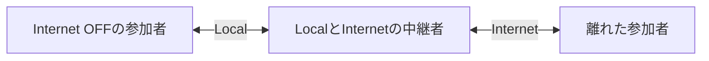

# 通話を始める・続ける・終える

このマニュアルは現在の画面と操作を説明する。Local、Internet、中継で音量やエフェクトの操作は共通。実機の音質・Bluetooth・画面ロックと実Cloudflare媒体は後続確認であり、自動テストの成功と区別する。

## 最初の準備

| 操作する場所 | 操作 | 確認する結果 |
|---|---|---|
| OS | マイク・Local Networkなど、使用する機能の権限を許可する | 拒否した場合はCallのエラーとOSの設定を確認 |
| Settings → Audio I/O | Input / Outputを選ぶ。選択肢が複数ある場合だけPickerを表示 | AutoはOSの既定。接続中のBluetooth / 有線機器と希望が一致するか確認 |
| Settings → Audio Check | 通話接続がない状態でRecord 5s and Play | 5秒録音して再生。これは自端末の確認であり、相手までの通信試験ではない |
| Audio Check実行中 | Stop Audio Checkで中断できる | 再実行可能。Connectを始めた場合も録音確認を終了する |
| Settings → Communication | Local Network / Internetを選ぶ | 既定は両方ON。最後の1経路はOFFにできない。変更は現在の接続を終了する |

Audio Checkが押せないときはCallでDisconnectする。Groupsへ戻るだけでは通話は終わらない。設定の具体的な効果は[設定と音声効果](設定と音声効果.md)を参照する。

## グループを作る・参加する

| 場面 | 操作と挙動 |
|---|---|
| 新しく始める | Call → Groups → Create Talk Group。現状の新規名はTalk Group固定。作成後に選択する |
| 保存済みgroupへ入る | Groupsで行を選択。既存のactive groupがなければ接続を開始し、相手の認証後に音声を開始する |
| 招待する | CallのInviteからOS共有画面を開く。同じgroupの招待URLを相手へ渡す |
| 招待を受ける | 端末で招待URLを開く。形式・期限を検査しgroupを保存して選択。別group通話中ならその通話を維持し、新groupは閲覧状態になる |
| 切断後に入り直す | 選択中groupのConnect |
| 別groupを見たい | Groupsへ戻って別groupを選ぶ。既存通話は続く |
| 通話先を変えたい | 別groupを表示してConnect。旧通話を終了して新groupへ接続する |
| 終了する | 通話中groupのDisconnect。タブ移動・Groupsへの戻りとは異なる |

招待URLはgroupの秘密情報を含む。公開投稿せず、参加者へ共有する。group招待とInternet用の端末資格は別物である。

## 通話中の操作

| 操作 | 相手や通信への影響 |
|---|---|
| InputのMute | 自分の音声送信を止める。自端末が担当する他者の中継は維持 |
| OutputのMute | 自分に聞こえる音を止める。自分のマイク送信とは独立 |
| Output Volume | 自分が聞く全員の音量を調整。OSの音量ではない |
| 参加者のOutput | その相手だけ自分に聞こえる音量を調整。相手の端末音量・他の聞き手には反映しない |
| 参加者 / OutputのVoice Isolation | 自分の受信再生へ適用。中継payloadへは適用しない |
| SettingsのTransmit Voice Isolation Effect | 自分から送る音声へ適用。対応環境でのみ表示 |
| 参加者Delete | ローカルの保存メンバー表示を削除する操作。ネットワークのアクセス禁止・資格失効ではなく、再度presenceを受ければ現れ得る |
| GroupsのDelete | 保存groupを削除。active groupを削除するとその通話を切断 |

## Local / Internet / 中継の考え方

| 変化 | 期待する動作と制約 |
|---|---|
| 全員が近い | Localの到達経路を使う |
| 一部が離れる | Internetや近くの中継者を通る経路があれば通話を維持。切替時の短い音声欠落はあり得る |
| 自分のInternetがOFF | 自端末のサービス接続を止める意味。近くの人を経由した遠方との通話まで禁止する意味ではない |
| 中継者がMute / 音声機器を失う | その人の送受話は停止しても他者の中継は維持 |
| 最後の中継者が切断 / 圏外 | 分断した側同士の通話は不可能。各側の残る経路で継続し、復帰を待つ |
| 一部Internet接続が失敗 | 正常なLocal通話を巻き込んで切らず、理由を表示して再試行 |
| Local / Internetの設定を手動変更 | 自動的な経路復旧とは異なり、現在の接続を終了。Connectで再接続する |

中継する端末の電池・通信量を使う。経路表示はその端末の接続概要であり、全員への直接接続や全員が聞けた証明ではない。[状態の見方](状態の見方.md)と[通信仕様](../spec/App/通信仕様.md)を参照する。

## Bluetooth・有線機器が外れた場合

使用中の機器が失われるとAudio Pausedを表示して自分の入力・出力を停止する。意図せずスピーカーへ会話を流さないため、機器が戻っただけでは自動再開しない。出力先を確認し、認証済みの相手がいる状態でResume Audioを押す。失敗理由が残る場合は[切り分け](困ったとき.md)へ進む。接続・中継は停止中も維持し、マイク・出力muteの選択も保持する。

## Internetを初めて試す

| 担当 | 手順・完了条件 |
|---|---|
| サービス運用者 | [Workerの初期設定と試用](../spec/server/Worker.md)に沿ってSFU App、Worker、利用枠、個別端末資格を準備。秘密はWorkerに置く |
| 各利用者 | Settings → Configure Internet ConnectionでWorkerのHTTPS originと、その端末のDevice access tokenを保存。保存成功時は現在の通話を終了 |
| 各利用者 | Diagnostics → Check Internet Serviceで認証と利用枠を確認。Authorizedだけでは音声・SFU接続成功ではない |
| 全参加者 | 同じgroup招待で参加し、互いの声を確認する。Internetのみを試すならLocal NetworkをOFFにして再接続 |
| サービス運用者 | [費用試算](../spec/server/Cost.md)と実際の使用量を比較。参加者秒の予約上限は請求額の厳密な上限ではない |

端末資格はKeychainへ保存し再表示しない。失効は運用者側で行う。公開向け本人確認・abuse対策、TURNによる制限回線対応、実アカウントでの請求確認は未完了である。
