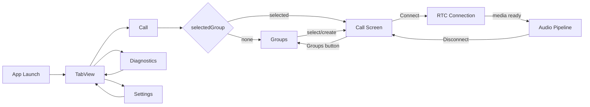

# RideCom 共通画面遷移

## 目的

本書は、現行のRideCom App の画面間遷移の共通ルールを定義する。

個別状態遷移は `docs/spec/App/UI/画面・状態遷移.md`、画面項目は `docs/spec/App/UI/画面項目定義.md` から参照する画面別文書を正とする。

## サインイン直後の名前の入力

サインイン後、本人の名前を一度も保存していなければ（`needsDisplayNameChoice`）、iOSは閉じられない全画面、macOSは閉じられないsheetで名前の入力（`displayNameChoice`）を出す。既定の「You」は選んだ名前として扱わない。この印より前に「You」以外の名前を保存していた人は決定済みとする。

| 項目 | 識別子 | 表示と操作 |
|---|---|---|
| 見出し | — | 「あなたの名前」（Your Name） |
| 入力 | `displayNameChoiceField` | 空欄で開き、表示時にフォーカス。プレースホルダ「例: ナオ」、iOSは`textContentType(.nickname)`。footerに「仲間に表示される名前です。本名でなくてかまいません。」 |
| 主要操作 | `displayNameChoiceSaveButton` | 「はじめる」。有効な名前の間だけ有効。既存の`setLocalDisplayName`で保存し、成功で閉じて一覧へ進む |
| 保存失敗 | `displayNameChoiceError` | 理由1文を表示し、主要操作を「もう一度試す」に変える |

保存後の変更はSettingsの`localDisplayNameField`で行う。検証ビルドのUI fixtureはサインイン済みで名前を決定済みとして起動し、`RIDEINTERCOM_NAME_PROMPT=1`のときだけこの入力を出す。

## StandardとAdvancedの選択

初期のStandardはUsers / Groups / Settings（AdvancedはDiagnosticsを加える）で、最初はUsers。通話はタブではなく、選んだ接続先を`inspector`で開き、切断で閉じて一覧へ戻る。相手・groupの既存行選択は`openDestination`で、待機中ならその場で接続を始めてCallへ移る。現在の通話先なら再接続せずにCallへ戻り、別の通話中なら切替を確認してから置き換える（キャンセルで現在の通話を維持）。新group作成の確定と招待URL受理は既存の共通開始規則を使う。Settingsの表示切替では通話状態を変えず、切替後に存在しないタブ（標準表示での診断）だけUsersへ移す。

以下の従来の3タブと一覧選択時の自動接続はAdvancedの遷移。認証・削除復旧のroot分岐は両表示で共通とする。

## 共通ルール

| 操作 | 遷移 | 接続への影響 |
|---|---|---|
| App 起動 | Call タブを開く | 接続は開始しない |
| group 未選択 | Groups 画面を表示 | 接続は開始しない |
| group 選択 | Call 画面へ進む | active groupがなければ接続を開始し、認証後にmedia開始。他group通話中は閲覧のみで既存通話を維持 |
| Groups ボタン | Groups 画面へ戻る | 既存接続は維持する |
| Diagnostics タブ | Diagnostics 画面へ移動 | 接続と media は維持する |
| Settings タブ | Settings 画面へ移動 | 接続と media は維持する。設定変更は可能な範囲で即時反映する |
| deep link invite 成功 | Call タブへ移動し、参加 group を選択する | selectGroupと同じ規則。他group通話中はConnectで明示切替 |
| Disconnect | RTC connection と App audio pipeline を停止する | 明示的に停止する |

## 遷移図

## 非同期処理中の画面遷移

| 処理 | 画面遷移時の扱い |
|---|---|
| RTC 接続中 | タブ移動では継続する |
| media 開始中 | タブ移動では継続する。失敗時は Call と Diagnostics に反映する |
| Audio Check | Settings を離れても進行状態は保持する。Call で media 開始する操作とは競合させない |
| invite 受理 | 共通操作が試行開始時に前の成功・失敗表示を消し、結果をApp状態へ保存する。URL入口はCallへ戻り、Standard／Advancedとも選択言語で表示する |

## 招待受理の失敗と再試行

| 結果 | 表示・復帰操作 |
|---|---|
| 有効期限切れ | 期限切れを示し、送信者へ新しい招待を依頼する |
| 非対応の招待version | Appの更新と新しい招待の取得を案内する |
| 不正なURL・形式・署名・本人証明 | 招待を確認できないことと、新しい招待の取得を案内する。受け取った秘密・URL・生の内部エラーを表示しない |
| 別人宛て・通話種別の不一致・通話中の鍵変更 | 既存の個別理由を維持する。鍵変更は終話後に同じ招待を開き直す |
| 保存失敗・本人情報の衝突 | 保存処理が示した理由と復旧操作を維持し、招待の無効へ置き換えない |
| 再試行成功 | 失敗表示を消し、受理したグループの成功状態へ更新する |

無効な招待では保存済みグループ・鍵・進行中の通話を変更しない。招待URLを永続的な再試行台帳へ保存せず、送信者から受け取ったリンクを再度開く。
