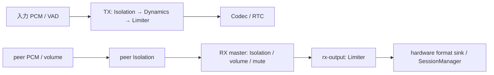

# RideIntercom App 音声処理仕様

## 目的

本書は、作り直す RideIntercom App が音声系 package をどう組み合わせるかだけを定義する。

音声処理の詳細は `docs/spec/packages` を正とし、本書では App 本体に残る責務だけを扱う。

## 責務境界

| 領域 | App 本体の責務 | 詳細仕様 |
|---|---|---|
| Audio Session | media 開始/終了に合わせて session を構成し、入出力デバイス選択を渡す | `docs/spec/packages/Audio/SessionManager.md` |
| 入力処理 | マイク権限、ミュート、他音声ダックのユーザー設定を保持する | `docs/spec/packages/Audio/SessionManager.md` |
| VAD / gate | App 設定から VAD 感度 preset を選び、送信可否や発話表示へ使う | `docs/spec/packages/Audio/Effectors/VADGate.md` |
| codec | App の codec UI 設定を Codec / RTC の codec policy へ渡せる形に変換する | `docs/spec/packages/Audio/Codec.md`、`docs/spec/packages/RTC.md` |
| mixer / output | master 音量、出力ミュート、参加者別音量を反映する | `docs/spec/packages/Audio/Mixer.md` |
| effect | App が使う effect の有効/無効を決める | `docs/spec/packages/Audio/Effectors/*.md` |
| transport | 符号化済み音声の配送、packet audio、WebRTC接続lifecycle は RTC に委譲する | `docs/spec/packages/RTC.md` |

## 基本方針

| 項目 | 方針 |
|---|---|
| 接続と音声 | 接続確立と media 開始を分ける。peer 認証前にマイクやスピーカーを起動しない |
| OS 差分 | iOS / macOS の Audio Session 差分は App で直接扱わず、SessionManager に渡す |
| 高頻度処理 | frame、packet、jitter、codec の詳細値は App 仕様に重複定義しない |
| 設定 | 設定値は本書に重複定義せず、`docs/spec/App/setting parameters` に集約する |
| 診断 | App は package の runtime report / event を要約し、ユーザーが状態を理解できる値だけを表示する |
| ログ | App は package 操作結果を `docs/requirements/log.md` に従って構造化ログへ変換する。高頻度 frame は通常ログに出さない |

## Package runtime 入力

App は音声 package の設定や状態を App 独自の表示 model で作り直さない。Diagnostics と RTC 送信用の現在値は package が返す snapshot / report / runtime state を `RTCRuntimePackageReport` に詰める。

| package | App が保持する package runtime 入力 | 用途 |
|---|---|---|
| AudioMixer | `AudioMixerSnapshot` | TX bus、RX peer bus、RX master bus、route、output bus、effect chain、graph 描画 |
| Codec | `CodecRuntimeReport` | requested codec、selected codec、fallback、codec option summary |
| VADGate | `VADGateRuntimeSnapshot` | speech / silence、noise floor、threshold、gate gain |
| SoundIsolation | `VoiceIsolationRuntimeSnapshot` | 接続した実ノードのactive / bypassed。未生成時はruntime reportを送らない |
| DynamicsProcessor | `DynamicsProcessorRuntimeSnapshot` | 接続した送信ノードの設定と状態 |
| PeakLimiter | `PeakLimiterRuntimeSnapshot` | TX と RX master の limiter stage 表示 |
| SessionManager | `AudioSessionConfigurationReport`、`AudioSessionOperationReport`、`AudioStreamOperationReport` | session resolved 設定、input/output stream、voice processing の適用結果 |

| 更新契機 | 仕様 |
|---|---|
| 接続 / media lifecycle | connect、standby、media start、media stop、disconnect で最新 report を生成する |
| 設定変更 | codec、bitrate、VAD、mute、ducking、output mute、master volume、peer volume、SoundIsolation 有効状態の変更で即時生成する |
| stream / session report | SessionManager の operation report を受け取った時点で即時生成する |
| 音声 tick | 通話中は 0.5 秒以上の間隔で定期生成する |
| RTC 連携 | 生成した report 配列を `CallSession.updateRuntimePackageReports(_:)` へ渡し、RTC の runtime status に同梱する |

## 設定値

音声関連の App 設定、既定値、永続化、package へ渡す値は `docs/spec/App/setting parameters/App/設定値一覧.md` を正とする。

## 音声 lifecycle

| タイミング | App の動作 |
|---|---|
| 接続準備 | Audio Session、入力監視、出力 renderer は開始しない |
| peer 認証完了 | RTC の media 開始条件を満たしたら、App の音声 pipeline を開始する |
| media 開始 | SessionManager を構成し、入力、VAD、codec、mixer / output を接続する |
| media 停止 | 入力、出力、mixer を停止する。Audio Sessionの非活性化は所有者が指定した場合だけ行う |
| 入力設定変更 | Duck Other Audio、ローカルマイクミュートは `AudioInputStreamCapture.updateVoiceProcessing(_:)` で即時反映する |
| effect設定変更 | Voice Isolation Effect は SoundIsolation effect chain の有効/無効として扱い、SessionManager の voice processing へは渡さない |
| codec / RTC format 設定変更 | `preferredTransmitCodec`、codec option、`rtcAudioFormatPreset` は audio pipeline、Codec、RTC policy へ同時に反映し、利用不可なら fallback 結果を Diagnostics とログへ出す |
| 出力設定変更 | volume / mute は Mixer bus へ即時反映する。出力 device 変更だけは SessionManager / output renderer の report を確認する |

## Mixer 構成

App は AudioMixer 上で、送信用のマイク入力系統と受信用の参加者入力系統を分けて扱う。

### マイク入力側

マイク側は SessionManager で Audio Session、Duck Other Audio、入力ミュートを構成したうえで、マイク入力を送信用処理へ入れる。Voice Isolation Effect は SessionManager の input voice processing ではなく、SoundIsolation effect chain で扱う。

| 順序 | 処理 |
|---|---|
| 1 | SessionManager で Audio Session、入力デバイス、入力 stream format を構成する |
| 2 | `AudioInputStreamCapture` で他音声ダック、入力ミュートを初期適用してマイク入力を取得する |
| 3 | AudioTransmissionController が VADGate で発話・preroll・keepaliveを判断し、送信対象PCMをAudioMixerのTX sourceへ入れる |
| 4 | TX busでformat変換・PCMの時間順処理とSoundIsolation → DynamicsProcessor → PeakLimiterを適用する |
| 5 | AudioMixer の TX sink を `rtcAudioFormatPreset` の target format で受け取り、Codec で encode して `RTCAudioPacket` として RTC へ渡す |

### 送信用 effect chain

送信用 effect chain は固定分岐ではなく、AudioMixer package の `AudioMixerSnapshot` に含まれる `tx-bus` の `MixerBusSnapshot.effectChain` を正とする。App の `transmitEffectChainSnapshot` は package snapshot から UI stage metadata へ写す薄い adapter であり、Diagnostics はこの snapshot を描画するだけで、effect の既定値や stage 配列を持たない。

| 処理 | 現在の適用箇所 | 検証状態 |
|---|---|---|
| VADGate | Mixerの前段。発話判定、preroll、無音時keepaliveを制御 | package / App単体テスト |
| input mute | SessionManagerの入力設定とAppの送信gate | App単体テスト |
| SoundIsolation | TX / RX peer / RX masterに実ノードを接続。無効設定時は実Audio Unitをbypass | offline graph / 設定反映テスト |
| DynamicsProcessor / PeakLimiter | TXにDynamicsProcessorとPeakLimiter、受信出力直前にPeakLimiterを接続 | 実Audio Unitとoffline PCMテスト |

旧DiagnosticsはAVAudioMixerNodeを仮のeffectとして並べた別グラフを生成していた。現在はその生成処理を廃止し、実際の `AppAudioPipeline.snapshot` だけを使用する。実Audio Unitを接続したgraphを表示し、生成前・停止後はruntime stageを表示しない。

## 他音声ダック

`Duck Other Audio` のユーザー設定、実際の有効条件、SessionManager へ渡す値は `docs/spec/App/setting parameters/App/設定値一覧.md` と `docs/spec/App/setting parameters/packages/Audio/SessionManager.md` を正とする。

OS API の適用方法、入力ノード、ducking level の詳細は `docs/spec/packages/Audio/SessionManager.md` を正とする。

## Codec UI 設定

送信 codec のユーザー設定、bitrate、fallback の扱いは `docs/spec/App/setting parameters/App/設定値一覧.md` と `docs/spec/App/setting parameters/packages/Audio/Codec.md` を正とする。

| 状態 | App の扱い |
|---|---|
| 要求 codec が利用可能 | `CodecRuntimeReport.selectedCodec` を `CodecEncodingConfiguration.codec` と `RTCAudioPolicy.preferredCodecs` の先頭へ反映し、`RTCAudioPolicy.preferredSendFormat` は `rtcAudioFormatPreset` と一致させる |
| 要求 codec が現在環境で利用不可 | `CodecRuntimeReport` の fallback 結果に従い、`pcm16` fallback が可能なら通話を継続し、Diagnostics に fallback 理由を出す |
| decode 失敗 | 該当 frame を破棄し、受信 drop として扱う |
| Local / Internet / 中継 | 同じCodec設定とMixerを使用。SDKのnative音声trackは使わない |

## Audio Check

Audio Check は App 本体の診断機能として残す。

| 項目 | 仕様 |
|---|---|
| 目的 | マイク入力とスピーカー出力をユーザーが単独で確認できるようにする |
| 実行条件 | 通話 media が開始していない時だけ実行する |
| 録音 | 5 秒間マイク入力を取得し、入力メーターを表示する |
| 再生 | 捕捉時のPCMFrameのformatを保持し、AudioMixerで実出力formatへ変換して5秒間再生する。サンプルを別formatとして再ラベルしない |
| 失敗 | 権限拒否、入力なし、session 構成失敗をユーザーに分かる状態として表示する |
| 終了 | 一時的に使った audio pipeline を解放し、通話状態へ影響させない |

## 表示する音声状態

| 表示 | 意味 |
|---|---|
| マイク権限状態 | 未決定、拒否、許可を区別する |
| ローカル発話状態 | VAD / gate の結果から表示する |
| 入力レベル | マイク入力の現在レベルを表示する |
| 出力レベル | 最終出力へ渡した音声レベルを表示する |
| 参加者別レベル | 受信した peer ごとの音声レベルを表示する |
| Audio Check 状態 | recording、playing、completed、failed を表示する |

## 異常時

| 事象 | App の扱い |
|---|---|
| マイク権限未決定 | 権限要求中として表示し、許可後に再試行できるようにする |
| マイク権限拒否 | 設定変更が必要な状態として表示する |
| 入力/出力デバイス適用失敗 | 通信失敗とは分けて、音声デバイスの問題として表示する |
| 音声 pipeline 開始失敗 | 接続状態とは分けて、media 開始失敗として表示する |
| codec / packet / route の失敗 | App で詳細を再定義せず、RTC / Codec から受け取った error を要約表示する |

## ログ

| 事象 | Event | Level | metadata |
|---|---|---|---|
| media 開始成功 | `audio.media.started` | `.info` | `operationID`, `route`, `codec` |
| media 開始失敗 | `audio.session.failed` | `.error` | `operationID`, `errorType`, `isRecoverable` |
| 入出力 device / route 変更 | `audio.session.route_changed` | `.notice` | `operationID`, `reason` |
| voice processing 更新 ignored | `audio.input.voice_processing_ignored` | `.debug` | `operationID`, `reason` |
| voice processing 更新失敗 | `audio.input.voice_processing_failed` | `.warning` | `operationID`, `errorType`, `isRecoverable` |
| output schedule 失敗 | `audio.output.schedule_failed` | `.warning` | `operationID`, `errorType`, `isRecoverable` |
| codec fallback | `audio.codec.fallback` | `.notice` | `requestedCodec`, `selectedCodec`, `reason` |
| decode 失敗 | `audio.codec.decode_failed` | `.error` | `codec`, `errorType`, `isRecoverable` |

音声 sample、encoded payload、frame ごとの通常処理はログへ出さない。ログ仕様の正本は `docs/requirements/log.md` と `docs/spec/App/ログ仕様.md` とする。

## 移管済みとして本書に書かないもの

| 領域 | 参照先 |
|---|---|
| VAD の attack / release / noise floor | `docs/spec/packages/Audio/Effectors/VADGate.md` |
| Audio Session category / mode / option | `docs/spec/packages/Audio/SessionManager.md` |
| voice processing / advanced ducking API | `docs/spec/packages/Audio/SessionManager.md` |
| codec payload / availability / fallback | `docs/spec/packages/Audio/Codec.md` |
| mixer bus / effect chain / output format | `docs/spec/packages/Audio/Mixer.md` |
| packet audio / jitter / relay | `docs/spec/packages/RTC.md` |

## 起動・停止とcallback所有

| 操作 | 処理 |
|---|---|
| 入力・出力・Mixer途中起動失敗 | 開始済み入力、出力、Mixer、media、tickerを共通停止処理で解放し、同じgroupで再試行できる |
| 通常停止 / 起動失敗 | sessionの無条件非活性化はしない。所有者が活性状態を管理する |
| Audio Check終了・中断 | 所有する入力・出力・Mixerを停止し、sessionを非活性化。録音フレームを解放する |
| Audio Checkから通話 | timerと世代を無効化してAudio Checkを終了後、通話用入力・出力を開始する |
| 古い入力 / Mixer callback | 音声世代またはグラフ世代が異なる場合は破棄する |
| 切断peer | 該当PCM sourceの未再生データを停止で破棄し、他peerのsourceは維持する |
| 出力時刻 | output callbackの受信時刻を壁時計で記録する。AVAudioTimeのhostTimeを壁時計と混同しない |

自動テストはオフラインAVAudioEngineと偽のハードウェア境界を用いる。実デバイスの音質、ロック中継続、経路切替は未確認。

## エフェクトの実配線

| 状態・操作 | 契約 |
|---|---|
| TX / RX peer / RX master Isolation | 対応環境では実nodeを保持。設定変更時はbypassを即時反映し、Mixer再構築・media再起動を行わない |
| Isolation非対応 | 実nodeは挿入しない。support reportで非対応を区別し、操作を非表示にする |
| Dynamics / Limiter生成・設定失敗 | 起動を失敗として扱い、既存の共通停止処理で部分graphを解放する。保護なしで成功扱いしない |
| RX master音量 | rx-masterのfaderへ適用し、その後のrx-output busのLimiterで最終ピークを抑制 |
| Audio Check | rx-outputのLimiter経由で再生。任意Isolationは無効。音声機器確認に不要なノイズ処理を掛けない |
| 診断 | 接続したeffectのruntime snapshotとMixer metadataを使用する。要求設定と実行状態を分ける |
| 実機音質 | 自動検証は実Audio UnitのPCM処理・配線・制御・解放を対象とする。風切音・会話品質・聴感評価は実機確認へ残す |

## Local / Internet 共通の音声所有者

| 対象 | 所有と処理 |
|---|---|
| capture / render | 全production routeでSessionManager。WebRTC SDKのマイクは開始しない |
| Mixer / Codec | Local / SFU DataChannelで共通。選択codec、VAD、TX/peer/master effectと音量を適用 |
| 中継端末 | 符号化済みpayloadをRTCが転送。中継者のmute、音量、effectを他人の音声に適用しない |
| mute / stopMedia | 自分の送受話だけ停止。接続がある間は他者の中継を維持 |
| 経路追加・喪失 | 音声所有者を変更せず、同じMixerと入出力を維持 |
| 診断 | 実際に処理するpacket / PCM / effect snapshotを表示。未提供のRTT/lossを正常値に置換しない |

## 音声機器の変化

| イベント | 挙動 |
|---|---|
| 使用中の機器消失、oldDeviceUnavailable、利用可能routeなし | 自分の入力・出力・Mixer・tickerを停止。接続・中継は維持し、Audio Pausedと理由をCallへ表示。スピーカーへの意図しない再生を避ける |
| 認証・presence更新 | 機器消失後は自動で送受話を再開しない |
| Resume Audio | 接続済みpeerがいる場合に再試行。成功時に停止表示を解除。失敗時は資源を解放して再試行可能。muteの意図を維持 |
| 実際のdefault入出力変更 | systemDefault選択値が同じでも、snapshotのcurrent device差を検知して入出力とMixerを再構成 |
| 再構成失敗 | 音声稼働中と表示せず、Audio Pausedと理由・再開操作を表示 |
| Audio Check中の機器変更 | 録音・再生と旧完了Taskを中断し、再実行を案内 |
| configuration report | snapshotだけ反映。設定中に再帰的な再起動をしない |
| Disconnect | 再開待ち表示と経路状態を初期化 |

実機Bluetooth・有線の通知順、音質、画面ロック中の継続は未確認。自動テストではSessionManagerのruntime eventを入力し、資源解放・接続維持・再試行を検証する。

## 経路共通の操作とcallback配送

| 項目 | 実装契約 |
|---|---|
| UI | Internetでも個別音量、マスター音量、入力・出力、VAD、Codec、effect、meterを同じ画面で操作する。非対応effectだけOSのsupport reportに従う |
| 旧所有権分岐 | AppのusesRouteManagedAudio / audioOwnershipChanged / supportsPacketAudioControlsを廃止。経路による音声graphの分岐を持たない |
| PCM callback | AudioFrameDeliveryで入力・TX sink・RX sinkのactor間配送を共通化。各32件・100msまで、古いフレームは破棄。DSPは行わない |
| RTC送信への受け渡し | 制御操作は直列。音声は進行中1件と最新待ち1件だけ保持し、待ち100ms超過は送らない。stop/mute/接続世代変更で待ちを破棄 |
| RTC受信からViewModel | actor内で直接渡す。無制限のmain queueへ再投入しない |
| 停止 | callback consumerをcancelし、generationを更新。停止済みgraphの入力・送信・出力を拒否 |
| 中継と個別音量 | 中継packetはMixerに戻さずRTCでopaque転送。聞き手のpeer volume/effectはその聞き手の再生だけに適用 |

100msは各アプリケーション境界の待ち期限で、OS/SFU/機器を含む端末間遅延の上限ではない。ネットワーク配送の件数・期限・再送契約は[RTC仕様](../packages/RTC.md)を正とする。

## 通話の再生予約

| 境界 | Appから指定する設定 |
|---|---|
| 通話TX / RX peer source | `maximumBufferedDuration = 0.1`。予約超過は当該sourceだけ古い予約を解放し、effect・他peer・接続を維持 |
| hardware output | `AudioOutputStreamConfiguration.intercom`で100ms。連続して古い音声を再生しない |
| Audio Check source | nil。5秒分の録音予約を保持し、engineの通常速度でhardware outputへ流す |
| 診断 | Mixer sourceとSessionManager snapshotの予約時間・リセット回数を使用。未提供backendはnilのまま扱う |
