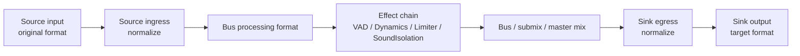
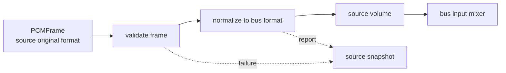
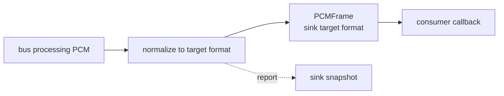
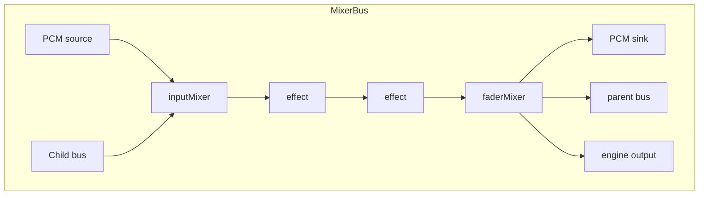

# AudioMixer 仕様

`AudioMixer` は送信と受信で同じ形に使う PCM graph package である。format差、peer差、effect配置、音量、mix、最終出力をここで吸収する。

この仕様書は、利用者が mixer graph を安全に組み立て、改修者が format 正規化や graph 変更の影響範囲を判断できることを目的とする。

## 実装の責務配置

公開APIと処理順は維持し、変更理由ごとに実装を分離する。状態とlockは元の所有者に置き、分割のための公開APIや中間protocolは追加しない。

| ファイル | 所有する責務 |
|---|---|
| `AudioMixer.swift` | bus間のgraph接続、bus所有、graph snapshot |
| `MixerBus.swift` | 所属node/effect/tapの寿命とメタデータ同期 |
| `MixerPCMPorts.swift` | source再生待ちとsink配信 |
| `MixerPCMNormalizer.swift` | PCM形式変換とbuffer境界 |
| `MixerModels.swift` | 公開snapshot・errorの値型 |

## Package Profile

| 項目 | 仕様 |
|---|---|
| パス | `RideIntercom/packages/Audio/AudioMixer` |
| Product | `AudioMixer` library |
| 依存 | `AudioCore` |
| 実装基盤 | `AVFAudio`, `AVAudioEngine`, `AVAudioMixerNode` |
| 対応プラットフォーム | iOS `26.4` 以降、macOS `26.4` 以降 |
| Swift | Swift `6` |
| テスト | Swift Testing の SwiftPM テスト |

## Boundary

| 持つ | 持たない |
|---|---|
| PCM source / sink | Audio Session |
| source ingress正規化 | hardware capture / render |
| sink egress正規化 | codec encode / decode |
| bus graph / submix / master mix | RTC route / packet / encryption |
| effect chain | OS voice processing |
| source / bus / master volume | AudioCoreのPCM語彙定義 |

## Background

RideIntercom の音声経路では、送信と受信の両方で次の差分が同時に発生する。

| 差分 | 発生元 | Mixerで吸収する理由 |
|---|---|---|
| sample rate差 | hardware input、decoded packet、codec target、output hardware | effect chain と bus mix を安定したformatで動かすため |
| channel count差 | mono mic、stereo output、peer packet | sourceごとの違いを bus へ持ち込まないため |
| peer別音量 | remote peer、local monitor | transportやcodecではなく音声graphの状態だから |
| effect順序 | VAD、Dynamics、Limiter、SoundIsolation | effectはbus processing format上でないと結果が安定しないため |
| send / receive差 | capture send、receive output | 特別APIを増やさず、source/bus/sink構成の違いで表すため |

`SessionManager` が hardware format を偽装して変換すると、OS/device差分と音声graph差分が混ざる。`Codec` が暗黙変換すると、codec失敗とformat吸収が混ざる。`RTC` が変換するとDSP責務が通信へ漏れる。そのため、PCMの正規化とmixは `AudioMixer` に集約する。

## Design Principles

| 原則 | 仕様 |
|---|---|
| 対称性 | 送信と受信は同じ `MixerPCMSource -> MixerBus -> MixerPCMSink` で表す |
| bus format固定 | effect chain と mix は bus processing format だけで動く |
| ingress / egress分離 | source input と sink output のformat差を別々にreportする |
| source単位診断 | peerやcapture sourceの失敗はsource snapshotへ閉じる |
| sink単位診断 | outputやsend sinkの失敗はsink snapshotへ閉じる |
| App推測禁止 | Appは graph を推測せず `AudioMixerSnapshot` を読む |

## Format Lifecycle

| 段階 | format | 仕様 |
|---|---|---|
| source input | source original format | `SessionManager` や `Codec` が出したまま受け取る |
| source ingress | bus processing format | `AudioMixer` が sample rate / channel count を正規化する |
| bus / effect chain | bus processing format | Effectors、source volume、bus mix、master mix を同じformatで動かす |
| sink egress | sink target format | `SessionManager output` や `Codec encoder` が要求するformatへ正規化する |

```text
MixerPCMSource(original PCM)
  -> ingress normalize
  -> bus processing format
  -> effects / volume / mix
  -> egress normalize
  -> MixerPCMSink(target PCM)
```

Effect chain は source original format では動かさない。hardware format でしか意味がない処理は `SessionManager` に置く。



## External Specification

| 外部入力 | 正常出力 | エラー出力 | 保証 |
|---|---|---|---|
| `AudioMixer(format:)` | mixer instance | `formatCreationFailed` | bus processing format を固定する |
| `createBus(id)` | `MixerBus` | `emptyBusID` | bus id を mixer内で一意にする |
| `MixerBus.addPCMSource(id:)` | `MixerPCMSource` | `invalidNodeID`, `duplicateNodeID` | source id を bus 内で一意にする |
| `MixerPCMSource.schedule(frame)` | source snapshot / scheduled frame | source `lastFailure`, `AudioProcessingReport.failed` | source original format を保持し、bus formatへ正規化して投入する |
| `MixerBus.installPCMSink(id:targetFormat:onFrame:)` | `MixerPCMSink` と callback frame | sink `lastFailure`, `AudioProcessingReport.failed`, `pcmSinkInstallFailed` | bus format から target format へ正規化して callback へ出す |
| `MixerBus.addEffect(...)` | effect chain更新 | `incompatibleEffectNode`, `invalidNodeID`, `duplicateNodeID` | effect順序を snapshot と graph に保持する |
| `route(child, to: parent)` | route snapshot更新 | `unknownBus`, `invalidRoute`, `busAlreadyRouted`, `cycleDetected` | bus routingをDAGとして保つ |
| `routeToOutput(bus)` | output route snapshot更新 | `unknownBus`, `busAlreadyRouted` | v1では最終output busをひとつにする |
| `snapshot()` | `AudioMixerSnapshot` | なし | source / sink / route / graph を同じ粒度で診断できる |

## Source I/O

| 項目 | 仕様 |
|---|---|
| 入力型 | `AudioCore.PCMFrame` |
| 入力format | source original format。sourceごと、frameごとに異なってよい |
| 内部出力 | bus processing format の PCM |
| 正規化 | sample rate と channel count を bus processing format へ合わせる |
| 音量 | `MixerPCMSource.volume` で source単位に適用する |
| 失敗出力 | `MixerSourceSnapshot.lastFailure` と `normalizationReport` |
| 成功出力 | `scheduledFrameCount` の更新 |



## Sink I/O

| 項目 | 仕様 |
|---|---|
| 入力型 | bus processing format の PCM |
| 出力型 | `AudioCore.PCMFrame` |
| 出力format | sink target format。consumerごとに異なってよい |
| consumer例 | `CodecEncoder`、`SessionManager output`、monitor、test harness |
| 正規化 | bus processing format から sink target format へ合わせる |
| 失敗出力 | `MixerSinkSnapshot.lastFailure` と `normalizationReport` |
| 成功出力 | `emittedFrameCount` の更新と callback frame |



```text
external caller
  -> create bus
  -> attach source / sink / effects
  -> start mixer
  -> schedule or receive PCM
  -> inspect snapshot
```

## External Guarantees

| 項目 | 保証 |
|---|---|
| send/receive対称性 | capture send と receive output を同じ source/bus/sink 構造で表す |
| format吸収 | sample rate / channel count 差は source ingress と sink egress で吸収する |
| report | 正規化の成否を `AudioProcessingReport` と `lastFailure` で外へ出す |
| isolation | `SessionManager`、`Codec`、`RTC` の型を public API に要求しない |
| realtime姿勢 | source scheduling failure は graph全体を壊さず source単位で診断する |

## Symmetric Flows

| flow | graph |
|---|---|
| capture send | `SessionManager input actual PCM -> MixerPCMSource -> capture bus effects -> MixerPCMSink(send format) -> Codec -> RTC` |
| receive output | `RTC -> Codec -> peer MixerPCMSource -> peer/master effects -> MixerPCMSink(output hardware format) -> SessionManager output` |
| local monitor | capture source / bus を monitor bus または output sink へ route する |

送信だけ、受信だけの特別な mixer API は作らない。違いは source、bus、sink の組み方だけで表す。

## 推奨 Bus 構成

| bus | 入力source | effect例 | sink / route |
|---|---|---|---|
| `capture` | `SessionManager input actual PCM` | VAD、Dynamics、SoundIsolation | send sink、local monitor route |
| `peer:<peerID>` | decoded peer PCM | peer用Dynamics、peer volume | receive master route |
| `receiveMaster` | peer buses | master limiter | output sink |
| `monitor` | capture bus or selected source | limiter | output sink |

上表は RideIntercom の構成例である。別Appでは必要なbusだけを作る。`AudioMixer` は bus名に意味を持たず、snapshot ID として扱う。

## Public Contract

| 型 | 契約 |
|---|---|
| `AudioMixer` | `AVAudioEngine`、bus作成、routing、output接続、snapshot を管理する |
| `MixerBus` | source、sink、effect chain、bus volume、route を管理する |
| `MixerPCMSource` | 任意formatの `PCMFrame` を bus processing format に正規化して graph へ入れる |
| `MixerPCMSink` | bus processing format の PCM を target format に正規化して emit する |
| `AudioMixerSnapshot` | bus、source、sink、effect、route、graph を診断する |
| `MixerSourceSnapshot` | source original format、mixer format、scheduled count、normalization report、last failure を持つ |
| `MixerSinkSnapshot` | mixer format、target format、emitted count、normalization report、last failure を持つ |
| `MixerEffectSnapshot` | effect id、型名、順序、状態、表示用parameterを持つ |
| `MixerGraphSnapshot` | node / edge として現在の信号経路を表す |

## Graph Contract

```text
source nodes / child buses
  -> input mixer
  -> effect chain
  -> fader mixer
  -> sinks / parent bus / engine output
```

| 要素 | 役割 |
|---|---|
| source node | capture PCM、decoded peer PCM、test PCM の入口 |
| input mixer | source と child bus の合流点 |
| effect chain | VAD、Dynamics、Limiter、SoundIsolation などを順序付きに接続する |
| fader mixer | bus volume、render capture、parent/output route の起点 |
| sink node | send PCM、output PCM、monitor PCM の出口 |



## Snapshot Graph

| node kind | ID形式 | 意味 |
|---|---|---|
| `source` | `bus:<busID>:source:<sourceID>` | PCM source node |
| `busInput` | `bus:<busID>:input` | source と child bus の合流点 |
| `effect` | `bus:<busID>:effect:<effectID>` | effect chain node |
| `busFader` | `bus:<busID>:fader` | bus volume と route の起点 |
| `sink` | `bus:<busID>:sink:<sinkID>` | PCM sink node |
| `output` | `mixer:output` | engine output |

| edge kind | 接続 |
|---|---|
| `sourceToBusInput` | source -> bus input |
| `busSignal` | bus input -> effects -> fader |
| `busToSink` | fader -> sink |
| `busRoute` | child bus fader -> parent bus input |
| `outputRoute` | final bus fader -> engine output |

graph はUI専用ではない。packageが現在の信号経路を説明するための診断データである。描画側やAppは node/edge をそのまま使い、App固有の推測で経路を補完しない。

## Volume Ownership

| 操作値 | 所有 |
|---|---|
| source volume | `MixerPCMSource.volume` |
| peer volume | peer別 `MixerPCMSource.volume` |
| bus volume | `MixerBus.volume` |
| master volume | master bus の `MixerBus.volume` |
| gain / limiter | Effectors を `MixerBus.addEffect` で挿入する |
| signal measurement | `AudioCore.AudioSignalMeter` |

## Runtime Snapshot

| snapshot | 必須情報 |
|---|---|
| source | original format、mixer format、scheduled frame count、normalization report、last failure |
| sink | mixer format、target format、emitted frame count、normalization report、last failure |
| bus | source count、sink count、effect count、effect chain |
| graph | source、bus input、effect、bus fader、sink、output の node / edge |

snapshot は Codable とし、RTC runtime package report へ載せられる。

## Snapshotの読み方

| 見たいこと | 読む場所 | 判断 |
|---|---|---|
| peerごとの入力format | `MixerSourceSnapshot.originalFormat` | RTC受信やCodec decodeのformat多様性を確認する |
| bus処理format | `MixerSourceSnapshot.mixerFormat`, `MixerSinkSnapshot.mixerFormat` | effect chain が動くformatを確認する |
| output/codec向けformat | `MixerSinkSnapshot.targetFormat` | `SessionManager` や `Codec` が要求するformatに合っているか確認する |
| source正規化成否 | `MixerSourceSnapshot.normalizationReport` | source ingressの変換有無と失敗を確認する |
| sink正規化成否 | `MixerSinkSnapshot.normalizationReport` | sink egressの変換有無と失敗を確認する |
| graph接続 | `MixerGraphSnapshot.nodes/edges` | route、effect順序、sink接続を確認する |
| effect状態 | `MixerEffectSnapshot.state/parameters` | Effectors側のruntime状態を表示する |

## Routing Constraints

| 制約 | 仕様 | エラー出力 |
|---|---|---|
| 空ID禁止 | bus/source/effect/sink id は空にしない | `emptyBusID`, `invalidNodeID` |
| ID重複禁止 | 同じbus内のsource/effect/sink id は重複しない | `duplicateNodeID` |
| 管理外bus禁止 | route対象は同じ `AudioMixer` が作成したbusだけ | `unknownBus` |
| 複数親禁止 | ひとつのbusは親busまたはoutputへ一度だけ送る | `busAlreadyRouted` |
| 循環禁止 | `A -> B -> C -> A` を作らない | `cycleDetected` |
| sink-only node禁止 | effect chainにsink専用nodeを入れない | `incompatibleEffectNode` |

## Error I/O

| エラー出力 | 発生条件 | 外部から見える場所 |
|---|---|---|
| `formatCreationFailed` | AudioCore `AudioFormat` から `AVAudioFormat` を作れない | throw |
| `pcmSourceScheduleFailed` | source frameをbus formatへ正規化またはbuffer化できない | source `lastFailure`, normalization report |
| `pcmSinkInstallFailed` | render notify / callback setupに失敗 | throw |
| `AudioProcessingReport.failed` | source ingress / sink egress の正規化失敗 | source / sink snapshot |
| routing系error | graph制約違反 | throw |

エラーはI/Oである。AppやDiagnosticsは throw だけでなく、snapshot上の `lastFailure` と `normalizationReport` を読む。

## External State

| 状態 | 外部から観測できる値 |
|---|---|
| stopped | engine未開始、graph snapshot取得可能 |
| running | source schedule / sink callback が有効 |
| source failure | source `lastFailure` と normalization report |
| sink failure | sink `lastFailure` と normalization report |
| graph changed | `AudioMixerSnapshot.graph` の node / edge |

## 改修者向け判断表

| 変更したいこと | 変更する場所 | 変更してはいけない場所 | 同時に更新する仕様 |
|---|---|---|---|
| source inputの受け口を増やす | `MixerPCMSource` | `SessionManager`, `RTC` | Source I/O, Snapshotの読み方 |
| sink outputのconsumerを増やす | `MixerPCMSink` | `Codec`, `SessionManager` | Sink I/O |
| sample rate変換を改善する | AudioMixer内の正規化処理 | `AudioCore`, `Codec`, `RTC` | Format Lifecycle, Error I/O |
| channel count変換を改善する | AudioMixer内の正規化処理 | `AudioCore`, `SessionManager` | Format Lifecycle, Test Matrix |
| effect状態を増やす | `MixerEffectSnapshot` と Effectors側snapshot | `RTC` | Public Contract, Snapshotの読み方 |
| route制約を変える | `AudioMixer.route` / graph snapshot | App | Routing Constraints, Snapshot Graph |
| peer volume仕様を変える | `MixerPCMSource.volume` | `RTC` | Volume Ownership |
| master limiterを変える | Effectors + bus構成 | `SessionManager`, `Codec` | 推奨Bus構成 |

## Test Matrix

| 観点 | 確認 |
|---|---|
| source ingress | mixed sample rate / channel count の PCM を bus format へ正規化する |
| sink egress | bus format の PCM を target format へ正規化する |
| symmetry | source と sink が同じ粒度の report / failure を持つ |
| graph | source / sink / effect / route が node / edge として診断できる |
| effect | effect chain が bus processing format 上に接続される |
| route constraints | 管理外bus、複数親、循環routeを拒否する |
| snapshot diagnostics | source/sink/effect/graphの外部観測値が欠落しない |

## 連続PCMと複数話者の回帰検証

| ケース | 検証 |
|---|---|
| 同一sourceの連続frame | 48 kHz mono、480 samplesずつの2 frameをscheduleし、960 samplesの時間順序を保持 |
| 異なるsourceの同時音声 | 960 samplesの別話者を同じbusへ接続し、前半/後半それぞれの和を全sampleで検証 |
| 実行環境 | AVAudioEngineのoffline manual rendering。実マイク・実スピーカーの音響結果には依存しない |

既存のplayer nodeの連続scheduleで成立するため、App内の配列ミキサーや独自のPCM加算経路は追加しない。`PCMContinuityTests`で保護する。

## 再生予約量の制御

| 項目 | 契約 |
|---|---|
| `addPCMSource(id:maximumBufferedDuration:captureTimePlayoutDelay:)` | nilは録音済み音声などの連続予約。正の秒数を指定すると新frameの再生開始までの待ち時間上限。同じ値を単一frame長の上限にも使う |
| 計測 | source playerの有効な再生sample時刻と予約末尾の差。停止前・開始直後の無効なAVAudioTimeを照会しない |
| 超過 | 新frameを加える前の予約量が上限以上なら、`.interrupts`で古い予約を最新bufferへ置換する。player時計、他peerのsource、effect instanceは維持する |
| 単一frameが上限超過 | schedule失敗として報告。長いframeを遅延再生したり、formatを偽装して短く扱わない |
| snapshot | `bufferedDuration`と`playbackResetCount`をsourceごとに報告 |
| Mixer停止 | 全PCM sourceを停止して予約も解放する。再開後に旧音声を出さない |

これは新frameが再生開始を待つ時間の上限であり、OS・実機の出力遅延保証ではない。瞬間的な欠落よりも過去の会話が遅れて続くことを避けるlive用途と、録音再生用途を明示的に分ける。

## 所有権と資源解放

Graphの作成・変更・schedule・snapshotは単一の直列ownerから呼ぶ。render通知はAudioRenderCaptureで非render threadへ渡す。sinkの更新・正規化・transition・callbackは再帰lockで直列化し、設定変更とsample処理の競合を防ぐ。sink登録時は有効なformatと正のbuffer frame数を要求する。

`removeBus(id)`は対象busのsource/player/fader/effect/tapを停止・detachし、関連routeを除く。対象へ入力していた別bus自体は残し、再route可能にする。削除したbus/sourceへの参照は破棄し再利用しない。他のbusは継続する。参加者の入れ替わりに伴うノード蓄積を防げる。

新frameの再生開始までの待ち時間が上限以上なら旧bufferを置換する。stop/playはplayer時計をリセットし実I/Oの遅延照会を伴うため使わない。停止中のsourceはscheduleだけで自動再生しない。offline AVAudioEngineの20並行fixtureで、置換後64 ms以内に最新音声へ切り替わり、その後に旧予約が戻らないことを確認する。

## 実時間sinkのフレーム上限

| 項目 | 契約 |
|---|---|
| `installPCMSink(maximumFrameDuration:)` | nilはnative render quantum単位。有限の0超〜1秒を指定すると、その時間以下のPCMへ分割して通知する |
| `bufferFrameCount` | 正の値を要求する。現在のnative render通知はOSのquantumを使うため、callback周期の保証値ではない |
| 分割 | sampleを欠落・重複させず、sample位置に応じたtimestampと単調増加sequenceを付ける。各片をtarget formatへ変換する |
| report | 各片の正規化結果を通知し、emittedFrameCountは分割後の通知数を示す |

100 msのtapをそのまま48 kHz PCM16として送ると9,600 byteになり、RTCの音声payload上限を超える。低遅延の送信側は20 msなどの上限を明示する。OSのtapサイズ指定だけを通信packetサイズの保証として扱わない。

## 通常配送の重なりと過負荷の区別

100 msのcaptureまたはtap配送は、OSのrender境界と同時にはならない。前の音声が数ms残った状態で次のbatchが届く。新frameの長さまで加えた合計を待ち時間上限と比較すると、この正常な重なりで旧音声を破棄する。20 msへ分割したbatchでも、最後の片の投入で約80 msをまとめて破棄し得る。

上限の判定は新frameの投入前に行う。投入前の待ち時間が上限未満であり、かつ新frame自身も上限以下なら連続予約する。したがって予約末尾までの長さは「待ち時間上限＋今回のframe長」未満、最悪でも上限の2倍未満に収まる。`bufferedDuration`は今回のframeを含む実際の予約量であり、上限値で丸めない。100 ms設定へ20 msのframeを入れる場合は120 ms未満、100 msのcaptureなら200 ms未満となる。無制限のqueueは設けない。

5 msの未再生tailに100 msのframeを追加する回帰試験と、既存の停止中に6個の20 msを詰める過負荷試験を併用する。前者はtailを維持して破棄0回、後者は最新bufferへ置換する。全文の同一性と連続性は独立した音声E2Eで判定する。

## 収録時刻に基づく受信再生

`captureTimePlayoutDelay`を指定したsourceは、最初の`PCMFrame.capturedAt`とplayer sample時刻を対応付け、その後のframeを収録時刻の差で予約する。送受信機の時計の原点が同じである必要はない。無音packetの省略や通信到着の揺れがあっても、発話間の無音と音節の位置を維持する。nilのsourceは従来の連続予約を用いる。

開始遅延は有限・0以上で、有限の`maximumBufferedDuration`未満でなければ作成を拒否する。正常な受信では開始遅延の範囲で揺れを吸収する。収録時刻が非有限ならscheduleを拒否する。時刻逆行、待ち上限を超える遅着、上限より先の予約は時計の不連続として再基準化し、残った古い予約を置換する。上限内の単発の遅着では時計全体をずらさず、playerが既に過ぎたsample部分だけを省略する。次のframeは元の収録時刻に沿って再生する。`playbackResetCount`へ反映する。停止は時刻の対応も破棄する。

capture時刻を持つ予約は、連続frameを含めて`AVAudioPlayerNode.scheduleBuffer`へ同じ時計の時刻を明示する。連続frameのtargetは直前の終端に一致させる。省略した無音から戻るframeも、保守的な予約用frontierを越えただけでは再基準化しない。期限切れはnativeと同じ整数sampleへ丸め、nativeが報告した再生位置で判断する。同じsampleへ届いたframeを浮動小数点誤差で過去扱いしない。無音回復のinterrupt後も暗黙予約と混在させず、次の省略無音で発話時刻が戻る不整合を防ぐ。`at: nil`は前のbufferの直後を意味し、収録時刻の間隔を自動で復元しない（[Appleの説明](https://developer.apple.com/documentation/avfaudio/avaudioplayernode)）。80 msの無音を挟む20 msの2packetを一括で予約し、先行待機・両音声・間の無音の全sampleを検証する。大きな時計ジャンプでも待ち時間を上限内に戻し、停止後に古い時計を使わない試験も持つ。

10 ms遅着したframeの未経過半分と直後のframeを全sample照合し、完全に期限を過ぎたframeが再生されず後続音声の時刻も変わらないことを確認する。遅着ごとに開始待機を足し直して再同期を連鎖させない。

実時間modeでは`playerTime`の最後のrender境界から現在のhost時刻までを補正し、予約量と収録時刻の上限判定へ使う。offline・停止中は補正しない。境界の古さだけで正常な予約を過負荷または時計不連続として破棄しない。

収録時刻再生のsourceは、固定時刻・offline再生では`start()`で開始を要求し、最初のbufferを予約してからplayerを開始する。実時間のadaptive再生はローカルの無音1sampleでplayer時計を先に確立し、最初の音声の収録時刻を動作中の時計に対応付ける。この準備は通信packetを生成しない。固定時刻・offline再生では最初の収録時刻とplayerのsample 0を同時に確立し、音声到着前の負の再生位置を基準にしない。開始済みの`start()`は時計を再起動せず、`stop()`は開始要求と収録時計を解除する。通常の連続予約sourceも、最初のbufferを用意してからplayerを開始し、空のplayerを先に走らせない。

## 低遅延の連続処理

| API / 境界 | 契約 |
|---|---|
| AudioFrameProcessor | 単一の直列ownerからprocessを呼ぶ。graph構築前にoffline manual renderingへ入り、AVAudioSourceNodeが現在の入力bufferを同期供給する。native Audio Unit chainをoffline renderし、hardware出力・playerの非同期queueを持たない。software node検査はengineのinputNode/outputNodeを取得せず、不要なdevice I/O初期化を避ける |
| suspendsDuringSilence | 既定false。trueでは入力が完全な0で、active effectのlatency＋tailTime以上を流し、さらに出力の完全な0が250ms続いた場合にnative描画とbuffer生成を休止する。閾値で小声を削らない。次の非無音入力を同じprocess呼出しで処理し、音声時刻の間隔を保持する |
| processingTailTime | active native effectのtailTime合計。無効effectはlatency・tailTime・render resource allocationの対象外。休止前にはCodecの100ms排出より長い250msの無音出力を渡す |
| installPCMSink(packetDuration:) | 指定時間までだけ蓄積して送る。入力formatで先にpacket化してから変換し、任意hardware quantumごとの丸めでsample数を増減させない |
| installPCMSink(maximumFrameDuration:) | 蓄積を待たず即時配送し、長過ぎるframeだけ分割する |
| RenderCaptureNode | unity EQのpost-render notifyからAudioRenderCaptureへコピーする。installTapによる約100ms集約を使わない。notify登録失敗はthrow |
| MixerPCMStreamNormalizer | 変換位相と前sampleをframe間で保持し、境界のplateauと累積時計ずれを防ぐ |
| updateOutputFormat / updatePCMSinkFormat | sink targetだけ更新。effect履歴・未完の入力packet・受信graphを維持 |
| prepareEffect | 有効化要求時だけ未接続のAudio Unitをbus formatで準備する。重いnative初期化中も既存経路を継続できる。graph変更と同じ直列ownerから呼ぶ。無効のまま常時準備・描画しない |
| setEffectBypassed | 無効effectを経路から外し、native graphの不要なlatency補償を避ける |
| beginSinkTransition | native処理遅延だけフェード付き無音へ切替。queue・繰り返し・伸縮を追加しない |
| droppedCaptureFrameCount | render配送ringのoverflowを累計。診断値であり通常のframeごとのログにはしない |

adaptivePlayoutは相手ごとのcapture clockとsample clockを対応付け、連続frame（2sample以内）は末尾へ正確につなぐ。遅れた到着は未再生発話を切らず再基準化し、250msを超える省略無音からの復帰でも健全なcapture時計を保ち、過剰に蓄積した待ちだけを削る。既に発話を出力し終えた無音区間だけ、余分な予約を短縮できる。無音はRMSが0.0001未満かつpeakが0.001未満で判断し、圧縮codecの小さな尾で遅延を固定しない。通常の発話は置換しない。

## 無音の滞留と入力バッチ

適応再生は、隣接した10ms packetが20msの入力callbackからまとめて届く場合に、その通常の予約を短縮しない。無音の短縮は開始余裕に加えて20msまたは2 packet分を超える予約がある場合に開始し、滞留を検出した同一無音バーストの残りだけを集約する。通常の時計位置へ戻るか発話を受けると集約を終了する。未再生の発話は短縮しない。これは新しい固定待機を追加する処理ではなく、過剰な短縮による発話位置の揺れを防ぐ条件である。

## 設定切替の実出力

render captureを持つbusの`beginSinkTransition`は、post-renderの実PCMに2msのfade-out、指定した整定時間、2msのfade-inを適用する。hardware outputと全sinkは同じ変更後のPCMを観測し、計測用コピーだけを加工しない。render threadは事前確保したchannel別状態とatomicな切替要求だけを使う。同期processorのbusは従来どおりsinkで同じ境界処理を行う。定常時のPCM・frame数・時刻は変更しない。

整定時間後もnative処理が無音を返している場合、fade-inを使い切らず、実際に戻った最初のsampleから適用する。sampleを保持・再送・後方移動せず、停止時間の長さを増やさない。

native設定呼び出しの所要時間がまだ分からない間は、`holding: true`でfade-out後の無音を維持する。呼び出しの完了後、初期化済みnodeから得た整定時間で同じAPIを再度呼び、保護を解除する。失敗時にも解除が必要であり、Appは`defer`で行う。この間のPCMを後から再生するqueueは作らない。

稼働中のeffect接続変更は、`AVAudioPlayerNode.isPlaying`がtrueのまま既存の再生予約を無効にすることがある。変更busへ流入するsourceだけを停止して予約とcapture時計を破棄し、次の新しいPCMで再開する。停止中だったsourceは自動開始しない。別の経路や別ownerのsourceは初期化しない。ただし共有engineのnative graph切替区間には他経路にも短い無音が生じ得るため、呼び出し側は最終出力のtransitionを要求する。通常packet到着時の遅延回復ではstop/playを使わない。

adaptive再生はcapture時計に対応する明示時刻を使う。render captureで観測したnative描画ブロックの長さを共有し、新規の予約時計を作る際は`lastRenderTime`と描画ブロックから保守的な予約下限を求める。この将来の予約位置は、既存capture時計の期限切れ判定には使わない。単なる連続追記と絶対時刻を混在させず、実予約と待ち時間診断を同じ時計へ揃える。

実時間のadaptive再生では、時計の取得とplayerへの予約の間にも描画が進むため、再生中の再基準化は指定した到着揺らぎ時間にnative手渡し余裕を加算する。手渡し余裕は実測quantumと2msの小さい方とし、機器の大きな描画周期を丸ごと重ねない。再生予約の下限には現在ブロックの終端が既に含まれる。到着揺らぎと手渡しの両者の最大値だけにすると設定したjitter余裕を失うため、独立に確保する。停止中のplayerは初回bufferを予約してから開始するため指定時間だけを使う。合計は最大待機予算未満へ制限し、offline描画へnative余裕は追加しない。正常な連続packetごとに余裕を足し直さない。10秒の連続発話と遅延無音、1秒の省略無音後の発話間隔を厳密に検査する。

無音予約を置換できるかの判定には、この未来の予約下限を使わない。最後の有声音が確実に終わったことをplayerの確定位置で確認する。描画中のブロックに残っている語尾を、無音の置換で取り消さない。

実時間のadaptive sourceを開始した時点で、ローカルの無音1sampleを使ってplayer時計を準備する。音声packetの到着時は、その時計へcapture epochを対応付ける。停止中のsourceやoffline/fixed再生は事前に開始しない。長い無音からの復帰だけを理由に正常なcapture時計を合わせ直さず、期限を過ぎた時刻、または指定待機・1frame長を超える余分な待ちがある場合に再基準化する。

受信PCM sourceもstream単位で再サンプリングの位相と直前sampleを保持する。16/24/44.1kHzから48kHzへ上げる際、packet末尾を複製して埋めない。次packetの先頭との補間に必要な1 sample未満の入力時間だけ継続し、正規化後のcapture時刻で予約する。stop・時計不連続・format変更で履歴を破棄する。

## 端数sample-rate変換

44.1/48kHzのように整数比でないstream変換は、Appleの連続sample-rate converterを使う。Normal / high quality / prime noneで、入力を次のcaptureまで保持しない。変換器と位相は連続frame間で保持し、formatまたはcapture時刻の不連続時だけ作り直す。同一formatでは変換器を生成せず、整数比の既存sample変換は維持する。

独立した全入力一括のnative参照と、任意のcapture分割後の全sampleを1e-6以内で比較する。従来の「位相遅延ゼロの直線補間」を期待する比較をnative参照へ置き換え、毎captureのsample数誤差1以内、600Hzの振幅差0.0002未満、不要成分0.00002未満、impulseの伝搬遅延1ms未満、左右channel独立も同時に要求する。独立音声E2Eの音質・途切れ・125ms判定は変更しない。

端数rate変換は、入出力formatが同じ無音復帰では既存converterを`reset()`し、format変更時だけ再生成する。filter履歴・sample phase・capture epochは復帰時に初期化し、独立converterとの全sample一致を検証する。初期化のために語頭を待たせない。

## codec由来の送出間隔の揺れ

`MixerPCMSource.schedule(_:packetizationJitter:)` はcodecやtransportから独立した秒数を受け取り、capture時刻を最初に再生時刻へ写す際の余裕へ加える。既定0、有限の0〜60msのみ許可する。native command handoff、設定したnetwork jitter余裕、codecの周期差は独立に扱い、総量は既存の最大buffer時間を超えない。30ms codec frameを20ms入力から作る40/20ms交互到着でも、必要な10msだけでsample隣接性を維持する。後続の正常音声を移動・重複・伸縮しない。無音中の余剰遅延除去はこの必要分を保つ。
