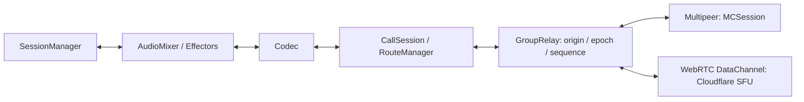
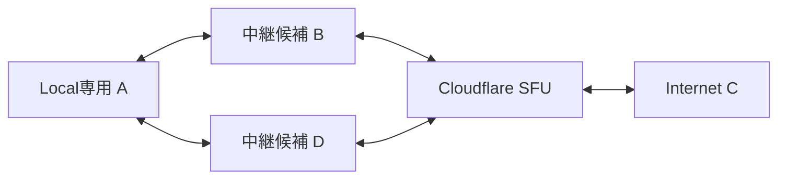

# RTC パッケージ仕様

## 役務と所有関係

| 項目 | 契約 |
|---|---|
| 通信 | 接続・認証・複数経路の維持・中継・重複破棄・受信待ち・診断を所有 |
| 音声 | `RTCAudioPacket` のcodec、format、sampleCount、bitRate、payloadを保持。RTC内でDSP・再符号化をしない |
| 音声I/O | `SessionManager` が所有。Local/InternetともApp compositionがAudioMixer・Codec・RTCへ接続 |
| パッケージ境界 | RTCはAudioパッケージに依存しない。hardware 48kHz、RTC 16/24/48kHzなどの変換はAudioMixer/Codec側 |
| products | `RTC`、`RTCNativeWebRTC`。後者のみ同梱WebRTC binaryへ依存 |
| カメラ | 同梱WebRTCからカメラ撮影・プレビュー・撮影位置helperの実装と公開headerを除外。音声とDataChannel通信は維持し、カメラ利用を要求しない |
| OS / Swift | iOS・macOS 26.4以上、Swift 6 |
| plugin | `RTCCallRoute`、`CallSessionFactory`。中継の共通契約は認証済みpeerとapplication dataの配送 |

## 混在通話と経路

| 状況 | 振る舞い |
|---|---|
| `.singleRoute` | preferred routeだけを開始。ほかの経路を無断で有効化しない |
| automatic設定 | preferredを開始し、fallbackDelay後に許可済みの残りの経路も開始する。一部Local接続が成功してもInternet開始を抑止しない |
| 既存のautomatic 2値 | ともにグループ接続維持として扱う。1経路へ切り替えて他の接続を切る旧動作は廃止 |
| Local専用A、両経路B、Internet専用C | A↔B↔Cで元の話者を保持して中継。AはCloudflare資格を持たなくてよい |
| 中継候補が複数 | Local近隣でInternet媒体がreadyと通知された候補の最小PeerIDを選ぶ。直接Internetへ送る話者の再出版は抑止 |
| 全員近くにいる | Internet参加者がすべてLocal隣接peerでもある送信者は、音声のInternet出版を省略。presence・制御・leaseは継続 |
| 複雑なLocal接続グラフ | Localは重複破棄付き転送。近隣ごとに候補が異なる間は重複転送があり得るが、再生は1回。最大8hop |
| 中継離脱・接続障害 | 残る経路を停止しない。membership/presence更新で中継候補を再評価し、失敗した経路だけ2〜30秒間隔で再試行 |
| 接続経路がなくなる | 接続を作れるまで音声は届かない。無音や探索中を接続成功とみなさない。presence失効は8秒 |
| `stopMedia`、中継端末自身のmute | 自分の収録・再生要求を停止。他人の中継は継続。`stopConnection`が明示的な離脱 |
| `stopConnection` / group変更 | leave通知、世代無効化、購読・タイマー・受信バッファ・認証状態を終了 |
| active/media route | UI用の代表経路。実際に使う経路が1本だけであることを表さない。availableRoutesとmembersのrouteも確認する |

## 認証・重複・バッファ

| 境界 | 制約 |
|---|---|
| Local接続 | MCSession暗号化必須。同一groupHash discovery/contextとshared secretのhandshake。切断peerの登録解除、旧session通知拒否 |
| peer識別 | MCPeerIDは`CallStartRequest.localPeer.id`。表示名の変更でInternet側と別人にならない |
| Internet接続 | Workerの端末資格・同一room購読認可。SFU App Secretはサーバーのみ |
| 中継envelope | `rtc.group-relay.v1`。session、origin、epoch、sequence、path、body、Internet ready状態。招待由来のgroup keyでAES-GCM暗号化 |
| 信頼境界 | 接続元hopが認証済みpeerで、path末尾と一致すること。group credentialを持つ参加者間の信頼モデル。個人署名による悪意あるグループ参加者のなりすまし防止ではない |
| 自分へ戻った音声 | path内に自分が含まれるものを破棄 |
| duplicate / replay | originと接続epochごとの1024 sequence window。古いepochは直近8世代を拒否。音声は直近presenceが有効な話者だけ受理 |
| 再参加 | 新epochで当該peerの受信待ちを破棄し、memberの再認証をAppへ通知。他のpeerは維持 |
| presence | 2秒周期、8秒失効。leave以前の遅延presenceで離脱を取り消さない |
| 上限 | リモート7人、path最大8、envelope 32KiB、音声payload 8KiB、受信待ち256件。過剰分は古い受信待ちから破棄 |
| 再生時刻 | 端末間時計の同期を前提にしない。最終受信端末で15ms待ち、100msを過ぎた受信待ちは破棄。enqueue時とdrain時にpeerごとの再生済みsequenceを検査し、待機中に古くなったフレームも破棄 |
| codec / format | policyで許可されたcodec、8〜48kHz、1〜2ch。対応範囲内のformat差は保持し、PCM変換しない |
| パケットsequence | 中継epoch内のsequenceで再生順を管理。収録再起動によるApp側counterのリセットと分離 |

## Cloudflareの媒体契約

| 項目 | 実装 |
|---|---|
| transport | ネイティブWebRTCのDTLS/SCTP DataChannel。標準RTP audio track方式から、話者を保持できる符号化済みパケット転送へ変更 |
| audio channel | `group-audio-v1`、unordered、maxRetransmits=0。送信待ちが残ると新しい音声を捨て、蓄積しない |
| control channel | `group-control-v1`、ordered/reliable。送信待ち上限64KiB |
| 接続 | 完全SDP offer → Worker `/join` → SFU datachannels/establish → answer。ICE接続後 `/publish` で2種類のchannelを確保 |
| 購読 | roomのpeer IDから `/pull`。SFU allocation IDは端末ごとに異なり、Workerの返却値でnegotiated channelを作る |
| presence / 操作 | 同じgroup envelopeで中継。WorkerのWebSocketはroom情報・従来の小さい制御メッセージのみ。音声は通さない |
| 離脱・期限切れ | known channelをcloseし、GET sessionの残存channelも確認。部分成功・応答不明の割当ては回収記録を保持 |
| upstream不明 | timeoutしたallocationの完了を空のGET結果だけで断定しない。session消失確認まで再確認 |
| native audio device | 本経路ではWebRTCへマイクを接続しない。DSP・codec・ミュート・相手別音量は共通音声pipeline |
| TURN | WorkerからSDP作成前に短期資格を取得し、更新通知を既存native connectionのsetConfigurationへ適用。設定はWorker仕様を参照 |

Cloudflareは[custom media payloads](https://developers.cloudflare.com/realtime/sfu/features/datachannels/#custom-media-payloads)を認める一方、復号・再生時刻・欠落回復をアプリに委ねる。本実装は既存Codecと受信待ちを利用し、SDKのRTP jitter/codec/DTXが動いているとは記載しない。受け入れ条件は[検証](../../validation/未確認事項.md)を参照する。

## 音声の配送と待ち行列

| 境界 | 方針 | 所有者 |
|---|---|---|
| Local / Internet送信 | 音声とpresenceはunreliable、ミュート・leaveなどの制御はreliable | GroupRelayが分類、各routeが配送 |
| Internet DataChannel | 音声は`ordered=false`、`maxRetransmits=0`。送信バッファが空のときだけ送信し、詰まっていたらその音声を破棄 | RTCNativeWebRTCとWorkerのpublish/pullで同じ指定 |
| 接続通知と音声のイベント待ち | 各購読者につき一時データ最大64件・100ms。古い音声・telemetryを捨て、接続・認証・離脱・reliable制御は256件まで順序を保持 | EventSource（Local受信、native engine、route、CallSessionの各境界） |
| 再生待ち | 受信から15ms、期限100ms、最大256件。期限・件数超過・再生済みsequence以下は破棄 | PacketAudioReceiveBuffer |
| 再接続 | peer離脱でそのpeerの再生sequenceを破棄、session停止で全待ち状態を破棄 | RTC |

DataChannelの順序保証と再送回数は、TCP/UDPを選ぶUIではなく配送契約である。既定のreliable/orderedを音声に流用しない。`maxRetransmits=0`は初回送信後の再送を止める設定で、OS・SFUを含む絶対遅延の保証ではない。`maxPacketLifeTime`との同時指定は行わない。上記100msは各境界での待ち時間上限であり、端末間の総遅延ではない。期限に使う端末内時計は同期不要である。

イベント待ちでの破棄数はeventDropsとして境界別に公開する。受信bufferでの破棄は既存counterへ反映する。制御イベントは音声と一緒に追い出さないが、永続保存・相手の処理完了保証は持たない。

根拠: [W3C DataChannelInit](https://www.w3.org/TR/webrtc/#dom-rtcdatachannelinit)、[Cloudflare message delivery](https://developers.cloudflare.com/realtime/sfu/features/datachannels/#configure-message-delivery)。

## Local探索のOS所有境界

| 操作 | 契約 |
|---|---|
| Multipeer browser / advertiser生成・開始・停止・解放 | main run loopへ直列化。main上からの同期再入は直接実行してdeadlockを避ける |
| 停止 | delegateを外して探索・sessionを停止。停止済み・別sessionの遅延callbackを拒否 |
| 理由 | SimulatorのDisconnect UIでBonjour `_MonitorCancel` / `_netServiceMonitorCallBack` がEXC_BAD_ACCESSとなった。探索の寿命をcallback側run loopと揃える |

## ネットワーク診断の契約

| 情報 | 所有者・意味 | 未取得・限界 |
|---|---|---|
| RTCNetworkDiagnostics | CallSessionがnetworkDiagnosticsChangedでローカル通知。遠隔runtime statusにもRTC / networkのpackage reportとして追加 | 生成時刻付き。別セッションへ持ち越さない |
| eventDrops | EventSourceの購読者mailboxごとにoverflowとexpiredを加算。route / engine / transport境界を区別 | ネットワークpacket lossではない。同じイベントの購読者別の破棄は別件 |
| roundTripTime | nativeの選択済みICE candidate pairのcurrentRoundTripTime、秒 | SFUまでのtransport RTT。相手端末までの往復・音声遅延ではない。未取得はnil |
| bufferedBytes | native connectionが所有するDataChannelのbufferedAmount合計 | アプリの送信待ちbyte数。接続がない場合はnil |
| packetLoss | DataChannel用の損失率はnil | RTPのpacketsLostをSCTP音声に流用しない。取得不能理由を明示し、0で正常表示しない |
| peers | group envelopeを認証・重複検査した最後のpathと到着route、観測時刻 | 最後に届いた経路。全候補経路の探索結果ではない。8秒経過・hop消失・route消失・stopで表示対象から除く |
| Multipeer | transportとrouteのmailbox破棄を通知 | OSが公開しないRTT/loss/buffered値は取得不能として返す |

経路の新実装が統計backendを持たない場合も、共通診断APIから明示的な取得不能を返す。新たなplugin層は追加せず既存route / native engine境界を使う。packet形式・音声送信方式は変更しない。

## TURN資格のlifecycle

| 操作 | 契約 |
|---|---|
| 接続準備 | Workerのroom配下ice/participantへ接続試行のleaseIDを送る。資格取得後にiceServersイベント、connectedイベントの順で通知 |
| native適用 | SDP生成前にICE設定。更新は同じpeer connectionへsetConfigurationを適用しDataChannelを作り直さない |
| lease更新 | Workerのrenew応答にiceServersがある場合だけ更新。Cloudflare長期秘密は受け取らない |
| 中断 | SFU session成立前は試行leaseID付きDELETE、成立後はsession DELETE。古い試行の遅延cleanupは新資格を削除できない |
| エラー | 資格の取得・適用失敗はInternet routeの失敗として既存report/eventに反映。他の有効なLocal経路を止めない |

[Cloudflare公式の資格生成・失効・更新](https://developers.cloudflare.com/realtime/turn/generate-credentials/)に基づく。資格の期間・利用枠・失効再試行は[Worker](../server/Worker.md)が所有する。

## 経路と音声の境界

| 層 | 契約 |
|---|---|
| RTCCallRoute | 接続、認証済みmembership、application data、ネットワーク診断を配送。音声開始・ミュート・再生のAPIは持たない |
| CallSession / RouteManager | 共通の音声開始・停止・ミュート・暗号化中継・受信待ちを所有 |
| SFU signaling | 完全なSDP offer / answerとmembership snapshotを使用。trickle候補の個別配送や空のsendAnswer APIは持たない |
| NativeWebRTCEngine.prepareTransport | 接続試行の診断を初期化。マイク・スピーカーを取得しない |
| Local wire | handshakeはreliable、application dataはmessage.deliveryに従う。音声も認証済みgroup envelopeをapplication dataとして送る |

旧per-route音声API・暗号化・二重受信待ちは削除した。招待URLと現行group-relay wireは変更しない。旧per-route音声wireとの互換は提供せず、参加端末は同じ版を使用する。

## 入力と復旧の境界

制御mailboxは購読者ごとに最大256件。超過時はその購読者の未処理queueを破棄しfailedイベントを一度通知し、消費されるまでは後続を破棄する。通知消費後は同じ購読で再接続イベントを受信できる。破棄数はeventDrops.overflowに記録する。全制御の永続配送を保証しない。

再試行・presence・診断の間隔はmonotonic clockで測り、prepare/stopで基準を初期化する。重複startは同じ試行でtimerを増殖させない。fallback delayは有限の0–60秒へ正規化し、非有限値は3秒へ戻す。重複route kindは先の登録を採用する。

Local識別子は[MCPeerIDの制約](https://developer.apple.com/documentation/multipeerconnectivity/mcpeerid/init(displayname:))に従いUTF-8で1–63 byteを生成前に検証する。Local受信は64 KiB以下、WebSocket signaling messageも64 KiB以下。Local送信失敗はイベントで通知し、生ID・payload・OS error全文を直接ログへ出さない。nativeのmediaReady判定はchannel IDだけでなく現行channelオブジェクトの同一性を確認する。
