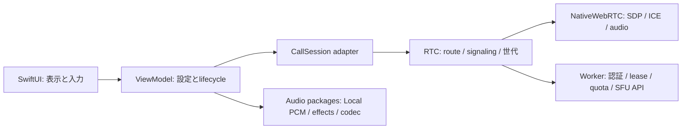

# Cloudflare試用前の品質点検

> これは中継実装前（`2df188f`まで）の点検記録。以下のnative RTP音声、Worker WSへのApp data集約、Localのみのエフェクト制限は当時の方式であり、現行仕様ではない。現在の責務・試験結果・残件は [混在通話検証](混在通話検証.md) と [RTC仕様](../packages/RTC.md) を参照する。


## 指示・背景と判定

Cloudflare設定後の試用を見据え、UI、実行時の状態表示、責務分割、保守・拡張方法、UIなしの検証とペア検証を点検した。既存のpackage優先開発を守り、RTC修復・コミット後にAppを適応した。2026-10-21実施、作業ブランチは `codex/restore-dev-calls`。

**ローカル自動検証と試用準備を進めた段階であり、Cloudflare設定だけで全環境の通話が成立するとは判定しない。** 実SFU媒体、UDP制限環境、実機音声、実請求は別の受け入れが必要。公開運用の未対応事項も残る。

## 発見した問題と修復

| 領域 | 点検前 | 変更後と検証 |
|---|---|---|
| WebRTC開始 | startMedia呼出だけでmediaReadyを通知 | ICE接続と媒体開始が揃った後に通知。失敗SDP・遅延通知の回帰テスト |
| 再試行 | closeで失ったlocal trackの準備を再実行しない | 各開始で再準備。失敗時にengineとsignalingを閉じ、再試行可能にする |
| 非同期状態 | routeの可変状態と旧接続callbackが競合し得る | actor、接続世代、購読解除で直列化。native callback側の状態も保護 |
| 制御データ | Worker WSと未使用DataChannelの二重経路 | Worker WSへ統一。切断後・不明peerのデータを破棄 |
| peer入替 | 同じpeer IDの新publicationを検知できず、購読media sectionも増加 | publicationのsessionIdを識別し、離脱した購読midを再利用 |
| 音声所有者 | Internet中のデバイス変化でLocal rendererを起動する | native経路ではpacket rendererを起動しない |
| Audio Check | peer認証待ちの間も確認録音が残り得る | Connect開始で中断し、接続中の再開始を禁止。Stop操作も提供 |
| 接続表示 | App準備済みを媒体接続済みとして表示 | RTCの実状態から Connecting Audio / Audio Active / Connection Failedを表示 |
| 設定・診断 | Internet媒体へ効かないLocal効果・音量や未計測meterを表示 | 実経路を先に表示し、適用外操作を隠すか無効化。未計測値は正常評価しない |
| 資格設定 | Viewが保存・RTC変更を担当 | ViewModelがvalidation・保存・切断・反映を担当。失敗入力では通話を維持 |
| 試用診断 | 設定後に通話してみるまで認証状態が分からない | Check Internet Serviceで設定・端末認証・利用枠を確認。SFU sessionは作らない |
| 検証用依存 | stable Miniflareのundici/sharpにaudit警告 | 安定版を維持し当該依存のみ修正版へoverride。audit 0件、Workerとペアを再検証 |

native WebRTCの「Audio Active」はICE/mediaの状態であり、相手の耳に届いたことの証明ではない。Localのマイク表示も `Live` から `Unmuted` へ変更し、ミュート解除と媒体到達を混同しない。

## 責務と拡張方法



| 境界 | 維持した方針 |
|---|---|
| 別transport / signaling | RTCのroute・factory・signaling protocolへ実装。UI内へprotocol処理を増やさない |
| 別音声backend | SessionManagerの入出力backendへ実装。PCMのformatを境界で保持・明示変換 |
| 別codec / effect | Codec factory、Mixerのeffect chainに追加。Appは設定とcompositionを担当 |
| 別Appへの移植 | package単位の公開契約とテストを使用。Appへ依存させない |
| 公開identity | Worker入口の認証を拡張。端末資格とgroup招待は分離済み |
| プラグイン性の範囲 | ビルド時のprotocol/factory差替え。動的pluginのダウンロード・ロード機構は追加していない |

責務のためだけの薄いラッパー、新規中間package、全面的な言語モード変更は追加していない。native媒体へ既存AudioMixerを挿す契約、native統計・peer音量・TURNは未提供であり、Appで擬似的に補わず [Appからpackageへの要望](../App/Appからpackageへの要望.md) に残した。

## 自動検証の層

| 層 | 実行対象 | 保証しないこと |
|---|---|---|
| Audio package | 生成PCM、offline render、偽hardware backend、効果・codec・format・途中失敗 | 実マイクの音質やOS実デバイスの復帰 |
| RTC単体 | 認証、暗号化、重複、handover、10分相当の双方向生成フレーム、遅延callback、再試行 | 実時間10分の無線品質 |
| native SDK | 実WebRTC SDKで音声のみのSDP、Opus、無効answer、close反復・再初期化 | 実SFUとのICE接続・RTP送受信 |
| Worker | workerd/SQLite DO、HTTP/WS、認証、quota、lease、10回のpublication入替 | Cloudflare本番API・請求meter |
| Swift/Workerペア | 実URLSession HTTP/WS client 2台 → 実workerd → test provider。双方向message、lease自動更新、再参加、mid再利用、終了 | providerのSDPは合成。音声/RTPのペア試験ではない |
| App単体 | ViewModel、音声所有者、起動途中失敗、Audio Check、設定、実状態表示 | UI操作と実機媒体 |
| Simulator UI | グループ作成/選択/削除、接続/切断、ミュート、効果・codec設定、資格validation、タブ復帰、大文字・横画面 | 実機音響・Mac/iPhone通話 |

通常のRTC単体実行ではWorkerペアを1件skipする。`headless` または `pair` が起動する専用fixtureでその1件を別途実行する。テスト専用の通信分岐を本番Appへ追加していない。

## 実行結果と証跡

証跡root: `/private/tmp/rideintercom-quality-validation`。ログ・xcresult・JSONはローカル生成物でありGit管理しない。機密資格を証跡へ書き込まない。

| 対象 | 結果 | 証跡 |
|---|---|---|
| Audio 8 package | 94件成功 | `headless/package-*.log` |
| RTC | 通常34件成功、ペア1件skip | `headless/package-RTC.log` |
| native SDK | 1件成功、RTCNativeWebRTC build成功 | 同上、`headless/native-WebRTC.log` |
| Worker | 9件成功、type-check成功 | `worker-updated/worker-test.log` / `worker-types.log` |
| Swift/Workerペア | 1件成功。4秒leaseを越えて継続・再参加 | `worker-updated/swift-worker-pair.log` |
| 更新・費用・資格scripts | Python 2件、Node 3件成功 | `headless/webrtc-scripts.log` / `cloudflare-scripts.log` |
| macOS App | 52件成功、通常build/launch成功 | `macos-state-label/macos-tests.xcresult` / `macos-launch.log` |
| iOS App + UI | 単体52件 + UI4件、計56件成功 | `ios-accepted/ios-tests.xcresult` |
| 資格画面の反復 | 最終Appで同一UIテストを連続2回成功 | `credential-repeat.xcresult` |
| 横画面・大きな文字 | sheet内のFormをスクロールして保存ボタンまで到達、Close後に復帰。全画面画像を保存 | `adaptive-form.xcresult` |
| npm audit | 0 vulnerabilities | `npm-audit-after.json` |

使用環境: Xcode 27.1、Swift 6.4、macOS 27.0.1、iPhone 17 Pro Simulator / iOS 26.4.1、Node 26.12.0。`DEVELOPER_DIR=/Applications/Xcode.app/Contents/Developer`。global xcode-selectは変更しない。

全体回帰後のSettings接続ラベル修正は、macOS単体52件とiOS資格画面の連続2回で再ビルド・再検証した。横画面のApp範囲スクリーンショットが欠けたため、専用Simulator全画面の撮影へ変更した。大文字の保存ボタン到達検査も追加し、App全体へのswipeでは動かないことを再現後、sheetのFormを対象にスクロールして成功した。

途中の赤テスト、古いoverview行期待値、接続方式を両方OFFにしようとするUI手順、tab identifierの一時不在・座標タップの失敗を成功に読み替えていない。UIではidentifierが未付与の間は標準labelで検索し、sheet消失を待って通常のbutton tapを行う。検証入口はxcresultのテスト0件・失敗を検出して非zero終了する。出力directoryを誤って再利用した実行はxcresult作成拒否で失敗したため、以後はresults.tsvが既存ならログを上書きする前に終了コード2で拒否する。この拒否動作も検証済み。

XcodeのAppIntents metadata未抽出、SDK build番号の診断、Simulator音声デバイス診断、既存vendor警告はログに残る。Macは通常起動後のプロセス存在まで確認したが、画面ロックのため今回のmacOS画面の目視・サイズ変更は未確認。

## 再実行

リポジトリrootで実行する。`VALIDATION_DIR` は毎回新しいdirectoryとする。

```sh
VALIDATION_DIR=/tmp/rideintercom-headless scripts/validate.sh headless
VALIDATION_DIR=/tmp/rideintercom-pair scripts/validate.sh pair
VALIDATION_DIR=/tmp/rideintercom-macos scripts/validate.sh macos
VALIDATION_DIR=/tmp/rideintercom-ios scripts/validate.sh ios
scripts/build_and_run.sh --verify
npm --prefix server audit
```

`ios-ui` はUIだけの短縮入口。専用Simulatorを新規作成し、既定darkで実行、終了時はshutdownして証跡用に保持する。利用者のSimulator・Macのgroupや資格を消去しない。詳細は [自動検証](自動検証.md)。

## アカウント準備後と公開前

| 段階 | 必要な確認 |
|---|---|
| 少人数試用の設定 | [Worker手順](../server/Worker.md) に従いアカウント、SFU app、server secret、端末資格、Worker URLを設定。AppのCheck Internet Serviceを実行 |
| 最初の実通話 | 2端末で招待・publish/subscribe・実音声。20分以上のlease跨ぎ、切断/再参加、ネットワーク断を確認 |
| 実機受け入れ | Audio Check、同時発話、ミュート、10分通話、画面ロック、Bluetooth/有線切替 |
| 制限ネットワーク | TURN credential発行/更新とnative ICE server適用が未接続。STUN/SFU直接接続だけで全環境を保証しない |
| 公開運用 | identity自動発行/失効、edge abuse制限、実egress/DO時間/請求監視、停止操作を整備・検証 |
| 費用評価 | [費用試算](../server/Cost.md) の仮定を実測値へ置換。参加者秒quotaは請求金額のhard capではない |

既存通話の継続はlease自動更新で扱う。通常利用で定期的な手動再接続を要求しないが、利用枠の拒否や回復不能な障害では停止を表示する。実サービス未確認を「全機能動作済み」「公開準備完了」と記載しない。

## コミット

| コミット | 変更 |
|---|---|
| `f2e631a` | RTC状態・再試行・native交渉テスト |
| `020746c` | SFU購読mid再利用・Swift/Workerペア |
| `ee4fe80` | Worker検証環境の間接依存修復 |
| `e45531a` | App音声所有権・実状態表示・資格診断・単体回帰 |
| 本記録を含むコミット | UI自動化、統一検証入口、要求・構造・証跡の文書整備 |

main/devの履歴と元のmain由来worktreeを保持し、マージ・push・デプロイは行っていない。
