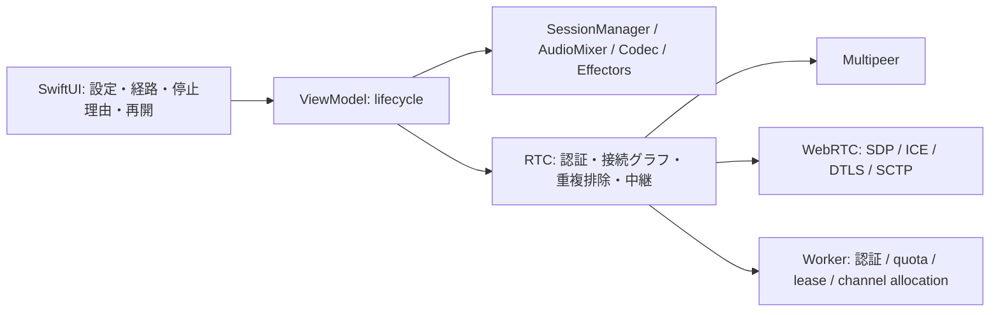

# 混在グループ通話・音声機器切断の検証

## 指示・背景と結論の範囲

一部Local専用、一部Internetの参加者が混在しても、接続経路がある間は中継してグループ通話を維持する。利用者の指示に従い実機は待たず、状態遷移・UI・費用・文書の矛盾を自動検証で確認した。作業はdev由来の `codex/restore-dev-calls`。旧main由来のworktreeとmain/devは変更せず、push・merge・deployを行わない。

**中継のローカル自動検証が成立した段階。Cloudflare設定だけで全環境の通話・公開運用・低価格を保証する段階ではない。** 旧native RTP音声とLocal専用DSPの説明は、現在のgroup envelope / DataChannel / 共通音声pipelineへ更新した。

## 要求と検証の対応

| 要求 | 実装・確認 | 実環境の残件 |
|---|---|---|
| 混在全員通話 | Local-only A、両経路B/D、Internet Cの4個の実RouteManagerで双方向配送 | 実Cloudflare、無線電波、実音声 |
| 中継者離脱 | D離脱→再参加→B離脱でもA/Cを再接続せず双方向経路を維持 | 切替瞬間の無音時間・実機復帰時間 |
| 一部のInternet失敗 | 他routeを閉じない。失敗routeを再試行。Appは音声エラーと分けて案内 | quota終了後や制限回線での実表示 |
| 中継者mute / 機器停止 | 自分のmedia停止でも他者の中継は継続 | 電池・熱・画面ロック中のOS制約 |
| 重複・旧通知 | origin / epoch / sequence / path、認証済みhop、group key、世代確認 | 悪意ある正規groupメンバーの個人なりすまし対策は別 |
| 10分相当 | 20ms生成フレーム30,000個、重複・payload保持・バッファ上限 | 実時間10分の聴感試験ではない |
| 本物のWebRTC媒体 | 同梱SDKの2engine loopbackで符号化済みPCMパケットを双方へ配送 | 実SFUのDataChannel allocationとICEは未確認 |
| Bluetooth等の消失 | runtime eventで自分の送受話を停止、接続を保ちResume Audioで復帰。失敗後の再試行・mute保持 | 実Bluetooth / 有線機器の通知順・音質 |
| 設定とエフェクト | 全production routeでSessionManager / Mixer / Codecを使用。経路変更で音声所有者を切り替えない | 風切音、音響AEC、遅延・欠落回復の評価 |
| 資格とlease | 実Swift HTTP/WS clientとworkerd/SQLite DO。認証、部分allocation失敗、close、lease更新、再参加 | 本番provider、請求、公開identity・abuse制御 |
| UI | 既存主要導線、資格入力、タブ、設定、大文字、横画面を専用Simulatorで検証。新しいpause/resume状態はViewModel単体で検証 | 実デバイス切断で出るResumeボタンのE2E操作、VoiceOver、Mac/iPad各サイズの目視 |
| 費用 | serialized fixtureのサイズから512kbpsを既定に再計算。複数gateway・PCM fallbackの感度分析 | 1,000人4人通話で約$648/月の仮定。常に時間課金より安いとは結論しない |

## 責務と保守性



| 点検 | 結果 |
|---|---|
| package先行 | RTC/Workerの修復と試験を `097e77e` へコミット後、App適応を開始 |
| App変更量 | 中継アルゴリズムをAppへ置かず、既存adapterとViewModelを使用。新しい中間package・production型・ソースファイルは追加なし |
| format境界 | hardware / Mixer / Codec / RTCのformat明示・変換を維持 |
| 拡張性 | route factory、Codec factory、Audio backend、Effectorsを既存境界として維持。動的plugin配布は未実装 |
| 旧経路整理 | per-route音声API・旧暗号化/回帰テストの一括削除は自動承認レビューで拒否。既存を保持し、新CallSession中継からは使わない。旧route-managed App分岐も残り、整理完了とはしない |
| wire小型化 | 独自UUID/整数parserによる通信形式変更は自動承認レビューで拒否。binary PropertyListを維持し、安価になったという評価はしない |
| 文書 | App通信・音声・UI・設定、RTC、Worker、Cost、要求資料を同期。以前の品質点検/Validationは履歴と明記 |

## 自動検証の実績

2026-10-21。Xcode 27.1 / Swift 6.4、macOS 27.0.1、iPhone 17 Pro Simulator / iOS 26.4.1、Node 26.12.0。すべて `DEVELOPER_DIR=/Applications/Xcode.app/Contents/Developer`。

| 対象 | 結果 | 証跡（ローカル生成物） |
|---|---|---|
| Audio 8 package | 94件成功 | `/private/tmp/relay-final-headless/package-*.log` |
| RTC | 通常42件成功、Worker専用ペアは別実行 | `relay-final-headless/package-RTC.log` |
| Native SDK | 2件成功、RTCNativeWebRTC build成功 | 同上、`native-WebRTC.log` |
| Worker | npm ci / type-check、10件成功 | `relay-final-headless/worker-*.log` |
| Swift / Worker | ペア1件成功 | `relay-final-headless/swift-worker-pair.log` |
| scripts | Python 2件、Node 4件成功 | `relay-final-headless/webrtc-scripts.log` / `cloudflare-scripts.log` |
| macOS App | 58件成功（パラメータ展開59実行） | `/private/tmp/relay-route-label-green/macos-tests.xcresult` |
| macOS通常起動 | build・管理対象binaryのプロセス存在を確認 | `/private/tmp/relay-final-label-launch.log` |
| iOS App / UI | 単体58件 + UI4件、合計62件成功 | `/private/tmp/relay-accepted-ios/ios-tests.xcresult` |

Appのredは `/private/tmp/relay-app-red/macos-tests.xcresult` に保持。機器消失、再起動失敗、Internet失敗の誤表示で失敗を確認し、greenへ修正した。追加の経路ラベルredは `/private/tmp/relay-route-label-red-full/macos-tests.xcresult`。単一テスト指定が0件だった試行は不採用とし、統一入口で実際の失敗を確認した。費用計算の新しい既定帯域・複数中継テストのredは `/private/tmp/relay-cost-red.log`。失敗を成功へ読み替えない。

Nativeの通常LAN候補ではICE checkingから進まず、loopbackを有効にしたtest用factoryで2engineの配送を確認した。Macの権限変更はしていない。この成功を公衆回線のICE成功と同一視しない。XcodeのAppIntents metadata未抽出などのSDK診断はログに残り、警告ゼロとは記載しない。

添付画像を `/private/tmp/relay-final-screens` へexportし、Call・Settings・Diagnosticsの大文字表示を目視確認。Communication footerにsecondary色を重ねていたため、標準Formのfooter色へ戻した。標準色への修正後にUI4件を再実行して成功。経路ラベル修正と処理名整理を含む `4e11aab` でも単体58件 + UI4件が成功した（`/private/tmp/relay-accepted-ios`）。

## 再実行

リポジトリrootから以下を実行する。VALIDATION_DIRは毎回新しいdirectoryを指定する。

```sh
VALIDATION_DIR=/private/tmp/relay-final-headless scripts/validate.sh headless
VALIDATION_DIR=/private/tmp/relay-final-macos \
  VALIDATION_DERIVED_DATA=/private/tmp/rideintercom-dev-validation/automation-macos scripts/validate.sh macos
VALIDATION_DIR=/private/tmp/relay-accepted-ios \
  VALIDATION_DERIVED_DATA=/private/tmp/rideintercom-dev-validation/automation-ios scripts/validate.sh ios
DERIVED_DATA_PATH=/private/tmp/rideintercom-dev-validation/RunDerivedData scripts/build_and_run.sh --verify
node scripts/Cloudflare/estimate-cost.mjs
```

## アカウント準備後の順序

| 段階 | 受け入れ |
|---|---|
| 設定 | [Worker](../server/Worker.md) の手順でSFU app、secret、個別端末資格、URLを設定。全端末を同じ中継対応版に更新 |
| 制御 | Check Internet Serviceで資格・利用枠を確認。ここではmediaを作らない |
| 2端末媒体 | InternetのみでDataChannelのpublish/pull、双方向PCM、lease跨ぎを確認 |
| 混在 | Local-only / 両経路 / Internet-only、可能なら代替中継者も追加。離脱・再参加・mute・機器切断を確認 |
| 公開前 | TURN、identity自動発行・失効、edge制限、実egress/DO/請求監視、停止運用、通信量削減を完了 |

仕様と試験が示すのは、認証・通信・OS実行が成立する連結成分での維持である。回線分断・利用枠終了・OSによる停止中まで全員通話を保証しない。実機通話復旧完了、公開準備完了、費用上限保証とは報告しない。

## コミット区分

| コミット | 内容 |
|---|---|
| `097e77e` | RTC中継・接続維持、実WebRTCペア、Worker DataChannel契約 |
| `4e11aab` | Appの共通音声接続、混在経路表示、機器停止・再開、対応仕様 |
| 本記録を含むコミット | wireサイズによる費用再試算、文書の履歴分離、検証結果と残件 |

旧API削除と独自wire parserの導入は、通話停止・セキュリティ・相互運用性リスクに対して変更範囲が広いとして自動承認レビューに拒否された。拒否された変更は実行せず既存実装を保持した。再開時は削除対象と検証範囲、または安全な符号化方式の具体的な差分を別途レビューする。既存の準備済みアカウントは必要ないが、Cloudflare実媒体の試用は利用者のアカウント設定後に行う。
