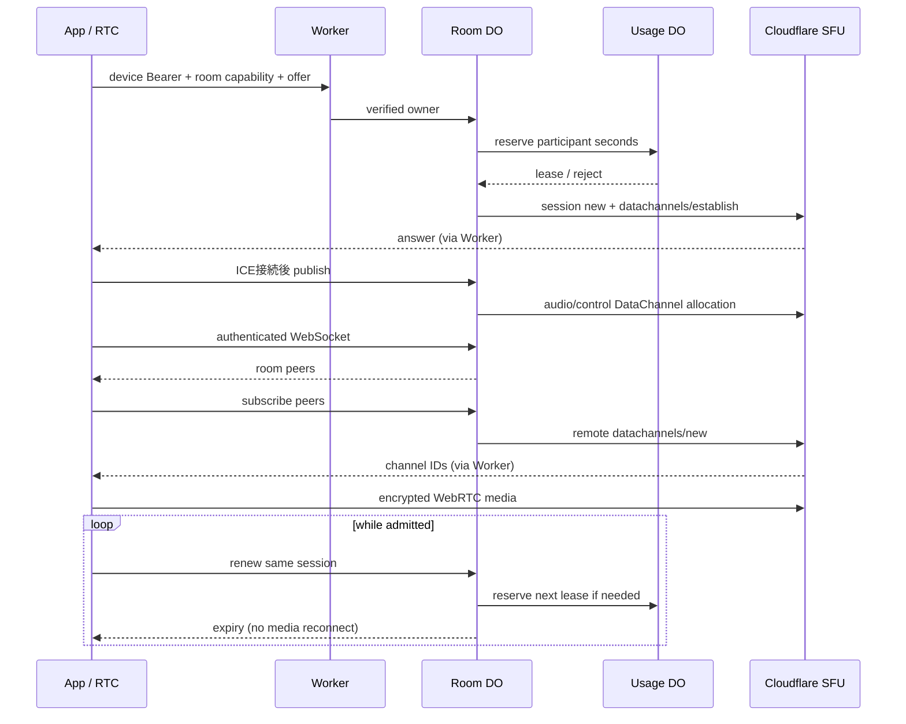

# Cloudflare Worker / SFU 仕様

## 所有する責務

少人数の招待制試用から公開へ進める際に、通話経路を作り直さず利用枠を制御する。Realtime SFUの音声を使用し、Cloudflare App SecretをAppへ配布しない。運用手順は[Cloudflare試用手順](../../development/Cloudflare試用手順.md)、確認状況は[検証](../../validation/README.md)を参照する。

| 責務 | 実装 |
|---|---|
| Worker入口 | Apple確認済みユーザーの端末Bearer、または試用registryの資格を検証。秘密の部屋capabilityでルーティング |
| AppleAuthAttempt / UserAccount (SQLite DO) | 使い捨てnonceとApple署名の検証、ユーザーと端末の区別、端末資格の発行・照合・失効 |
| SignalingRoom (SQLite DO) | 部屋最大8人。SFU establish / publish / subscribe / closeを所有者だけに許可。WSは参加者一覧・App dataに限定 |
| UsageGuard (SQLite DO) | 全部屋共通の同時数、月の参加者秒、端末ごとの開始回数、認証ユーザーごとの1接続枠を同じ同期KV更新で予約 |
| Realtime SFU | 音声媒体。端末ごとに1つのPeerConnection。Cloudflareが他の参加者の音声を配信 |
| RTC package | full SDP交換、lease自動更新、WS再接続、符号化済み音声のDataChannel中継 |
| App | Worker origin・個別端末資格をKeychainに保存。招待group credentialとともにRTCへ渡す |

## HTTP / WebSocket 契約

`R = /api/rooms/{groupHash}`。groupHashは64桁hexの秘密capabilityで、招待secretからRTCが導出する。guessableなgroup IDだけで部屋に入れない。通話APIは端末Bearer必須。`/health`と下記のApple登録開始・交換はBearer不要。ClientにSFU App ID/Secretを返さない。

### Apple認証と端末資格

[Appleの検証手順](https://developer.apple.com/documentation/signinwithapple/verifying-a-user)に従い、固定のApple公開鍵からJOSEでRS256署名・issuer・audience・有効期限を検証し、serverが発行したnonceと照合する。Appの端末内ログインだけをserverの本人確認とは扱わない。

| API / 条件 | 契約 |
|---|---|
| POST `/api/auth/apple/challenge` | UUIDの`deviceID`を受け、5分有効の`challengeID`・`nonce`・`expiresAt`を返す。native Apple requestのnonceへそのまま渡す |
| POST `/api/auth/apple/session` | `challengeID`と最大16KiBの`identityToken`を照合し、`userID`・`deviceID`・`expiresAt`・`accessToken`を返す。nonceは並行再送でも1回だけ消費する。1つのchallengeの検証試行は5回までで、外部鍵取得前に回数を永続化する。上限後は新しいchallengeが必要 |
| GET `/api/auth/session` | 端末Bearerを照合し、ユーザーID・端末ID・期限だけ返す |
| DELETE `/api/auth/session` | そのBearerの端末資格だけを失効。他の端末は維持。通話サービス停止中も操作できる |
| 同一人物 | Apple subjectのハッシュでユーザーDOを解決する。同じAppleユーザーの複数端末は同じ不透明なuser IDへ対応。表示名やメールによる統合はしない |
| 資格の保持 | 端末資格は30日有効、同一device IDの再認証で置換。serverには秘密のSHA-256と期限を保持し、秘密自体・Apple token・メール・Apple生IDを保存しない。DO名にもApple生IDを使用しない |
| 登録数 | ユーザーごとの有効な登録資格は最大8端末。上限でも登録済み端末の再認証は可能。WebRTC同時接続数とは別の上限。超過時は409 / `device_limit_reached`を返す |
| 登録入口の制限 | challenge・sessionのPOSTを合算し、edgeの`CF-Connecting-IP`ごとに30回/60秒、全送信元で300回/60秒をRate Limiting bindingで判定。body読取・DO作成・Apple検証より前に拒否する。超過は429 / `enrollment_rate_limited`と`Retry-After: 60`。端末IDや`X-Forwarded-For`で枠を分割しない |
| 制限の保持範囲 | bindingのkeyはUTC日付と送信元IPのSHA-256。生IP・hashをDOやAppへ保存・ログ出力しない。hashも匿名性の保証とは扱わない。ProductionとPreviewで異なるrate limit namespaceを使う |
| 制限の障害 | binding不在・例外、送信元不在・長さ不正は登録を503で拒否。既存端末資格の照合・失効、通話API、Local通話はこの登録制限の対象外 |
| 期限 | challengeと端末資格を期限時のalarmで整理し、照合時も期限を判定。server再起動後も期限は延びない |
| 所有者 | 通話sessionのownerはuser IDとdevice IDの組合せ。同一ユーザーでも他端末のsessionを操作できない |
| エラー | 不正bodyは400、検証失敗・期限切れ・再送は401、登録数上限は409、登録頻度上限は429、Apple鍵取得等の障害は503。tokenやApple応答内容はログ・エラーへ出さない |
| 有効化 | `APPLE_AUTH_ENABLED=false`がProduction/Previewの既定。実Bundle IDを`APPLE_CLIENT_ID`へ指定する。新規登録を無効にしても発行済み資格の照合・自己失効は残す |

AppのSettingsからnonce取得・native Apple認証・資格保存と、サインアウト時の自己資格失効を接続した。端末側の失効再試行と保存失敗時の扱いは[App通信仕様](../App/通信仕様.md#appleログインと端末内データ)を参照する。

[CloudflareのRate Limiting API](https://developers.cloudflare.com/workers/runtime-apis/bindings/rate-limit/)はlocation単位で非同期に集計する近似制限であり、分散攻撃の厳密な全世界上限・請求額上限ではない。共有回線では登録枠を共有する。公開時のedge対策・請求監視・緊急停止は別途整備する。

このserver実装は公開運用の完了ではない。Apple認可コードの交換・refresh token・アカウント削除／Apple grant取消、サーバー通知は後続工程とする。登録成功応答を失った場合は新しいnonceで再認証する。資格失効後は新規APIとlease更新を拒否するが、成立済みのmedia・WebSocketは現在のlease回収まで残り得る。

試用の静的`CLIENT_TOKENS_JSON`も既存の運用入口として残る。`ri1.`資格が無効でも静的registryへfallbackしない。静的資格には確認済みユーザーIDがないため、以下のユーザー単位制限は公開用のApple端末資格へ適用する。

### ユーザー単位のWebRTC接続予約

| 場面 | 動作 |
|---|---|
| 接続の単位 | serverがApple端末資格から確認したuserIDにつき、全room・全端末で有効な接続予約を1つにする。同じ端末が別participant IDや別roomを使っても追加できない |
| 接続準備 | TURN有効時はICE資格の発行前、無効時はjoinのSFU呼出前に予約する。ICE・join・renewは同じroomとparticipantの予約を共有する |
| 同時要求 | UsageGuardの既存予約とユーザー対応を同じ同期KV書込で確定する。新たなDOや定期pollingは追加せず、外部I/Oを同期区間に含めない |
| 追加接続 | HTTP 409 / `account_in_use`。先の接続を追い出さず、追加側へ既存通話の終了を案内する。受信したX-User・X-Ownerは信用せずWorkerが置き換える |
| 更新・解放 | 同じ予約の重複準備・更新を許す。終了と準備取消はSFU/TURNの回収後に解放。SFU session作成後の失敗も回収まで予約を保持する |
| 再起動・通信断 | 予約とuserID対応を永続化。通信断で終了要求が届かない場合、既存leaseの満了後に新規予約が可能になる。無効な資格の更新は認めない |
| 保持情報 | 既存のroom/participant予約にserver userIDを対応付ける。メール・本名・表示名・ユーザー一覧は追加保存しない。解放・期限切れ整理で対応も削除する |

これは有効な接続予約の制御であり、lease満了とprovider上の実媒体回収は同時完了の保証ではない。alarm遅延やprovider障害時には旧媒体が回収まで残り得る。任意に新旧2端末を併用する切替機能は提供していない。復旧時の重複の上限・切替方針とApp側の説明は[残課題](../../backlog/未実装課題.md#appleでのログインと通知先の識別)で継続する。

| Method / path | 入力 | 結果 |
|---|---|---|
| GET `/health` | なし | service / protocol。SFUへの接続確認ではない |
| GET `/api/status` | Bearer | 月の予約参加者秒・上限・active数。試用資格保持者に公開 |
| POST `R/join` | participantId、iceLeaseID、offer {type,sdp} | sessionId、expiresAt (Unix ms)、renewAfterSeconds、answer |
| POST `R/sessions/{id}/publish` | `{}` | audio/control channel ID。ICE接続後、同じsessionで1回確保 |
| POST `R/sessions/{id}/pull` | peerIds | peerID・channel ID・配送方針。部屋外peerは拒否 |
| POST `R/sessions/{id}/renew` | `{}` | 同じsessionIdのlease。前半の重複更新は予約追加しない |
| DELETE `R/sessions/{id}` | なし | 全channelをclose。利用枠のactive slotを解放 |
| GET `R/sessions/{id}/signal` Upgrade | Bearer | Hibernation WebSocket。1 sessionにつき1接続 |
| WS → server | `{type:"appData",namespace,payload:base64}` | serverが送信者を付与して同部屋へ中継 |
| WS ← server | `{type:"peers",peers:[{id,sessionId}]}` / appData | RTCが差分購読 / App data受信 |

| 拒否・上限 | 動作 |
|---|---|
| 401 / 403 | 未登録資格 / 他ownerのsession / 部屋外の購読を拒否 |
| 400 | 不正route/body/SDP。HTTP body最大64KiB、SDP最大48KiB |
| 409 | duplicate participant、duplicate WS、同じ認証ユーザーの別接続予約（`account_in_use`） |
| 410 | lease期限切れ |
| 429 | 部屋/同時/月/日上限。新しいSFU呼出前に拒否 |
| 502 / 503 | upstream失敗 / サービス停止・設定不足 |
| 音声形式 | joinはSCTP application m-line 1本。RTP audio/video trackを受け付けない |
| WS | 最大32KiB、600 messages/UTC分。senderを信用せず所有sessionから決定 |

公開招待URLは維持。中継用wire contractは変更し、全参加者を同じ版へ更新する。これはWebRTC SFU用のWorker APIであり、旧 `/api/sessions`・部屋全体のoffer/ICE中継は廃止する。

### 表示名を保存しない境界

RTCはjoinへ表示名を送らず、Workerは参加者の表示名を保存・配信しない。余分な`displayName`を受け取ってもmemberへコピーしない。participant ID・owner・SFU session ID・期限・channel・購読関係は接続認可と回収のため保持する。表示名は端末側のグループ情報と、グループ鍵で認証・暗号化されたpresenceで扱う。Workerのpeer一覧ではIDだけを名前の代替値に使い、グループの復号後に相手の表示名を取得する。

新規開発のため旧形式の利用者データ移行や旧client用の互換フィールドは追加しない。これは今回以後に作る通話状態の契約であり、配置済みproviderのbackup・保存期間・過去データの物理削除を確認したものではない。

## 継続と後始末

| 場面 | 動作 / 制約 |
|---|---|
| 通常の継続 | 600秒lease、300秒後に更新要求。同じsession/PeerConnectionを維持。前払い予約を上限判定に使う |
| WS切断 | mediaを閉じず1→2→4→最大10秒で接続を再試行。leaseは独立 |
| 更新拒否 | clientは通話を終了しDELETE。届かない場合もDO alarmで期限切れchannelを閉じる |
| 異常終了 | persisted memberをalarmで回収。SFUの成功応答が失われてもstatusからchannel IDを照会。応答不明のallocationはsession消失まで回収を継続 |
| providerで既に削除 | 404/410は回収済みと扱う。その他の閉鎖失敗は記録を保持し再試行 |
| 部屋変更 | 新しいroom capabilityを使い、旧sessionを終了 |
| SERVICE_ENABLED=false | HTTPを拒否。既存mediaの停止は次のlease alarmまで遅れ得る。即時アカウント停止APIではない |

## TURN資格の契約

[公式の資格生成・失効・setConfiguration更新](https://developers.cloudflare.com/realtime/turn/generate-credentials/)を使用する。SFU App SecretとTURN API tokenは別の秘密で、端末には短期iceServersだけ返す。

| API / 条件 | 挙動 |
|---|---|
| POST R/ice/{participantId} | bodyのleaseIDは接続試行ID。端末認証・room capacity・全体利用枠を確認してから資格を発行。所有者と試行IDが同じ再試行は既存の有効資格を返す |
| TURN無効 | STUNのみ返す。TURN用の追加予約・発行はしない |
| POST R/join | TURN有効なら同じ所有者・participant・iceLeaseIDの有効な事前資格が必要。事前予約とSFU予約は同じ利用枠IDを使用 |
| POST R/sessions/{id}/renew | 同じSFU sessionを延長し、更新したiceServersを返す。Appから手動再接続を要求しない |
| DELETE R/ice/{participantId} | SFU未成立の試行だけ回収。leaseID不一致は409。古いcallbackが新資格を失効できない |
| DELETE session / expiry | SFU channel回収と短期資格失効。失効が失敗すれば記録を保持してalarmで再試行 |
| 途中離脱 | SFU未成立でもalarmで資格の期限を回収。既発行資格は自身のTTLでも制限される |
| 更新時の旧資格 | 新資格が端末に届く前に旧資格を即失効しない。旧資格の期限まで保持し、切断時は未期限切れの全資格を失効 |
| TTL | 利用枠の有効期限までを秒へ切り上げ、最大7200秒。最大3600秒のleaseの前倒し更新を含む。通常既定は初回600秒程度 |
| 秘密の保存 | 短期資格をroom DOへ保存。no-store応答で返し、ログ・runtime reportへ含めない。取得・失効の長期秘密はWorkerのみ |

TURN資格は受け取った端末から別用途へ持ち出され得る。参加者秒・発行制限は実wire byteの厳密な請求上限ではない。公開向けの追加作業は[課題](../../backlog/未実装課題.md)、実サービスでの受け入れは[検証](../../validation/未確認事項.md)に分ける。

未成立のTURN試行もroom上限内で並行回収する。各外部APIの8秒timeoutを端末数だけ逐次加算せず、DOのblockConcurrencyWhileの時間上限内に収める。失効に失敗した記録は次のalarmへ残す。

## 設定値

`server/wrangler.toml`のWorker名は管理画面で作成済みの`rideintercom`と一致させる。Productionはtop-levelの`vars` / `durable_objects`、プレビューは`previews.vars` / `previews.durable_objects`を使用する。プレビューは通常変数とDO bindingをProductionから継承せず、DO namespaceもプレビューごとに分離される。top-levelの既存`v1` migrationは保持する。

試用プレビューは`npm --prefix server run preview`で作業branchごとに配置する。プレビューの`SERVICE_ENABLED`はtrue、その他の人数・予約秒・lease・TURN設定は下表の既定と同じ。SFU App ID / App Secretと端末registryはCloudflareのPreviews Baseへ保存し、新規プレビューが引き継ぐ。既存プレビューのsecretはBaseの後続変更から自動更新されない。Productionは資格登録・明示的な有効化までfalseを維持する。GitHub連携ではmainのdeploy commandと、他branchのPreview commandを分ける。

| 設定 | 既定 | 意図 |
|---|---|---|
| SERVICE_ENABLED | false | 無設定で課金対象処理を始めない。資格登録後、wrangler.tomlでtrueへ変更してdeploy |
| APPLE_AUTH_ENABLED | false | 新規Apple認証・端末登録を明示的に有効化する。公開前にApp連携とabuse制限を整える |
| APPLE_CLIENT_ID | com.yowamushi-inc.RideIntercom.RideIntercom | Apple identity tokenのaudience。iOS/macOS AppのBundle IDと一致させる |
| MAX_ROOM_PARTICIPANTS | 8 | hard maximumも8 |
| MAX_ACTIVE_SESSIONS | 32 | 全部屋共通、maximum512 |
| MONTHLY_PARTICIPANT_SECONDS | 1,000,000 | UTC月でリセット。失敗/早期切断の予約も返金しない |
| LEASE_SECONDS | 600 | maximum3600。短すぎる値はHTTP回数と障害感度を増やす |
| TURN_ENABLED | false | trueならSDP生成前にTURN資格を発行。未設定の長期秘密がある場合503で止め、STUNへの暗黙fallbackで成功を装わない |
| CLOUDFLARE_TURN_KEY_ID | secret未設定 | Realtime TURNのkey ID。SFU App IDとは別 |
| CLOUDFLARE_TURN_API_TOKEN | secret未設定 | TURN資格発行・失効用の長期token。端末へ渡さない |

## 購読の入替

| 項目 | 契約 |
|---|---|
| peer snapshot | id/displayName/sessionId。認証済みroom参加者だけに通知 |
| 再参加 | publication sessionIdが変わる。listenerは離脱peerのchannelをcloseして再購読し、同じPeerConnectionを維持 |
| 端末registry | 招待制試用向け。約4.5KiBまで |

## 異常入力とcleanupの期限

HTTP JSONはobjectだけを受け入れ、最大64 KiB・読取完了まで3秒。停滞したbodyをcancelしてroomを解放する。joinのparticipantIdは文字列のASCII英数/ハイフン/アンダースコア1–63字、displayNameは空白のみ不可・制御文字不可・UTF-8最大320 byte、SCTP属性は`a=sctp-port:5000`行の完全一致を要求する。WebSocketのnull/array/primitiveは例外にせず1008で切断する。

alarmは開始時点のmemberとTURN leaseを取得し、member cleanup（status取得・channel close・TURN revoke）と、memberを所有者に持たないorphan資格の失効を同時に始める。同じ資格を二重失効しない。独立batchを順番に待って8秒の上限を余分に足さない。各provider操作の上限は8秒、失敗記録は保持して再試行する。
