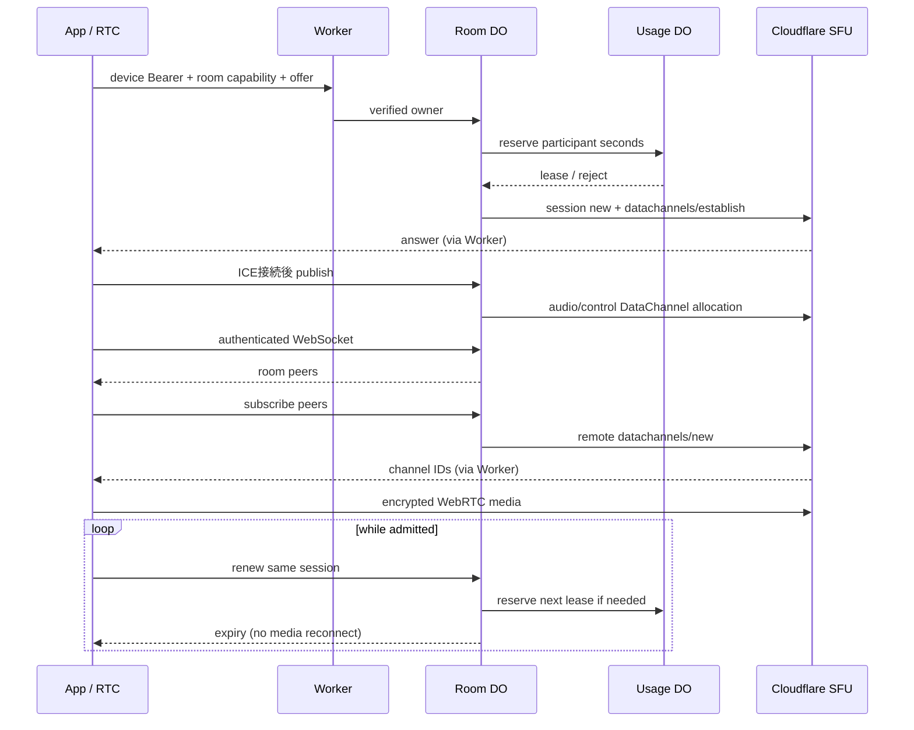

# Cloudflare Worker / SFU 仕様と試用手順

## 背景と到達点

少人数の招待制試用から公開へ進める際に、通話経路を作り直さず利用枠を制御する。Realtime SFUの音声を使用し、Cloudflare App SecretをAppへ配布しない。アカウント登録・デプロイ・実SFUでの通話は未実施。自動検証と実機確認を区別する。

| 責務 | 実装 |
|---|---|
| Worker入口 | SHA-256で登録された個別端末Bearerを検証。秘密の部屋capabilityでルーティング |
| SignalingRoom (SQLite DO) | 部屋最大8人。SFU establish / publish / subscribe / closeを所有者だけに許可。WSは参加者一覧・App dataに限定 |
| UsageGuard (SQLite DO) | 全部屋共通の同時数、月の参加者秒、端末ごとの開始回数を直列予約 |
| Realtime SFU | 音声媒体。端末ごとに1つのPeerConnection。Cloudflareが他の参加者の音声を配信 |
| RTC package | full SDP交換、lease自動更新、WS再接続、符号化済み音声のDataChannel中継 |
| App | Worker origin・個別端末資格をKeychainに保存。招待group credentialとともにRTCへ渡す |



## HTTP / WebSocket 契約

`R = /api/rooms/{groupHash}`。groupHashは64桁hexの秘密capabilityで、招待secretからRTCが導出する。guessableなgroup IDだけで部屋に入れない。`/health`以外は端末Bearer必須。ClientにSFU App ID/Secretを返さない。

| Method / path | 入力 | 結果 |
|---|---|---|
| GET `/health` | なし | service / protocol。SFUへの接続確認ではない |
| GET `/api/status` | Bearer | 月の予約参加者秒・上限・active数。試用資格保持者に公開 |
| POST `R/join` | participantId、displayName、offer {type,sdp} | sessionId、expiresAt (Unix ms)、renewAfterSeconds、answer |
| POST `R/sessions/{id}/publish` | `{}` | audio/control channel ID。ICE接続後、同じsessionで1回確保 |
| POST `R/sessions/{id}/pull` | peerIds | peerID・channel ID・配送方針。部屋外peerは拒否 |
| POST `R/sessions/{id}/renew` | `{}` | 同じsessionIdのlease。前半の重複更新は予約追加しない |
| DELETE `R/sessions/{id}` | なし | 全channelをclose。利用枠のactive slotを解放 |
| GET `R/sessions/{id}/signal` Upgrade | Bearer | Hibernation WebSocket。1 sessionにつき1接続 |
| WS → server | `{type:"appData",namespace,payload:base64}` | serverが送信者を付与して同部屋へ中継 |
| WS ← server | `{type:"peers",peers:[{id,displayName}]}` / appData | RTCが差分購読 / App data受信 |

| 拒否・上限 | 動作 |
|---|---|
| 401 / 403 | 未登録資格 / 他ownerのsession / 部屋外の購読を拒否 |
| 400 | 不正route/body/SDP。HTTP body最大64KiB、SDP最大48KiB |
| 409 | duplicate participant、duplicate WS |
| 410 | lease期限切れ |
| 429 | 部屋/同時/月/日上限。新しいSFU呼出前に拒否 |
| 502 / 503 | upstream失敗 / サービス停止・設定不足 |
| 音声形式 | joinはSCTP application m-line 1本。RTP audio/video trackを受け付けない |
| WS | 最大32KiB、600 messages/UTC分。senderを信用せず所有sessionから決定 |

公開招待URLは維持。中継用wire contractは変更し、全参加者を同じ版へ更新する。これはWebRTC SFU用のWorker APIであり、旧 `/api/sessions`・部屋全体のoffer/ICE中継は廃止する。

## 継続と後始末

| 場面 | 動作 / 制約 |
|---|---|
| 通常の継続 | 600秒lease、300秒後に更新要求。同じsession/PeerConnectionを維持。前払い予約を上限判定に使う |
| WS切断 | mediaを閉じず1→2→4→最大10秒で接続を再試行。leaseは独立 |
| 更新拒否 | clientは通話を終了しDELETE。届かない場合もDO alarmで期限切れchannelを閉じる |
| 異常終了 | persisted memberをalarmで回収。SFUの成功応答が失われてもstatusからchannel IDを照会。応答不明のallocationはsession消失まで回収を継続 |
| providerで既に削除 | 404/410は回収済みと扱う。その他の閉鎖失敗は記録を保持し再試行 |
| 部屋変更 | 新しいroom capabilityを使い、旧sessionを終了 |
| SERVICE_ENABLED=false | HTTPを拒否。既存mediaの停止は次のlease alarmまで遅れ得る。即時アカウント停止APIではない |

## 初期設定と試用

リポジトリrootで実行する。操作を実際に行うのは利用者がアカウントを用意した後。以下はデプロイ手順であり、この修正中に外部デプロイは行っていない。

```sh
npm --prefix server ci
npm --prefix server run type-check
npm --prefix server test
node --test scripts/Cloudflare/*.test.mjs
cd server
npx wrangler login
```

Cloudflare RealtimeでSFU Appを作り、App ID / App Secretを取得する。SDK付きRealtimeKitの会議作成と混同しない。[公式SFU API](https://developers.cloudflare.com/realtime/sfu/api/)が接続先の正本。

```sh
# server/ で実行。対話入力へ値を入れ、コマンド引数やgitへ秘密を残さない。
npx wrangler secret put CLOUDFLARE_SFU_APP_ID
npx wrangler secret put CLOUDFLARE_SFU_APP_SECRET
cd ..
# Worker名/アカウントに対応する実際のHTTPS originへ置換。
node scripts/Cloudflare/issue-device.mjs https://ride-intercom-server.example.workers.dev my-mac
node scripts/Cloudflare/issue-device.mjs https://ride-intercom-server.example.workers.dev my-phone
cd server
npx wrangler secret put CLIENT_TOKENS_JSON < .trial-credentials/client-tokens.json
```

| 設定 | 既定 | 意図 |
|---|---|---|
| SERVICE_ENABLED | false | 無設定で課金対象処理を始めない。資格登録後、wrangler.tomlでtrueへ変更してdeploy |
| MAX_ROOM_PARTICIPANTS | 8 | hard maximumも8 |
| MAX_ACTIVE_SESSIONS | 32 | 全部屋共通、maximum512 |
| MONTHLY_PARTICIPANT_SECONDS | 1,000,000 | UTC月でリセット。失敗/早期切断の予約も返金しない |
| LEASE_SECONDS | 600 | maximum3600。短すぎる値はHTTP回数と障害感度を増やす |
| TURN_ENABLED | false | trueならSDP生成前にTURN資格を発行。未設定の長期秘密がある場合503で止め、STUNへの暗黙fallbackで成功を装わない |
| CLOUDFLARE_TURN_KEY_ID | secret未設定 | Realtime TURNのkey ID。SFU App IDとは別 |
| CLOUDFLARE_TURN_API_TOKEN | secret未設定 | TURN資格発行・失効用の長期token。端末へ渡さない |

```sh
# server/ で設定をレビューした後だけ実行。
npx wrangler deploy
cd ..
node scripts/Cloudflare/check-service.mjs server/.trial-credentials/my-mac.json
```

発行ファイルはdirectory0700/file0600で生成しgitignore対象。端末へ渡すのは各device JSONのWorker URLとaccessTokenだけ。JSONはAppへの自動インポート形式ではなく、Settingsへ手入力するための保存形式。registryにはtokenのSHA-256だけを保存する。revoke時は対象hashをregistryから削除しsecretを再登録。稼働中のWSは既存lease終了まで残り得る。ファイルやsecretをログ・チャット・リポジトリへ貼らない。

`v1` migrationは未デプロイ開発用namespaceを前提にSQLite DOを作る。既に同名Worker/旧KV DOをデプロイしていた場合は、既存migrationを書き換えて適用せず、新しい試用Worker名とnamespaceで開始する。既存データの移行・削除はこの手順に含めない。

## Appでの試用と記録

| 操作 | 確認すること |
|---|---|
| Settings → Internet Connection → Configure | 同じWorker origin、端末ごとのaccess tokenを保存 |
| Settings → Local Network OFF | Internetを明示選択。近距離経路の成功をSFU成功と誤認しない |
| groupを作成し既存招待URLを共有 | 両端末が同じgroup secretを持つ |
| Connect、双方向発話、mute | SFU APIの成功だけで音声成功と判定しない |
| 20分以上継続 | leaseを跨いでsessionIdが変わらず手動再接続不要かを確認 |
| 一時的WS切断、端末終了 | media継続/WS再接続と、期限切れのchannel閉鎖を別々に確認 |
| 料金計測 | Cloudflare実egress / requests / duration / CPUと `Cost.md` の仮定を比較 |

## 未確認・公開前条件

| 項目 | 状態 |
|---|---|
| SFU HTTP契約・所有者・quota・WS sender・expiry alarm | workerd内でproviderを代替した自動テスト。実Cloudflareで未確認 |
| TURN credential | 短期資格の発行・更新・失効を実装しローカル契約試験済み。TURN_ENABLEDとWorker秘密設定が必要。制限回線・実Cloudflareでの更新継続は未確認 |
| 大量のpeer入退室 | SDPはSCTP 1 section。離脱peerのchannelをcloseして新しい購読を確保。10回の入替とSwiftクライアント再参加を自動検証。実SFUは未確認 |
| 音声効果・peer個別音量 | Local/Internetとも共通Codec/Mixerを使う契約へ変更。App追従と実機の音質確認を分ける |
| 公開identity | 個別端末registryは招待制試用向け（約4.5KiBまで）。公開登録/自動発行/失効を行うidentity backendは未実装。SFU transportとgroup招待形式を作り直さず入口認証を拡張する |
| abuse / 金額上限 | SDP制限・参加者秒予約は改変クライアントの過剰なDataChannel送信を金額で遮断する保証ではない。edge制限、監視、停止運用、実測が公開前条件 |
| 実機 | Mac/iPhoneの録音再生・音声品質・ロック・Bluetooth・実ネットワーク復帰は後続 |

費用判断の数式・全課金項目・スクリプトは [Cost.md](Cost.md) を参照する。

## 自動検証記録

2026-10-21、`codex/restore-dev-calls`。Node 26.12.0、Wrangler 4.151.3、TypeScript 7.0.2、workers-types 5.20261019.1、Miniflare 4.20260730.0。依存更新済みのdev復旧結果を使用し、この工程で追加依存は導入していない。

| コマンド / 証跡 | 結果 |
|---|---|
| `npm --prefix server run type-check` | 成功 |
| `npm --prefix server test` | dry-run bundle成功、workerd上10 tests成功。外部SFUはテスト側代替 |
| `node --test scripts/Cloudflare/*.test.mjs` | 費用・資格発行3 tests成功 |
| `/private/tmp/rideintercom-cloudflare-validation/server-final-types.log` | 型検査log |
| `/private/tmp/rideintercom-cloudflare-validation/server-final-tests.log` | Worker test log |
| `/private/tmp/rideintercom-cloudflare-validation/cloudflare-scripts.log` | script test log |
| `/private/tmp/rideintercom-cloudflare-validation/cost-scenarios.tsv` | 既定条件の費用計算出力 |
| `server-red.log` / `server-red2.log` (同じ証跡directory) | 旧APIの不一致、期限切れproviderの回収失敗を先に再現 |

`wrangler deploy --dry-run` は外部デプロイではない。health/statusのテスト成功を、SFU App Secretの正当性・双方向音声・実料金の確認済みと扱わない。

## ペア検証と購読入替

| 項目 | 契約 |
|---|---|
| 実行 | `DEVELOPER_DIR=/Applications/Xcode.app/Contents/Developer npm --prefix server run test:pair` |
| 実処理 | Swift URLSession HTTP/WS、Worker認証、SignalingRoom、UsageGuard、SQLite、期限更新 |
| 代替部分 | テスト側SFU REST providerと合成SDP。音声媒体・Cloudflare秘密設定は不要 |
| peer snapshot | id/displayName/sessionId。認証済みroom参加者だけに通知 |
| 再参加 | publication sessionIdが変わる。listenerは離脱peerのchannelをcloseして再購読し、同じPeerConnectionを維持 |
| 終了 | 子プロセスの終了コードを確認。120秒でタイムアウトし、workerdをfinallyで終了 |
| 位置付け | 制御経路の統合検証。実音声・実Cloudflareアカウント・請求確認と分ける |

## 検証環境の間接依存

| 依存 | 採用 / 理由 |
|---|---|
| Miniflare | 安定版4.20260730.0を維持。npm latestはこの版、5系列はbeta |
| undici | Miniflare 4配下を7.30.1へoverride。7系列の修正版。HTTP/WSのaudit指摘を解消 |
| sharp | Miniflare 4配下を0.35.5へoverride。libheif/librsvgのaudit指摘を解消 |
| 根拠 / 検証 | 2026-10-21 npm registryの版・依存、npm audit。lockfile同期、ci、型検査、Worker9件、Swiftペア成功 |
| override除去条件 | 安定版Miniflareが修正版を宣言したら通常依存へ戻し、同じWorker/ペア試験を通す |

例: [undici advisory](https://github.com/advisories/GHSA-w293-vg96-wgc3)、[sharp advisory](https://github.com/advisories/GHSA-wq5f-xc86-pv6w)。これらはローカル開発・検証ツールの依存であり、Worker bundleへそのまま配布するものではない。

## TURN資格の準備と運用

アカウント用意後、Cloudflare RealtimeでTURN keyを作り、serverディレクトリで次を対話入力する。`TURN_ENABLED = "true"`へ変更して設定をレビュー後にdeployする。この作業では実サービスに接続・deployしていない。

```sh
npx wrangler secret put CLOUDFLARE_TURN_KEY_ID
npx wrangler secret put CLOUDFLARE_TURN_API_TOKEN
```

[公式の資格生成・失効・setConfiguration更新](https://developers.cloudflare.com/realtime/turn/generate-credentials/)を使用する。SFU App SecretとTURN API tokenは別の秘密で、端末には短期iceServersだけ返す。

| API / 条件 | 挙動 |
|---|---|
| POST R/ice/{participantId} | bodyのleaseIDは接続試行ID。端末認証・room capacity・全体利用枠を確認してから資格を発行。所有者と試行IDが同じ再試行は既存の有効資格を返す |
| TURN無効 | STUNのみ返す。TURN用の追加予約・発行はしない |
| POST R/join | TURN有効なら同じ所有者・participant・iceLeaseIDの有効な事前資格が必要。事前予約とSFU予約は同じ利用枠IDを使用 |
| POST R/sessions/{id}/renew | 同じSFU sessionを延長し、更新したiceServersを返す。Appから手動再接続を要求しない |
| DELETE R/ice/{participantId} | SFU未成立の試行だけ回収。leaseID不一致は409。古いcallbackが新資格を失効できない |
| DELETE session / expiry | SFU channel回収と短期資格失効。失効が失敗すれば記録を保持してalarmで再試行 |
| 途中離脱 | SFU未成立でもalarmで資格の期限を回収。既発行資格は自身のTTLでも制限される |
| 更新時の旧資格 | 新資格が端末に届く前に旧資格を即失効しない。旧資格の期限まで保持し、切断時は未期限切れの全資格を失効 |
| TTL | 利用枠の有効期限までを秒へ切り上げ、最大7200秒。最大3600秒のleaseの前倒し更新を含む。通常既定は初回600秒程度 |
| 秘密の保存 | 短期資格をroom DOへ保存。no-store応答で返し、ログ・runtime reportへ含めない。取得・失効の長期秘密はWorkerのみ |

TURN資格は受け取った端末から別用途へ持ち出され得る。参加者秒・発行制限は実wire byteの厳密な請求上限ではない。公開時のabuse監視・実請求監視と制限回線での長時間試験は引き続き必要。失効APIの成功から実際の転送停止までの時間も実サービスで確認する。
