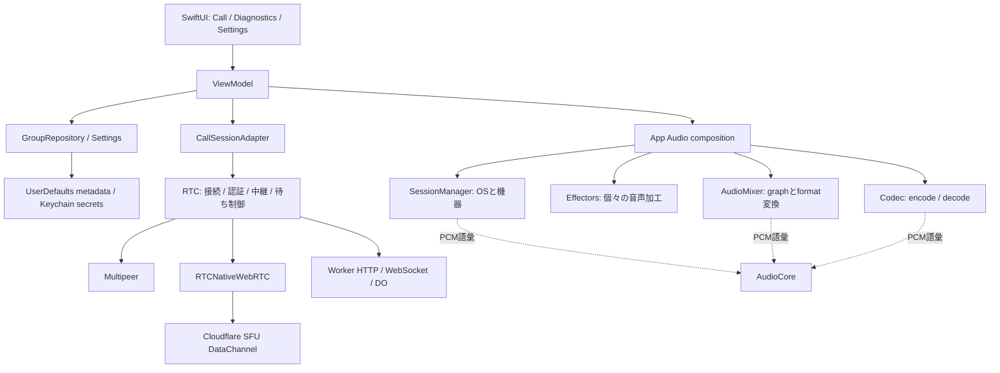
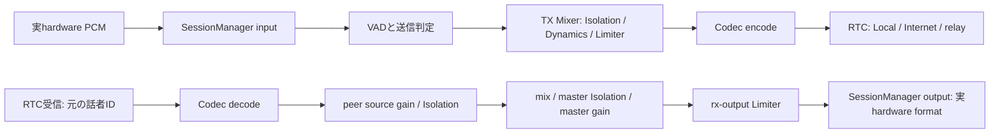

# アーキテクチャと文書の対応

## 文書の責務

| 読者の問い | 正本 | 変更の契機 |
|---|---|---|
| アプリが何を満たす必要があるか | [製品要求](../requirements/製品要求.md)、[パッケージ要求](../requirements/パッケージ要求.md) | 利用者の要求・受け入れ条件・package責務の変更 |
| どう作り、どう記録するか | [開発方針](../policies/開発方針.md)、[文書作成規約](../policies/文書作成規約.md)、[ログ記録規約](../policies/ログ記録規約.md) | 工程・設計・記録の制約の変更 |
| どこで何を操作し、どう変わるか | [使い方](../manual/使い方.md)、[設定と効果](../manual/設定と音声効果.md)、[状態の見方](../manual/状態の見方.md) | UI操作・既定値・反映・保存の変更 |
| 誰が処理・状態を所有するか | 本書、Appの各仕様、[package統合仕様](packages/Overview.md) | 責務境界・API・lifecycleの変更 |
| packageへ何を渡すか | Appの[Configuration](App/Configuration/設定値一覧.md)とBindings | Appの選択・固定値・導出値の変更 |
| package単体で何が可能か | `spec/packages` | package自身の契約変更。Appの採用設定と区別 |
| サーバーで何を許可・制限するか | [Worker](server/Worker.md)、[Cost](../development/Cloudflare費用試算.md) | API・資格・利用枠・費用仮定の変更 |
| どう開発し再検証するか | [開発環境](../development/開発環境.md)、[自動検証](../development/自動検証.md) | build・editor・検証入口の変更 |
| 何をどの条件で確認したか | [検証状況](../validation/README.md)、`validation/history` | 実行結果の追加。過去の成功を現行保証へ流用しない |

本書とspec配下は現在の実装を記述する。目的と統一方針は要求、これから作るものは[課題](../backlog/README.md)、確認待ちと結果は[検証](../validation/README.md)へ分ける。

## 構成と依存方向

RTCはAudio packageやDSPに依存しない。Appはpackageの生成・接続・設定・寿命を調整し、package内の音声加工や経路制御を複製しない。動的plugin loaderは設けず、既存のnode / backend / route factoryを差し替え口とする。

## 実ディレクトリと仕様

| 実装 | 所有するもの | 対応文書 |
|---|---|---|
| [App](../../RideIntercom/App) | 起動、deep link、ログbootstrap | [通信](App/通信仕様.md)、[ログ](App/ログ仕様.md) |
| [UI](../../RideIntercom/UI) | SwiftUIの入力と表示 | [画面一覧](App/UI/画面項目定義.md)、[デザイン](../design/デザインシステム.md) |
| [ViewModel](../../RideIntercom/Intercom/ViewModel) | group選択とactive接続、音声lifecycle、非同期世代、package report | [状態遷移](App/UI/画面・状態遷移.md)、[音声](App/音声処理仕様.md) |
| [Groups](../../RideIntercom/Intercom/Groups) | identity、group、招待、GroupRepositoryによる保存・復元 | [通信](App/通信仕様.md)、[利用手順](../manual/使い方.md) |
| [Settings](../../RideIntercom/Intercom/Settings) | UserDefaults / Keychain、希望値 | [設定値](App/Configuration/設定値一覧.md) |
| [Audio composition](../../RideIntercom/Intercom/Audio) | graph組立、codec/RTC境界、VAD送信判定、callback寿命 | [音声](App/音声処理仕様.md)、[AppからMixerへ渡す値](App/Configuration/Bindings/Audio/AudioMixer.md) |
| [Transport adapter](../../RideIntercom/Intercom/Transport) | App固有data、RTC factoryへの入力、イベント変換 | [通信](App/通信仕様.md)、[RTCへの設定](App/Configuration/Bindings/RTC.md) |
| [Diagnostics](../../RideIntercom/Intercom/Diagnostics) | package reportを画面用に要約 | [Diagnostics](App/UI/Diagnostics.md)、[状態の見方](../manual/状態の見方.md) |
| [AudioCore](../../RideIntercom/packages/Audio/AudioCore) | PCM型、format、measurement、report語彙 | [AudioCore](packages/Audio/AudioCore.md) |
| [AudioMixer](../../RideIntercom/packages/Audio/AudioMixer) | source/sink/bus、format変換、音量、node実行、予約上限 | [AudioMixer](packages/Audio/AudioMixer.md) |
| [SessionManager](../../RideIntercom/packages/Audio/SessionManager) | OS audio session、機器、入出力、runtime event | [SessionManager](packages/Audio/SessionManager.md) |
| [Codec](../../RideIntercom/packages/Audio/Codec) | codec availability、符号化・復号、fallback | [Codec](packages/Audio/Codec.md) |
| [Effectors](../../RideIntercom/packages/Audio/Effectors) | VAD / Dynamics / Limiter / Isolationの個別処理 | [VADGate](packages/Audio/Effectors/VADGate.md)、[Dynamics](packages/Audio/Effectors/DynamicsProcessor.md)、[Limiter](packages/Audio/Effectors/PeakLimiter.md)、[Isolation](packages/Audio/Effectors/SoundIsolation.md) |
| [RTC](../../RideIntercom/packages/RTC) | Local / WebRTC、認証、暗号化、再接続、中継、順序・鮮度 | [RTC](packages/RTC.md) |
| [server](../../server) | SFUの制御、端末認証、部屋、lease、利用枠 | [Worker](server/Worker.md)、[費用](../development/Cloudflare費用試算.md) |
| [scripts](../../scripts) | build、検証、WebRTC更新、資格発行、費用試算 | [自動検証](../development/自動検証.md)、[WebRTC更新](../development/BuildWebRTC/WebRTCビルドスクリプト.md) |

## 音声・通信の所有境界

| 境界 | 不変条件 |
|---|---|
| format | hardware実format、Mixer 48kHz mono、RTC選択48/24/16kHz monoを区別し、Mixerで明示変換 |
| 話者 | 個別音量・effectはorigin peer ID。経路や中継者が変わっても同じ話者として扱う |
| 中継 | 符号化済み音声をRTCで転送。中継者の音声graphへ戻して再加工しない |
| 配送 | 音声は順序待ち・再送なし、制御はreliable。App/RTC/PCM予約に上限・期限。100msは各境界の期限で総遅延の保証ではない |
| VAD | Mixer nodeではなく入力の発話分析と送信判定。runtime reportとMixer effect chainを混同しない |
| 音声停止 | 機器消失では自分の送受話を止め、接続・他者中継を維持。明示Resumeまで戻さない |
| group選択 | selectedGroupとactiveGroupIDを分離。他group閲覧は通話を終了しない |
| 手動設定 | route変更・資格保存成功は明示切断。自然な経路消失時の継続と区別 |

## 拡張時の変更単位

| 変更 | 先に更新・検証するもの | 次に追従するもの |
|---|---|---|
| 新しいroute / backend / Effector / codec | 対応package仕様、実装、単体・契約テストを独立commit | AppのBindings、composition、UI、マニュアル、統合テスト |
| UI / 既定値 / 保存方式 | App仕様・実装・テスト | 課題・検証の状態、設定と効果、操作手順 |
| Worker API / 利用枠 | WorkerとRTCの契約・ペア試験 | 端末設定と運用手順、費用の前提 |
| 文書移動 | 移動対応・全文保持・相対リンク | READMEの導線、コード対応、文書自動検査 |

共通基盤の責務方針は[パッケージ要求](../requirements/パッケージ要求.md)、現行APIは対応するpackage仕様を正本とする。実装変更の計画は課題、確認待ちは検証へ置く。
